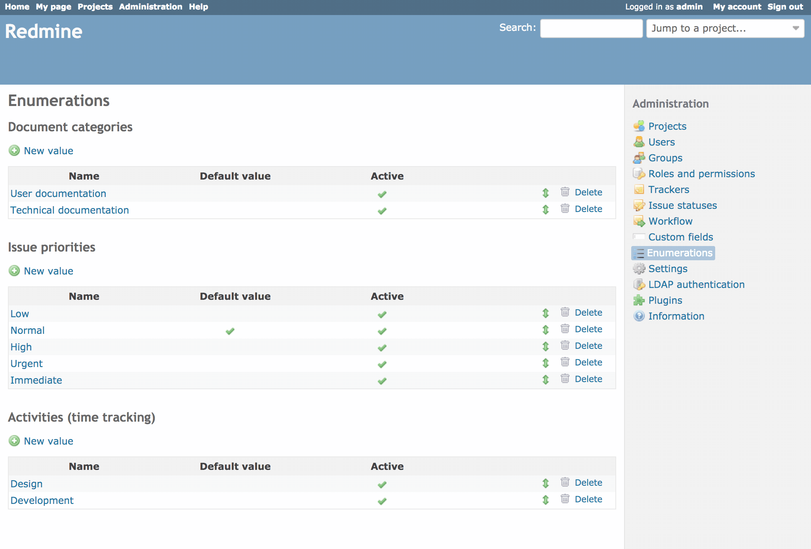

# Enumerations

Enumerations are global (cross-project) values for several parts of the Redmine system:

- Activities (time tracking)
- Document categories
- Issue priorities (sorted from lower priority to higher priority)

These items can be added, modified and deleted freely. They all have two configurable settings: **Active**, whether the enumeration can be selected, and **Default value**, whether the current enumeration should be the default value.

If the default-value checkbox is ticked, the selected enumeration will be the default value for the specific field(s). If no enumeration has been set to the default-value for the specific enumeration-category (activities, document categories or issue priorities) no enumeration will be pre-selected for the specific field(s).

