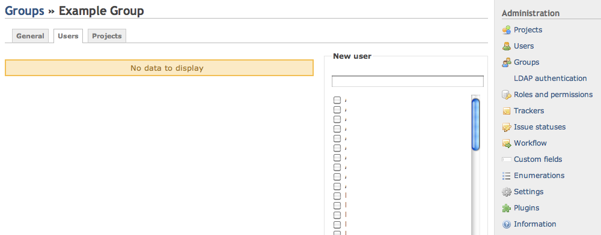
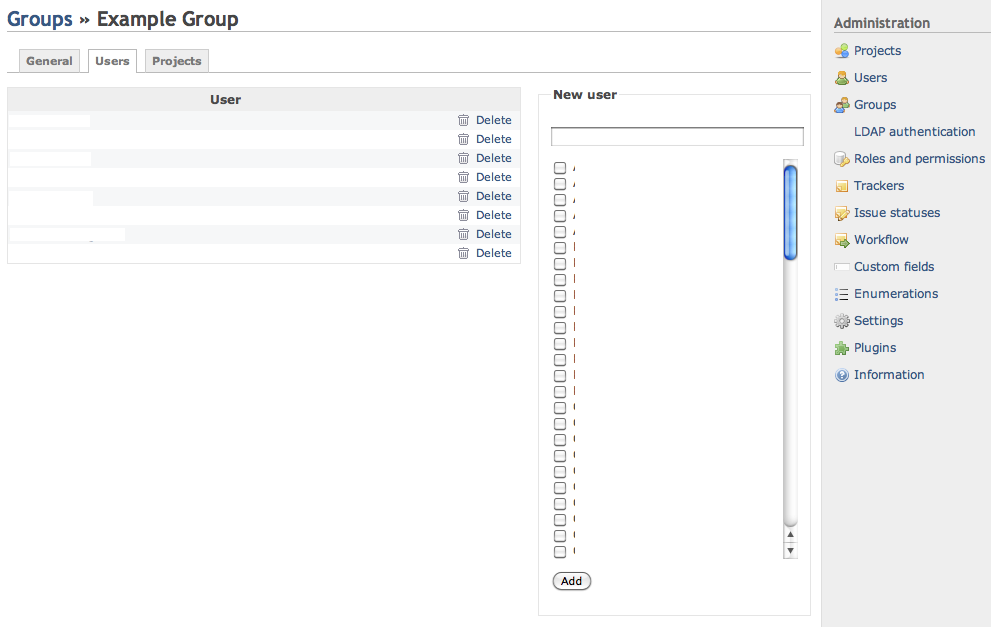
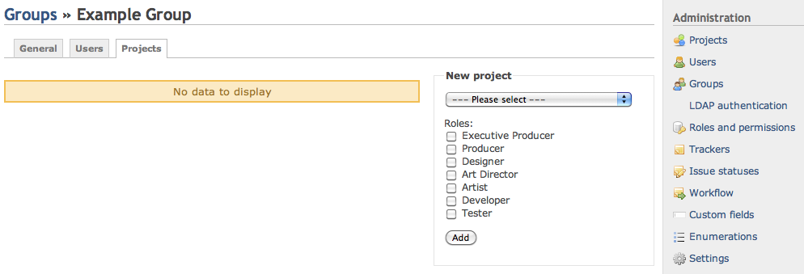
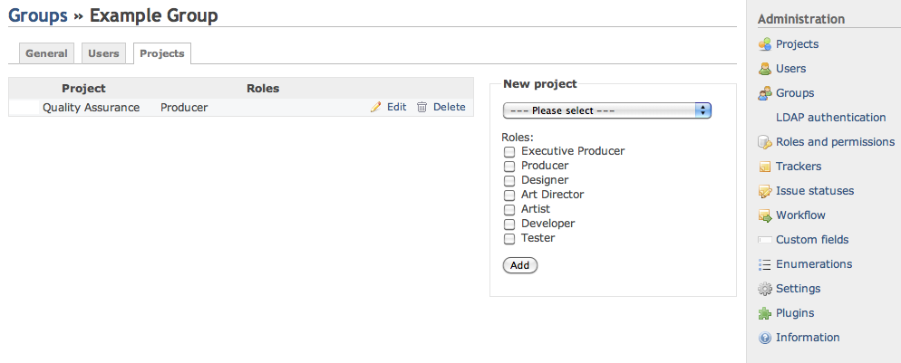

# Managing Groups

As of 0.9, Administrators can define groups of users in Redmine.\
Groups can be added as members of projects just like regular users, using the same [Roles](roles.md) too.

When adding a user to an existing group, this user inherits of all of the group privileges.

## Creating groups

To create a group, do the following:

1.  Click Administration
2.  Click Groups
3.  Click New Group
4.  Type the name of your group in Name
5.  Click Create

## Adding members and associating projects

To add members to a group, do the following:

1.  In Administration \>\> Groups
2.  Click the name of the Group you wish to change.
3.  You’ll see 3 tabs: General, Users, Projects
    - General
      - Change the name by editing the Name field
    - Users
      - Add users by checking the username box for each user
      - Click Add
    - Projects
      - Select a project from the pop-up menu
      - Set the Role
      - Click Add

\
Figure 1: Example Group Users tab

\
Figure 2: Adding Members to a Group

\
Figure 3: Example Group Project tab

\
Figure 4: Associating a group to a project (from the Group context)
