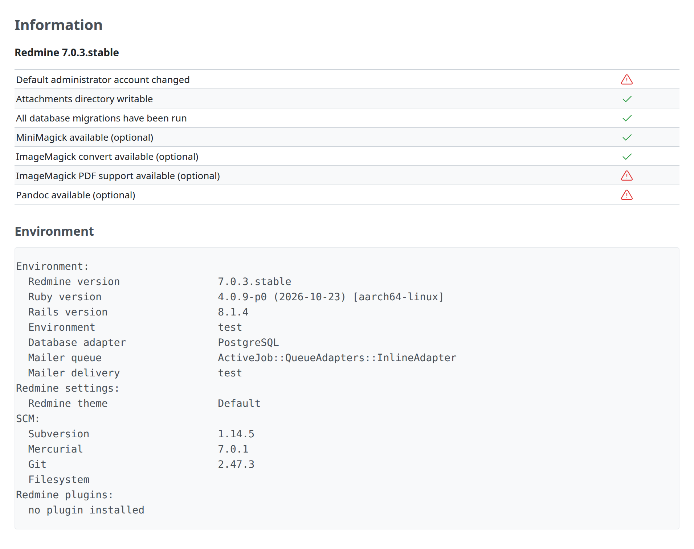

# Administration information

You can see the following three kinds of information on the “Administration” \> “Information” page:

- The version of the Redmine
- The table shows if some important configurations are done correctly
- Environment information of the Redmine server

## Redmine version

At the top, you can see the version of Redmine. The version number has a suffix “stable” or “devel”. Normally, it should be “stable”.

“devel” is shown when you are running Redmine with the development source code (the contributors call it as “trunk”). Since the trunk is not as stable as released versions, you should only use the trunk only when you want to be involved in the development of Redmine or try new features of the next release. It is not recommended to use the trunk in production is not recommended.

## Status of important configurations

Just below the Redmine version, you can see a table showing the status of the important settings. An exclamation mark ( **!** ) is displayed if any problems are detected.

### Default administrator account changed

It indicates whether the password of the admin account has changed from the default “admin”. If you see an exclamation mark, change the admin account’s password immediately.

### Attachments directory writable

It indicates whether the directory for storing attachments is writable. The default path of the directory is `files` under the installation directory, which can be changed by `attachments_storage_path` in `config/configuration.yml`.

If an exclamation mark is displayed, users cannot upload files. Set write permission to the directory so that Redmine can store files. See [RedmineInstall#Step-9-File-system-permissions](../install/install.md#Step-9-File-system-permissions) for further information.

### All database migrations have been run

It indicates whether all the database migrations have been run.

If an exclamation mark is displayed, run the database migrations. See [RedmineInstall#Step-7-Database-schema-objects-creation](../install/install.md#Step-7-Database-schema-objects-creation) for further information.

### MiniMagick available (optional)

It indicates whether MiniMagick gem used for image processing is available.

An exclamation mark is displayed only if you set `--without minimagick` option when you run bundler during the installation of Redmine. You can fix it by running bundler again with setting `--without ''` option. See also [RedmineInstall#Step-4-Dependencies-installation](../install/install.md#Step-4-Dependencies-installation) for more about bundler.

### ImageMagick convert available (optional)

It indicates whether the `convert` command, a part of ImageMagick, is available.

If `convert` command is not available, some features such as displaying thumbnails of images and exporting gantt in PNG image are disabled. You can fix this by installing ImageMagick. if the check fails even though ImageMagick is installed, you may have to configure `imagemagick_convert_command` in `config/configuration.yml`.

### ImageMagick PDF support available (optional)

It indicates whether ImageMagick `convert` command on the server supports PDF files.

When it is not available, the feature to display thumbnails for PDF files is disabled. You can fix this by installing both ImageMagick and GhostScript.

### Pandoc available (optional)

It indicates whether the Pandoc command is available. Redmine uses Pandoc to convert supported Microsoft Office and LibreOffice attachments to Markdown for preview.

When it is not available, the preview of these files is disabled. You can fix this by installing Pandoc. If the check fails even though Pandoc is installed, you may have to configure `pandoc_command` in `config/configuration.yml`.

### Default queue adapter which is well suited only for dev/test changed

It is displayed only in the production environment, and indicates whether the queue adapter of Active Job has been changed from the default one, which is well suited only for development and test. See [RedmineInstall#Queues-adapter](../install/install.md#Queues-adapter) for further information.

## Environment information

It displays a variety of information about the environment that the application is running in.

It is recommended to include this information when reporting issues to plugin developers, the Redmine team, and so on. The information helps them to investigate issues.
