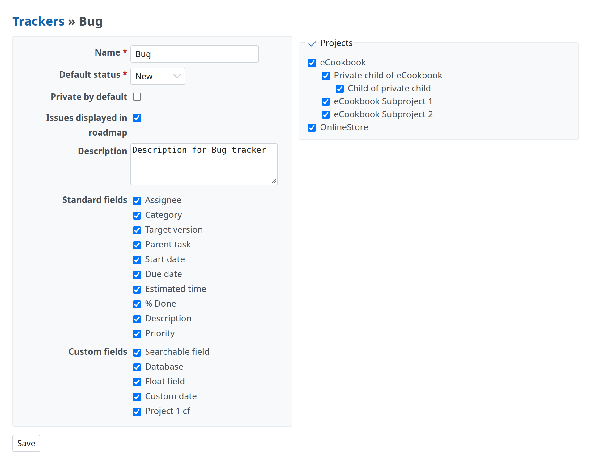
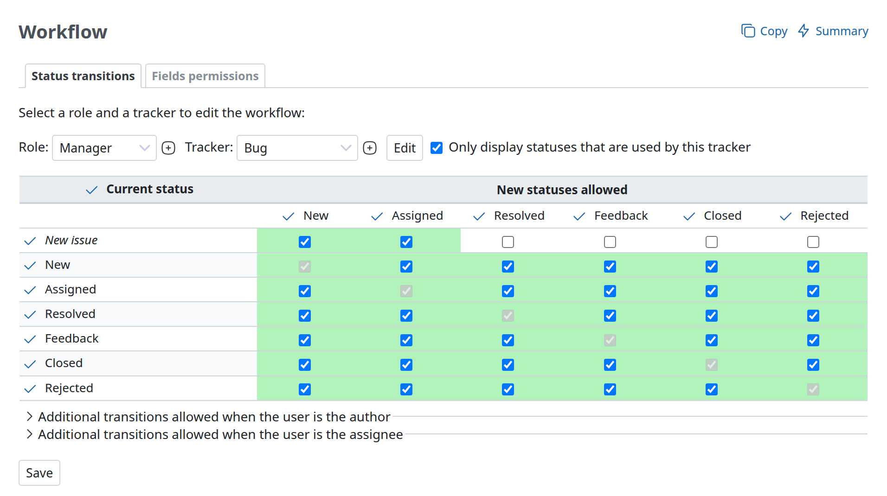
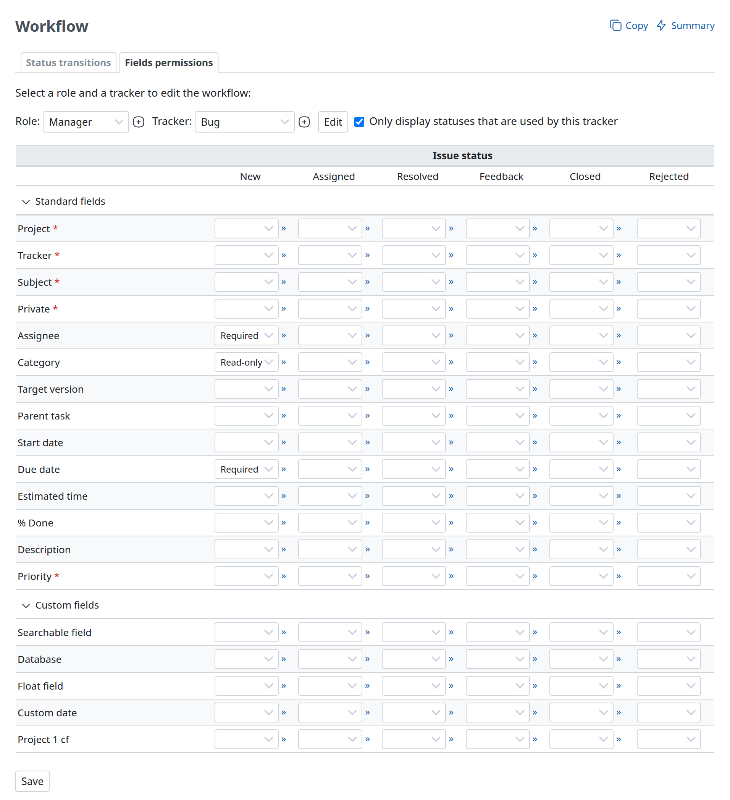

# Issue tracking system

## Trackers

Trackers are how you split your issues into different types - common ones are Bug, Feature, Defect or etc.

For each tracker, you can define: (see image below)

- Name (the example pictured is ‘Bug’)
- Default status (an issue status applied by default to new issues)
- If the issues bound to the tracker should be displayed on the [roadmap](../user/roadmap.md)
- A different workflow
- Standard and custom fields available for the tracker

When creating a new tracker, you’ll need to define its Workflow (see below) in order to properly use it. (To save time doing that - you can copy an existing tracker’s workflow when creating a new one. To do that, select a tracker in the ‘Copy workflow from’ drop-down list on the ‘New tracker’ screen).

## Issue statuses

Issue statuses can be added and deleted freely. Each status has the following configurable option:

- **Issue closed**: indicates that the issue is considered as closed (more than one status can be declared as closed)

### % Done

This option (and its column in the issue statuses overview) is only available if the ["Calculate the issue done ratio" option](settings.md#Calculate-the-issue-done-ratio) in the application settings has been set to “Use the issue status”. By setting the option, an issue’s done ration is automatically updated based on which status is assigned instead of manually entering the done ratio for each issue.

If left blank, changing an issue to this status will not change its percent done.

### Update issue done ratios

This command is only available if the ["Calculate the issue done ratio" option](settings.md#Calculate-the-issue-done-ratio) in the application settings has been set to “Use the issue status”. On execution, it will set all issue statuses to the values defined in each status’ “% Done” setting.

## Workflow

### Status transitions

The workflow lets you define status transitions that the various project members are allowed to make on the issues according to their type.

On the workflow setup screen, select the role and the tracker for which you want to edit the workflow, then click ‘Edit’. The screen lets you select the authorized transitions for the chosen role and tracker. The “Current status” column indicates the initial status of an issue. The “New statuses allowed” columns stand for the statuses that can be applied.

Note: For a user to change an issue status, they need to have either ‘Edit issues’ or ‘Edit own issues’ permission (the latter only for the issues they created) (see [Roles and permissions](roles.md)).

In the above example, Bugs with a New status could be given an Assigned or Resolved status by the Developer role. Those with an Assigned status could get a Resolved status. The status of all the other Bugs cannot be modified by the Developer.

### Fields permissions

On this tab one can set special permissions to a field in a specific state. One can choose between the attributes `read-only`, `required`, or leave it empty for default behavior. If the field is set as `read-only` it is hidden in the edit section and can not be changed by the selected role. If the field is set to `required` it can not be left empty when the issue gets edited by the selected role.

