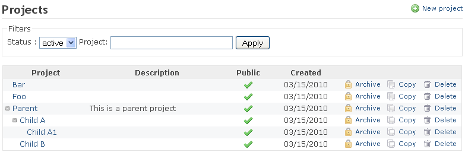
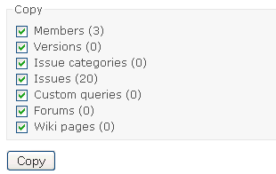

# Managing projects

## Projects list

The projects list shows all active projects by default. To view all projects (active and archived projects) change the status filter to *All*. Note that there is also the project list for regular users that can be accessed by clicking on `Projects` in the top menu. Non-administrator can create new projects in this list (and close projects within a project), but cannot do more administrative operations as it is possible in project list within the administration area that gets discussed here. Depending on the [user permissions](roles.md) the here presented project list may be the only place to manage projects at all.

- **Project:** The project name
- **Description:** A short description of the project
- **Public:** If the icon ✓ is present the project is public and everyone can see this project and may do things that are allowed by the roles [Non member and Anonymous](roles.md#System-roles). Non-public projects can be viewed only by a user who was given access by an administrator of the project.
- **Created:** Indicated the date when this project has been created.

## Adding or editing a project

See [Project settings](../user/project-settings.md).

## Closing a project

This sets a project to a read-only state. A closed project is still be accessible like a regular project but nothing can be changed anymore, thus it is read-only.

**The link to close a project is available on a per Project basis in the [Overview](../user/project-overview.md) screen of the project itself. It is not part of the project list shown above.**

See Feature \[#3640](https://www.redmine.org/issues/3640) for details.

## Archiving a project

From the projects list, click the **Archive** link to archive a project.

An archived project is no longer visible by users. It can be un-archived (with its original content) by the administrator. When archiving a project, any subproject is also archived.

Note that archiving a project does not reduce storage usage. It only hides the project but does not compress it.

## Copying an existing project

From the projects list, click the **Copy** link on the right of the project you want to copy.

You will get the new project form prefilled with the settings of the copied project (trackers, custom fields…). At the bottom of the form, you can choose what should be also copied to your new project:

## Deleting a project

From the projects list, click the **Delete** link. You will be asked for confirmation on a separate screen.
