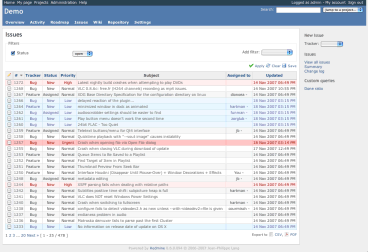

# Application Settings

On “Administration” \> “Settings” page, administrators can access various global level application settings.

## General settings

### Application title

Title which appears in heading of the application. This is the link just under the little bar with « Home/My page/Projects/Help» when you’re logged in.

### Welcome text

Text displayed on the home page of Redmine.

### Objects per page options

Here you can configure the fixed values which users can select for the amount of objects (issues, commits etc.) which are displayed per page.

*Default: 25, 50, 100*

### Search results per page

The number of [search](../user/search.md) results which are displayed per page.

*Default: 20*

### Days displayed on project activity

The initial (and recurring while browsing) amount of days of which the project(s)-activity is shown in the [activity](../user/project-activity.md)-tab.

### Host name and path

Host name and path of your Redmine server. This name is used to write URL in emails sent to users. i.e.: the hostname of this precise Redmine is redmine.org.

Redmine guesses the value of this setting and displays it as an example below the text box. The guessed value is appropriate for your Redmine server in most cases.

### Protocol

Protocol used to generate links in email notifications. *Default: http*

Links in email are “guessed”, but can’t determine whether you’re using an unsecured web server (http) or a secure one (https -\> http over SSL).

### Text formatting

Formatting method applied to the “description” fields of the issues, news, documents…

You can select **Textile** *<span class="default"></span>* or **Markdown**.

### Cache formatted text (1.0)

Text formatting transforms raw text to HTML and runs each time a formatted text is sent to a user’s browser (eg. issue description, wiki page…), and this process can be slow with large pages or texts.

This setting lets you enable caching of formatted text.

The storage to be used to store cached data depends on the configuration of a cache store. The default cache store is [FileStore](http://api.rubyonrails.org/classes/ActiveSupport/Cache/FileStore.html). It stores cached data as files in `tmp/cache` directory.

You can configure to change the cache store to other one such as [MemoryStore](http://api.rubyonrails.org/classes/ActiveSupport/Cache/MemoryStore.html) and [MemCacheStore](http://api.rubyonrails.org/classes/ActiveSupport/Cache/MemCacheStore.html) by adding a setting like `config.cache_store = :memory_store` to your `config/environments/production.rb`, for example:

```ruby
Rails.application.configure do
  # Settings specified here will take precedence over those in config/application.rb

  config.cache_store = :memory_store

  ...
```

You can read more about cache stores in the Rails guides:\
http://guides.rubyonrails.org/caching_with_rails.html#cache-stores

### Wiki history compression

Lets you activate compression for wiki history storage (reduces database size). *Default: disabled*

### Maximum number of items in Atom feeds

Maximum number of records contained in Atom feeds. *Default: 15*

## Display

### Theme

This option lets you choose a custom theme.\
Redmine is shipped with two additional themes besides the [default](https://www.redmine.org/projects/redmine/wiki/ThemeDefault) theme:

- [alternate](https://www.redmine.org/projects/redmine/wiki/ThemeAlternate), which mainly provides issue list colorization based on issues priority.
- [classic](https://www.redmine.org/projects/redmine/wiki/ThemeClassic), which is derived from the Redmine 0.5.1 design and brings a *classic* look.

Screenshot of the [alternate](https://www.redmine.org/projects/redmine/wiki/ThemeAlternate) theme:



Themes are located in `public/themes/`. You can read more about [Themes](https://www.redmine.org/projects/redmine/wiki/Themes).

### Default language

The default language is selected when the application could not determine the user’s browser language. The default language is also used when sending email to multiple users. *Default: English*

### Force default language for anonymous users

Disables automatic language detection based on browser setting and force [default language](settings.md#Default-language) for anonymous users.

### Force default language for logged-in users

Disables “Language” setting on [My account](../user/accounts.md#My-account) page and force [default language](settings.md#Default-language) for logged-in users.

### Start calendars on

Lets you choose the first day of the week.

The default value is “Based on user’s language”. With this setting, the first day of the week varies by user. For example, if the user’s language is set to English, the calendar starts on Sunday.

### Date format

Lets you choose how dates are displayed:

- **Based on user’s language**: dates will be displayed specifically for each user, according to the format defined for its language
- **Other formats**: dates will always be displayed using the specified format

*Default: Based on user’s language*

### Time format

Lets you choose how times are displayed:

- **Based on user’s language**: times will be displayed specifically for each user, according to the format defined for its language
- **Other formats**: times will always be displayed using the specified format

*Default: Based on user’s language*

### Time span format

Let you choose the display format of timespans (estimated time, spent time, etc).

- **0.75** *<span class="default"></span>* : Displays in decimal.
- **0:45 h** : Displays in “HH:MM” format.

### Users display format

Lets you choose how usernames are displayed. The following combinations are provided:

- *Firstname*
- *Firstname Surname*
- *Surname Firstname*
- *Surname, Firstname*
- *Username*

### Use Gravatar user icons

If enabled, users [Gravatars](http://en.gravatar.com/) (globally recognized avatar) will be displayed in several places.

### Default Gravatar image

The image to use for users who don’t have a Gravatar.

### Display attachment thumbnails

If enabled, thumbnails of attached images are displayed below the list of attached files.

### Thumbnails size

The size of thumbnail images in pixels when “[Display attachment thumbnails](settings.md#Display-attachment-thumbnails)” is enabled.

*Default: 100*

### Project menu tab for creating new objects

Let you choose the type of the tab for creating new objects.

- **none**: does not display either “New issue” tab or “+” drop-down.
- **Display the “New issue” tab**: displays “New issue” tab that was displayed in Redmine 3.2 and earlier.
- **Display the “+” drop-down** (\_default\_): displays “+” drop-down that can be used to create various objects such as issue, wiki page and so on.

## Authentication

### Authentication required

If this option is checked, no page of the application is accessible to anonymous users. Users must sign in to access the application. *Default: No*

### Autologin

This option let users use the auto-login feature. *Default: Disabled*

### Self-registration

This option lets you enable/disable new users self-registration:

- **disabled**: users are not allowed to register
- **account activation by email**: new users receive an email containing a link used to activate their accounts (users must provide a valid email address).
- **manual account activation** *<span class="default"></span>*: new users’ accounts are created but need administrator approval. Administrators receive an email informing them that an account is pending their approval.
- **automatic account activation**: new users can log in as soon as they have registered.

See [Register](../user/register.md) for further details about self-registration.

### Show custom fields on registration

(WIP)

### Allow users to delete their own account

If enabled, users can delete their account by clicking “Delete my account” link placed in the sidebar on “My account” page.

*Default: Enabled*

### Minimum password length

Let’s the admin decide on the minimum length of the chosen passwords.

*Default: 8*

### Require password change after

If enabled, users are forced to change their password periodically. You can set the maximum password age from 6 options between 7 days and 365 days.

### Lost password

If this option is checked, [lost password functionality](../user/accounts.md#Password-lost) is available. *Default: Yes*

### Maximum number of additional email addresses

(WIP)

### Allow OpenID login and registration

Provides the admin a way to disable OpenID logins and registrations.\
Note that the setting is immutable as long as the dependency for the feature (an installed copy of the `ruby-openid` gem) is not met.

### Session expiration

Session maximum lifetime: Lets the administrator set the maximum lifetime of the session\
Session inactivity timeout: Lets the administrator specify after how many hours of inactivity the session times out.\
<span style="color:red">Warning 1</span>: Changing these settings may expire the current sessions (including your own).\
<span style="color:red">Warning 2</span>: Redmine uses the rails cookiestore for session management. We strongly advise you to set a maximum session lifetime. If you don’t, it is theoretically possible that an attacker steals the session cookie and re-uses it.

## API

### Enable REST web service

(WIP)

### Enable JSONP support

(WIP)

## Projects

### New projects are public by default

The default state of newly created projects. The project can still be made non-public while creating new project or after the creation of the project.

### Default enabled modules for new projects

(WIP)

### Default trackers for new projects

(WIP)

### Generate sequential project identifiers

This setting will let Redmine propose sequential project identifiers for you. This can still be manually changed only while creating the project, not afterward.

### Role given to a non-admin user who creates a project

Defines which role is given by default to a non-admin user who creates a project (this only applies when you have configured Redmine permissions in such a way that non-admin users are actually privileged to create projects).

## Issue tracking

### Allow cross-project issue relations

If set to Yes, relations between issues from different projects can be created. *Default: No*

### Link issues on copy

(WIP)

### Allow cross-project subtasks

Define some limits for subtasking. Definitions used are the same as version sharing, documented in [RedmineProjectSettings#Versions](../user/project-settings.md#Versions). *Default: With project tree*

Options are:

- `disabled` : a parent task can only have subtasks in the same project.
- `With all projects` : a parent task can have subtasks in any other project.
- `With project tree` : a parent task can have subtasks in the same project, ancestor projects and all their descendants (e.g. also “sibling projects”, “cousin projects”, etc.).
- `With project hierarchy` : a parent task can have subtasks in the same project, subprojects, or ancestor projects.
- `With subprojects` : a parent task can only have subtasks in the same project or subprojects (not in parent projects or unrelated projects).

### Close duplicate issues automatically

(WIP)

### Allow issue assignment to groups

(WIP)

### Use current date as start date for new issues

(WIP)

### Display subprojects issues on main projects by default

If set to true, subprojects issues will be displayed by default on the issue list, calendar and gantt of the main projects (Since r1198). *Default: Yes*

### Calculate the issue done ratio

Defines how the Issue Done Percentage is set.

- **Use the issue field** *<span class="default"></span>*: Users can manually set % done.
- **Use the issue status**: Each issue status can be assigned a percentage. This enables the ["% Done" option for issues](issue-tracking-setup.md#-Done) and the ["Update issue done ratios" command in the issue statuses overview](issue-tracking-setup.md#Update-issue-done-ratios).

### Non-working days

(WIP)

### Issues export limit

Maximum number of issues contained in CSV and PDF exports. *Default: 500*

### Maximum number of items displayed on the gantt chart

(WIP)

### Parent tasks attributes

(WIP)

### Default columns displayed on the issue list

This setting lets you define which columns are displayed on the issue lists by default.\
Only custom fields that are marked as ‘For all projects’ can be selected here.

## Time tracking

### Required fields for time logs

(WIP)

## Files

### Attachment max. size

Maximum size of uploaded files (in [kibi-bytes](http://en.wikipedia.org/wiki/Binary_prefix)). *Default: 5120 (i.e. 5 [mebi-bytes](http://en.wikipedia.org/wiki/Binary_prefix) )*

### Allowed extensions

(WIP)

### Disallowed extensions

(WIP)

### Max size of text files displayed inline KB

It provides a way to limit the maximum size of text files which are display inline.

### Max number of diff lines displayed

It provides a way to limit the maximum number of diff lines which are displayed by Redmine.

### Repositories encodings

This option lets you specify preferred encodings for repository files (multiple values allowed, comma separated). These encodings are used to convert files content and diff to UTF-8 so that they’re properly displayed in the browser.\
When entering multiple encodings, the first valid encoding regarding the file content is used.

For French users, this option can be for example set to:

UTF-8, ISO 8859-15, CP1252

For Japanese users:

UTF-8, CP932, EUC-JP

## Email notifications

### Emission mail address

Email address used in the “From” field of messages sent to users.

### Blind carbon copy recipients (bcc)

If set to true, email notification will be sent as Blind carbon copy. *Default: Yes*

### Plain text mail

If set to true, emails are sent in plain text only (no HTML).

### Default notification option

(WIP)

### Emails header

(WIP)

### Emails footer

Here you can enter some text that will be appended to the emails sent by the application.

## Incoming emails

See for detailed instructions about these settings [RedmineReceivingEmails](receiving-emails.md).

### Truncate emails after one of these lines

These setting can be used to remove signatures from incoming emails.

### Exclude attachments by name

(WIP)

### Enable WS for incoming emails

Redmine can be configured to allow issue creation or comments via email. In order to use that feature, you have to enable the API that receives emails. That is where this setting is for. *Default: Off*

### API key

Within this setting you can enter a secret key used for the issue creation or comments via email feature.

## Repositories

### Enabled SCM

Here you can (de)select the SCM-systems Redmine should “provide” to the individual projects. This setting is useful if you only support several SCM-systems (e.g. only Git or only SVN).

### Fetch commits automatically

If this option is activated, the application automatically retrieves the new revisions when a user consults the repository.

*Default: Yes*

You can disable this option and automate the call to Repository#fetch_changesets using cron to regularly retrieve the revisions for all of the repositories in the background.\
Example:

    ruby script/runner "Repository.fetch_changesets" -e production

For Redmine 2.x:

    ruby script/rails runner "Repository.fetch_changesets" -e production

For Redmine 3.x:

    bin/rails runner "Repository.fetch_changesets" -e production

You can also call this task from your repository in a post-commit or post-receive hook, so that changesets are fetched after each commit.\
Here is a tutorial for doing so with git: http://web.archive.org/web/20160523024839/http://www.barricane.com/remine-git-post-receive.html

### Enable WS for repository management

This option should be activated only if you installed the script for automatic SVN repository creation. *Default: No*

### Repository management WS API key

A secret key for repository management WS.

### Maximum number of revisions displayed on file log

It provides a way to limit the amount of revisions which are retrieved from the SCM for a certain, browsed path.

### Apply text formatting to commit messages

(WIP)

### Referencing issues in commit messages

When fetched from the repositories, commit messages are scanned for referenced or fixed issue IDs.\
These options lets you define keywords that can be used in commit message to reference or fix issues automatically, and the status to apply to fixed issues.

Default keywords are:

- for referencing issues: refs, references, IssueID
- for fixing issues: fixes, closes

There’s no default status defined for fixed issue. You’ll have to specify it if you want to enable auto closure of issues.\
If you want to reference issues without using keywords, enter a single star: \* in the **Referencing keywords** (Administration/Repository) setting. In this case, any issue ID found in the message will be linked to the changeset.

Example of a working commit message using default keywords:

This commit refs \#1, \#2 and fixes \#3

This message would reference issues 1 and 2 and automatically fix issue 3.\
After a keyword issue IDs can be separated with a space, a comma or &.

The keywords are caseinsensitive and at least one blankspace or colon is needed between the keyword and the first hash to produce\
a match. More examples that will produce the same result as the example above:

    This commit refs:#1, #2 and fixes #3
    This commit Refs  #1, #2 and fixes #3
    This commit REFS: #1, #2 and fixes #3

### Enable time logging

Allows time logging directly from commit messages. This only makes sense if you activated the “Time tracking” module in said project. In this case, you can add special words in your commit message to indicate the time you spent on an issue.

The basic syntax for doing that is : @`<time>`, where time consists in a number of hours or minutes.

Here’s a list of many valid commit messages that would work if you want to say you spent N hours on issue 1234:

    Implement feature #1234 @2

    Implement feature #1234 @2h

    Implement feature #1234 @2hours

    Implement feature #1234 @15m

    Implement feature #1234 @15min

    Implement feature #1234 @3h15

    Implement feature #1234 @3h15m

    Implement feature #1234 @3:15

    Implement feature #1234 @3.25

    Implement feature #1234 @3.25h

    Implement feature #1234 @3,25

    Implement feature #1234 @3,25h

### Activity for logged time

This is the type of activity that should be used when detecting there’s a log time in a commit message (see above).
