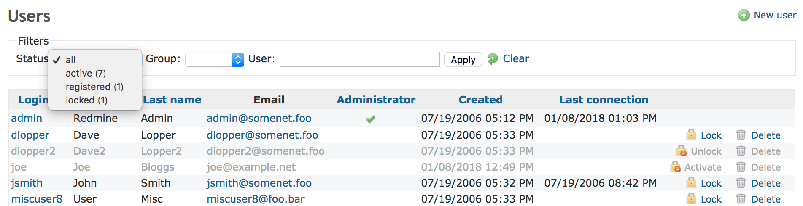

# Managing users

## Users list

The users list shows only the activated users by default. To view all users (activated, registered and locked users), change the status filter to ‘all’.

- **Login:** The login of the user.
- **First name:** The first name of the user.
- **Last name:** The last name of the user.
- **Email:** The email address of the user.
- **Administrator:** If the icon ✓ is present, the user is designated as an administrator who has unrestricted access to the application and to all projects.
- **Created:** Indicates the date when this user account has been created.
- **Last connection:** Indicates the date when this user logged into the application the last time.

### User status

Depending on the global configuration users can have several statuses:

- **active**
  - This icon 🔒 means that the account is activated. A user having an activated account can log in and access the application.
- **locked**
  - This icon 🔓 means that the account is locked. A user having a locked account:
    - cannot log in and access the application
    - cannot be assigned to an issue
    - cannot be set as watcher of an issue
    - don’t receive email notifications
    - is not listed as a member of the project in project overview screen
- **registered**
  - This icon 🔓 can also mean that the account is registered but *not activated*. A user having a registered account cannot log in and access the application.\
    This status is used for [self-registered](settings.md#Self-registration) users which first needs to be activated by either visiting a link provided by email themselves or by a Redmine administrator manually.

The Lock/Unlock buttons let you **lock/unlock** the activated users and the Activate button let you **activate** registered users.

## User authentication

Users are authenticated by *login* and *password*. These tokens can be managed by Redmine directly, by an external LDAP or OpenId server, or by Redmine plugins which allow for instance to reuse an already available Apache authentication.

See also:

- [LDAP Authentication](ldap.md)
- [Allow OpenID login and registration](settings.md#Allow-OpenID-login-and-registration)

## Adding or editing a User

*A user designated as an administrator has unrestricted access to the application and to all the projects.*

TODO

    ## This statement is important ##
    In editing mode, leave the Password field blank in order to keep the user's password unchanged.

    ## Improve this list to match global descriptions and to prevent duplication ##
     * Login - The User's Login account.
     * Firstname  - The User's First name.
     * Lastname - The User's Last name
     * Email - A user's email address which receives a mail sent by project.
     * Language - Set a User's mother language.
     * Administrator - If checked this property, this account has unrestricted access to the application and to all projects.
     * Authentication
     ** Password  - New password
     ** Confirmation - Confirm a new password
     * Send account information to the user - If checked AND password is changed (Defect #7577), send Account information to the user's email address when changed user's information by administrator.

## Deleting a User

Prior to Redmine version#27, user accounts couldn’t be deleted from Redmine. Starting from Redmine version#27, administrators have the ability to delete users (#7296) and from Redmine version#46 onwards, all users have the ability to delete their own account depending on the “[Allow users to delete their own account](settings.md#Allow-users-to-delete-their-own-account)” setting (#10664).\
When a user is deleted, their personal data (e.g. the user record itself, their saved preferences, any saved tokens or keys for the user, their project memberships, their private queries…) is deleted and their public data (e.g. any authorship references of issues, journals, wiki edits/pages, attachments…, issues assigned to the user, or any other any changes done by the user) is reassigned to the `Anonymous` user.
