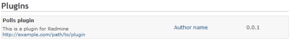
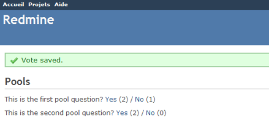
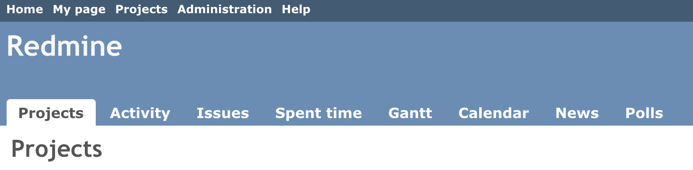
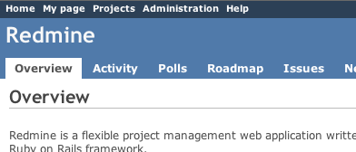
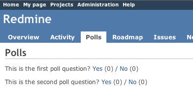
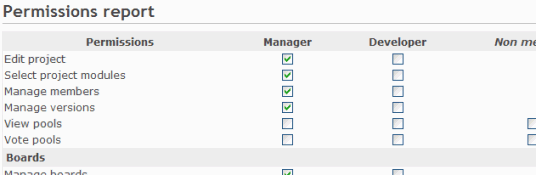
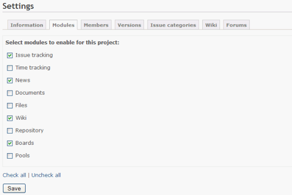
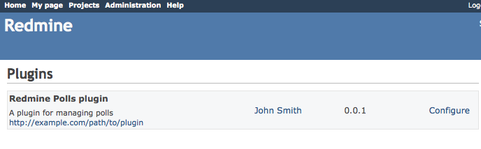
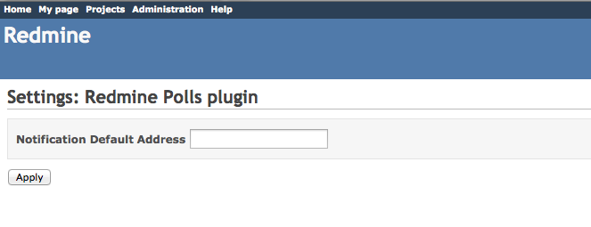

# Plugin Tutorial

This tutorial is based on Redmine 4.x and 3.x.\
You can view a previous version of this tutorial.\
[Redmine 1.x](https://www.redmine.org/projects/redmine/wiki/Plugin_Tutorial?version=66)\
[Redmine 2.x](https://www.redmine.org/projects/redmine/wiki/Plugin_Tutorial?version=104)

It assumes that you’re familiar with the Ruby on Rails framework.

## Creating a new Plugin

You may need to set the RAILS_ENV variable in order to use the command below:

    $ export RAILS_ENV="production"

On windows:

    $ set RAILS_ENV=production

Creating a new plugin can be done using the Redmine plugin generator.\
Syntax for this generator is:

    bundle exec rails generate redmine_plugin <plugin_name>

So open up a command prompt and “cd” to your redmine directory, then execute the following command:

    $ bundle exec rails generate redmine_plugin Polls
          create  plugins/polls/app
          create  plugins/polls/app/controllers
          create  plugins/polls/app/helpers
          create  plugins/polls/app/models
          create  plugins/polls/app/views
          create  plugins/polls/db/migrate
          create  plugins/polls/lib/tasks
          create  plugins/polls/assets/images
          create  plugins/polls/assets/javascripts
          create  plugins/polls/assets/stylesheets
          create  plugins/polls/config/locales
          create  plugins/polls/test
          create  plugins/polls/test/fixtures
          create  plugins/polls/test/unit
          create  plugins/polls/test/functional
          create  plugins/polls/test/integration
          create  plugins/polls/test/system
          create  plugins/polls/README.rdoc
          create  plugins/polls/init.rb
          create  plugins/polls/config/routes.rb
          create  plugins/polls/config/locales/en.yml
          create  plugins/polls/test/test_helper.rb

The plugin structure is created in `plugins/polls`. Edit `plugins/polls/init.rb` to adjust plugin information (name, author, description and version):

```ruby
Redmine::Plugin.register :polls do
  name 'Polls plugin'
  author 'Author name'
  description 'This is a plugin for Redmine'
  version '0.0.1'
  url 'http://example.com/path/to/plugin'
  author_url 'http://example.com/about'
end
```

Then restart the application and point your browser to http://localhost:3000/admin/plugins.\
After logging in, you should see your new plugin in the plugins list:



Note: any change to the `init.rb` file of your plugin requires to restart the application as it is not reloaded on each request.

## Generating a model

For now plugin doesn’t store anything. Let’s create a simple Poll model for our plugin. Syntax is:

       bundle exec rails generate redmine_plugin_model <plugin_name> <model_name> [field[:type][:index] field[:type][:index] ...]

So, go to the command prompt and run:

    $ bundle exec rails generate redmine_plugin_model polls poll question:string yes:integer no:integer
          create  plugins/polls/app/models/poll.rb
          create  plugins/polls/test/unit/poll_test.rb
          create  plugins/polls/db/migrate/xxxxxxxxxxxx_create_polls.rb

This creates the Poll model and the corresponding migration file `xxxxxxxxxxxx_create_polls.rb` in `plugins/polls/db/migrate`:

```ruby
class CreatePolls < ActiveRecord::Migration[5.2]
  def change
    create_table :polls do |t|
      t.string :question
      t.integer :yes, default: 0
      t.integer :no, default: 0
    end
  end
end
```

NOTE: For Redmine 3.x `class CreatePolls < ActiveRecord::Migration[5.2]` is `class CreatePolls < ActiveRecord::Migration`.

You can adjust your migration file (eg. default values…) then migrate the database using the following command:

    $ bundle exec rake redmine:plugins:migrate

    Migrating polls (Polls plugin)...
    ==  CreatePolls: migrating ====================================================
    -- create_table(:polls)
       -> 0.0410s
    ==  CreatePolls: migrated (0.0420s) ===========================================

Note that each plugin has its own set of migrations.

Let’s add some Polls in the console so we have something to work with. The console is where you can interactively work and examine the Redmine environment and is very informative to play around in. But for now we just need create two Poll objects

    bundle exec rails console
    >> Poll.create(question: "Can you see this poll")
    >> Poll.create(question: "And can you see this other poll")
    >> exit

Edit `plugins/polls/app/models/poll.rb` in your plugin directory to add a \#vote method that will be invoked from our controller:

```ruby
class Poll < ActiveRecord::Base
  def vote(answer)
    increment(answer == 'yes' ? :yes : :no)
  end
end
```

## Generating a controller

For now, the plugin doesn’t do anything. So let’s create a controller for our plugin.\
We can use the plugin controller generator for that. Syntax is:

    bundle exec rails generate redmine_plugin_controller <plugin_name> <controller_name> [<actions>]

So go back to the command prompt and run:

    $ bundle exec rails generate redmine_plugin_controller Polls polls index vote
          create  plugins/polls/app/controllers/polls_controller.rb
          create  plugins/polls/app/helpers/polls_helper.rb
          create  plugins/polls/test/functional/polls_controller_test.rb
          create  plugins/polls/app/views/polls/index.html.erb
          create  plugins/polls/app/views/polls/vote.html.erb

A controller `PollsController` with 2 actions (`#index` and `#vote`) is created.

Edit `plugins/polls/app/controllers/polls_controller.rb` to implement these 2 actions.

```ruby
class PollsController < ApplicationController
  def index
    @polls = Poll.all
  end

  def vote
    poll = Poll.find(params[:id])
    poll.vote(params[:answer])
    if poll.save
      flash[:notice] = 'Vote saved.'
    end
    redirect_to polls_path(project_id: params[:project_id])
  end
end
```

Then edit `plugins/polls/app/views/polls/index.html.erb` that will display existing polls:

```erb
<h2>Polls</h2>

<% @polls.each do |poll| %>
  <p>
    <%= poll.question %>?
    <%= link_to 'Yes', { action: 'vote', id: poll[:id], answer: 'yes', project_id: @project }, method: :post %> <%= poll.yes %> /
    <%= link_to 'No', { action: 'vote', id: poll[:id], answer: 'no', project_id: @project }, method: :post %> <%= poll.no %>
  </p>
<% end %>
```

You can remove `plugins/polls/app/views/polls/vote.html.erb` since no rendering is done by the `#vote` action.

### Adding routes

Redmine does not provide the default wildcard route (`':controller/:action/:id'`). Plugins have to declare the routes they need in their proper `config/routes.rb` file. So edit `plugins/polls/config/routes.rb` to add the 2 routes for the 2 actions:

```ruby
get 'polls', to: 'polls#index'
post 'post/:id/vote', to: 'polls#vote'
```

You can find more information about Rails routes here: http://guides.rubyonrails.org/routing.html.

Now, restart the application and point your browser to http://localhost:3000/polls.\
You should see the 2 polls and you should be able to vote for them:



## Internationalization

The translation files must be stored in config/locales, eg. `plugins/polls/config/locales/`.

## Extending menus

Our controller works fine but users have to know the url to see the polls. Using the Redmine plugin API, you can extend standard menus.\
So let’s add a new item to the application menu.

### Extending the application menu

Edit `plugins/polls/init.rb` at the root of your plugin directory to add the following line at the end of the plugin registration block:

```ruby
Redmine::Plugin.register :redmine_polls do
  [...]

  menu :application_menu, :polls, { controller: 'polls', action: 'index' }, caption: 'Polls'
end
```

Syntax is:

menu(menu_name, item_name, url, options={})

There are five menus that you can extend:

- `:top_menu` - the top left menu
- `:account_menu` - the top right menu with sign in/sign out links
- `:application_menu` - the main menu displayed when the user is not inside a project
- `:project_menu` - the main menu displayed when the user is inside a project
- `:admin_menu` - the menu displayed on the Administration page (can only insert after Settings, before Plugins)

Available options are:

- `:param` - the parameter key that is used for the project id (default is `:id`)
- `:if` - a Proc that is called before rendering the item, the item is displayed only if it returns true
- `:caption` - the menu caption that can be:
  - a localized string Symbol
  - a String
  - a Proc that can take the project as argument
- `:before`, `:after` - specify where the menu item should be inserted (eg. `after: :activity`)
- `:first`, `:last` - if set to true, the item will stay at the beginning/end of the menu (eg. `last: true`)
- `:html` - a hash of html options that are passed to `link_to` when rendering the menu item

In our example, we’ve added an item to the application menu which is empty by default.\
Restart the application and go to http://localhost:3000/projects:



Now you can access the polls by clicking the Polls tab that appears when the user is not inside a project.

### Extending the project menu

Now, let’s consider that the polls are defined at project level (even if it’s not the case in our example poll model). So we would like to add the Polls tab to the project menu instead.\
Open `init.rb` and replace the line that was added just before with these 2 lines:

```ruby
Redmine::Plugin.register :redmine_polls do
  [...]

  permission :polls, { polls: [:index, :vote] }, public: true
  menu :project_menu, :polls, { controller: 'polls', action: 'index' }, caption: 'Polls', after: :activity, param: :project_id
end
```

The second line adds our Polls tab to the project menu, just after the activity tab. The first line is required and declares that our 2 actions from `PollsController` are public. We’ll come back later to explain this with more details. Restart the application again and go to one of your projects:



If you click the Polls tab (in 3rd position), you should notice that the project menu is no longer displayed.\
To make the project menu visible, you have to initialize the controller’s instance variable @`project`.

Edit your PollsController to do so:

```ruby
def index
  @project = Project.find(params[:project_id])
  @polls = Poll.all # @project.polls
end


def vote
  poll = Poll.find(params[:id])
  poll.vote(params[:answer])
  if poll.save
    flash[:notice] = 'Vote saved.'
  end
  redirect_to :action => 'index', project_id: params[:project_id]
end
```

Add your routes.rb to do so:

```ruby
post 'projects/:project_id/post/:id/vote', to: 'polls#vote', as: 'vote_poll'
```

Edit your views/polls/index.heml.erb to do so:

```ruby
<h2>Polls</h2>

<% @polls.each do |poll| %>
  <p>
  <%= poll.question %>?
  <%= link_to 'Yes', { action: 'vote', id: poll.id, answer: 'yes', project_id: @project.id }, method: :post %> (<%= poll.yes %>) /
  <%= link_to 'No', { action: 'vote', id: poll.id, answer: 'no', project_id: @project.id }, method: :post %> (<%= poll.no %>)
  </p>
<% end %>
```

The project id is available in the `:project_id` param because of the `param: :project_id` option in the menu item declaration above.

Now, you should see the project menu when viewing the polls:



### Removing item in menu

To remove an item in a menu, you can use `delete_menu_item` like in this example:

```ruby
Redmine::Plugin.register :redmine_polls do
  [...]

  delete_menu_item :top_menu, :my_page
  delete_menu_item :top_menu, :help
  delete_menu_item :project_menu, :overview
  delete_menu_item :project_menu, :activity
  delete_menu_item :project_menu, :news
end
```

## Adding new permissions

For now, anyone can vote for polls. Let’s make it more configurable by changing the permission declaration.\
We’re going to declare 2 project based permissions, one for viewing the polls and an other one for voting. These permissions are no longer public (`public: true` option is removed).

Edit `plugins/polls/init.rb` to replace the previous permission declaration with these 2 lines:

```ruby
  permission :view_polls, polls: :index
  permission :vote_polls, polls: :vote
```

Restart the application and go to http://localhost:3000/roles/permissions:



You’re now able to give these permissions to your existing roles.

Of course, some code needs to be added to the PollsController so that actions are actually protected according to the permissions of the current user. For this, we just need to append the `:authorize` filter and make sure that the @project instance variable is properly set before calling this filter.

Here is how it would look like for the `#index` action:

```ruby
class PollsController < ApplicationController
  before_action :find_project, :authorize, only: [:index, :vote]

  [...]

  def index
    @polls = Poll.all # @project.polls
  end

  [...]

  private

  def find_project
    # @project variable must be set before calling the authorize filter
    @project = Project.find(params[:project_id])
  end
end
```

Retrieving the current project before the `#vote` action could be done using a similar way.\
After this, viewing and voting polls will be only available to admin users or users that have the appropriate role on the project.

If you want to display the symbols of your permissions in a multilingual way, you need to add the necessary text labels in a language file.\
Simply create an \*.yml (eg. `en.yml`) file in `plugins/polls/config/locales` and fill it with labels like this:

```yaml
"en":
  permission_view_polls: View Polls
  permission_vote_polls: Vote Polls
```

In this example the created file is known as `en.yml`, but all other supported language files are also possible too.\
As you can see on the example above, the labels consists of the permission symbols `:view_polls` and `:vote_polls` with an additional `permission_` added at the front.

Restart your application and point the permission section.

## Creating a project module

For now, the poll functionality is added to all your projects. But you may want to enable polls for some projects only.\
So, let’s create a ‘Polls’ project module. This is done by wrapping the permissions declaration inside a call to `#project_module`.

Edit `init.rb` and change the permissions declaration:

```ruby
  project_module :polls do
    permission :view_polls, polls: :index
    permission :vote_polls, polls: :vote
  end
```

Restart the application and go to one of your project settings.\
Click on the Modules tab. You should see the Polls module at the end of the modules list (disabled by default):



You can now enable/disable polls at project level.

## Improving the plugin views

### Adding stylesheets

Let’s start by adding a stylesheet to our plugin views.\
Create a file named `voting.css` in the `plugins/polls/assets/stylesheets` directory:

```css
a.vote { font-size: 120%; }
a.vote.yes { color: green; }
a.vote.no  { color: red; }
```

When starting the application, plugin assets are automatically copied to `public/plugin_assets/polls/` to make them available through your web server. So any change to your plugin stylesheets or javascripts needs an application restart.

The introduced classes need to be used by the links. So change in file `plugins/polls/app/views/polls/index.html.erb` the link declarations to:

```erb
<%= link_to 'Yes', {action: 'vote', id: poll[:id], answer: 'yes', project_id: @project }, method: :post, class: 'vote yes' %> (<%= poll.yes %>)
<%= link_to 'No', {action: 'vote', id: poll[:id], answer: 'no', project_id: @project }, method: :post, class: 'vote no' %> (<%= poll.no %>)
```

Then, append the following lines at the end of `index.html.erb` so that your stylesheet get included in the page header by Redmine:

```erb
<% content_for :header_tags do %>
    <%= stylesheet_link_tag 'voting', plugin: 'polls' %>
<% end %>
```

Note that the `plugin: 'polls'` option is required when calling the `stylesheet_link_tag` helper.

Javascripts can be included in plugin views using the `javascript_include_tag` helper in the same way.

### Setting page title

You can set the HTML title from inside your views by using the `html_title` helper.\
Example:

```erb
  <% html_title "Polls" %>
```

## Using hooks

### Hooks in views

Hooks in Redmine views lets you insert custom content to regular Redmine views. For example, looking at source:tags/2.0.0/app/views/projects/show.html.erb#L52 shows that there are 2 hooks available: one named `:view_projects_show_left` for adding content to the left part and one named `:view_projects_show_right` for adding content to the right part of the view.

To use one or more hooks in views, you need to create a class that inherits from `Redmine::Hook::ViewListener` and implement methods named with the hook(s) you want to use. To append some content to the project overview, add a class to your plugin and require it in your `init.rb`, then implement methods whose name match the hook names.

For our plugin create a file `plugins/polls/lib/polls_hook_listener.rb` with this content:

```ruby
class PollsHookListener < Redmine::Hook::ViewListener
  def view_projects_show_left(context = {})
    return content_tag("p", "Custom content added to the left")
  end

  def view_projects_show_right(context = {})
    return content_tag("p", "Custom content added to the right")
  end
end
```

Prepend this line to `plugins/polls/init.rb`:

```ruby
require_dependency File.expand_path('../lib/polls_hook_listener', __FILE__)
```

Restart Redmine and have a look into the overview tab of a project. You should see the strings on the left and the right side in the overview.

You can also use the `render_on` helper to render a partial. In our plugin you have to replace the just created content in `plugins/polls/lib/polls_hook_listener.rb` with:

```ruby
class PollsHookListener < Redmine::Hook::ViewListener
  render_on :view_projects_show_left, partial: "polls/project_overview"
end
```

Add the partial to your plugin by creating the file `app/views/polls/_project_overview.html.erb`. Its content (use some text like ‘Message from Hook!’) will be appended to the left part of the project overview. Don’t forget to restart Redmine.

### Hooks in controllers

TODO

## Making your plugin configurable

Each plugin registered with Redmine is displayed on the admin/plugins page. Support for a basic configuration mechanism is supplied by the Settings controller. This feature is enabled by adding the “settings” method to the plugin registration block in a plugin’s init.rb file.

```ruby
Redmine::Plugin.register :polls do
  [ ... ]

  settings default: {'empty' => true}, partial: 'settings/poll_settings'
end
```

Adding this will accomplish two things. First, it will add a “Configure” link to the description block for the plugin in the admin/plugins list. Following this link will cause a common plugin configuration template view to be loaded which will in turn render the partial view referenced by :partial. Calling the settings method will also add support in the Setting module for the plugin. The Setting model will store and retrieve a serialized hash based on the plugin name. This hash is accessed using the Setting method name in the form plugin\_\<plugin name\>. For this example, the hash can be accessed by calling Setting.plugin_polls.



The view referenced by the :partial hash key passed to the settings method will be loaded as a partial within the plugin configuration view. The basic page layout is constrained by the plugin configuration view: a form is declared and the submit button is generated. The partial is pulled into the view inside a table div inside the form. Configuration settings for the plugin will be displayed and can be modified via standard HTML form elements.



**NB** : if two plugins have the same partial name for settings, the first will override the second’s settings page. So be sure you give a unique name to your settings partial.

When the page is submitted, the settings_controller will take the parameter hash referenced by ‘settings’ and store it directly in a serialized format in Setting.plugin_polls. Each time the page is generated the current value of Setting.plugin_polls will be assigned to the local variable settings.

Create a file named `plugins/polls/app/views/settings/_poll_settings.erb` and fill it with following content:

```erb
<table>
  <tbody>
    <tr>
      <th>Notification Default Address</th>
      <td>
        <input type="text" id="settings_notification_default"
                           value="<%= settings['notification_default'] %>"
	                       name="settings[notification_default]" >
      </td>
    </tr>
  </tbody>
</table>
```

In the example above, the configuration form was not created using Rails form helpers. This is because there is no `settings model but only the setting hash. Form helpers will attempt to access attributes using model accessor methods which do not exist. For example, a call to `settings.notification_default will fail. The value set by this form is accessed as Setting.plugin_polls\[’notification_default’\].

Finally, the :default in the settings method call is to register a value that will be returned from the Setting.plugin_polls call if nothing has been stored in the settings table for this plugin.

## Testing your plugin

### plugins/polls/test/test_helper.rb

Here are the contents of my test helper file:

    require File.expand_path(File.dirname(__FILE__) + '/../../../test/test_helper')

### Sample test

Contents of `plugins/polls/test/functional/polls_controller_test.rb` for Redmine 4.x:

```ruby
require File.expand_path('../../test_helper', __FILE__)

class PollsControllerTest < ActionController::TestCase
  fixtures :projects

  def test_index
    get :index, params: { project_id: 1 }

    assert_response :success
    assert_template 'index'
  end
end
```

Contents of `plugins/polls/test/functional/polls_controller_test.rb` for Redmine 3.x:

```ruby
require File.expand_path('../../test_helper', __FILE__)

class PollsControllerTest < ActionController::TestCase
  fixtures :projects

  def test_index
    get :index, project_id: 1

    assert_response :success
    assert_template 'index'
  end
end
```

### Running test

Initialize the test database if necessary:

    $ RAILS_ENV=test bundle exec rake db:drop db:create db:migrate redmine:plugins:migrate redmine:load_default_data

To execute the polls_controller_test.rb:

    $ RAILS_ENV=test bundle exec rake test TEST=plugins/polls/test/functional/polls_controller_test.rb

### Testing with permissions

If your plugin requires membership to a project, add the following to the beginning of your functional tests:

```ruby
def test_index
  @request.session[:user_id] = 2
  ...
end
```

If your plugin requires a specific permission, you can add that to a user role like so (lookup which role is appropriate for the user in the fixtures):

```ruby
def test_index
  Role.find(1).add_permission! :my_permission
  ...
end
```

You may enable/disable a specific module like so:

```ruby
def test_index
  Project.find(1).enabled_module_names = [:mymodule]
  ...
end
```

### Reference file hierarchy

Here is a simple list of all the files and directories mentioned in this Tutorial and [Hooks](hooks.md). This is useful to ensure standard paths are used and also useful for newbies to know here files should go.

    plugins/PLUGIN/README.rdoc
    plugins/PLUGIN/init.rb
    plugins/PLUGIN/app/
    plugins/PLUGIN/app/controllers/
    plugins/PLUGIN/app/controllers/CONTROLLER_controller.rb
    plugins/PLUGIN/app/helpers/
    plugins/PLUGIN/app/helpers/CONTROLLER_helper.rb
    plugins/PLUGIN/app/models/
    plugins/PLUGIN/app/models/MODEL.rb
    plugins/PLUGIN/app/views/
    plugins/PLUGIN/app/views/CONTROLLER/
    plugins/PLUGIN/app/views/CONTROLLER/_PARTIAL.html.erb
    plugins/PLUGIN/app/views/CONTROLLER/CONTROLLER-ACTION.html.erb
    plugins/PLUGIN/app/views/hooks/
    plugins/PLUGIN/app/views/hooks/_HOOK.html.erb
    plugins/PLUGIN/app/views/settings/
    plugins/PLUGIN/app/views/settings/_MODEL_settings.html.erb
    plugins/PLUGIN/assets/
    plugins/PLUGIN/assets/images/
    plugins/PLUGIN/assets/javascripts/
    plugins/PLUGIN/assets/stylesheets/
    plugins/PLUGIN/assets/stylesheets/voting.css
    plugins/PLUGIN/config/
    plugins/PLUGIN/config/locales/
    plugins/PLUGIN/config/locales/en.yml
    plugins/PLUGIN/config/routes.rb
    plugins/PLUGIN/db/
    plugins/PLUGIN/db/migrate/
    plugins/PLUGIN/db/migrate/001_create_MODELs.rb
    plugins/PLUGIN/lib/
    plugins/PLUGIN/lib/PLUGIN_hook_listener.rb
    plugins/PLUGIN/lib/PLUGIN/
    plugins/PLUGIN/lib/PLUGIN/hooks.rb
    plugins/PLUGIN/lib/PLUGIN/MODEL_patch.rb
    plugins/PLUGIN/lib/tasks/
    plugins/PLUGIN/test/
    plugins/PLUGIN/test/test_helper.rb
    plugins/PLUGIN/test/functional/
    plugins/PLUGIN/test/functional/CONTROLLER_controller_test.rb
    plugins/PLUGIN/test/unit/
    plugins/PLUGIN/test/unit/MODEL_test.rb
