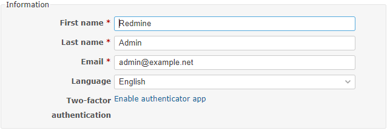
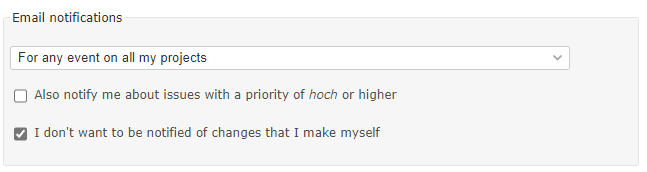
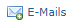
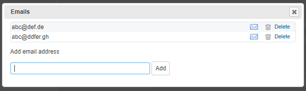
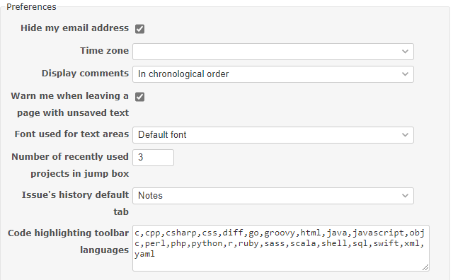
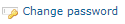
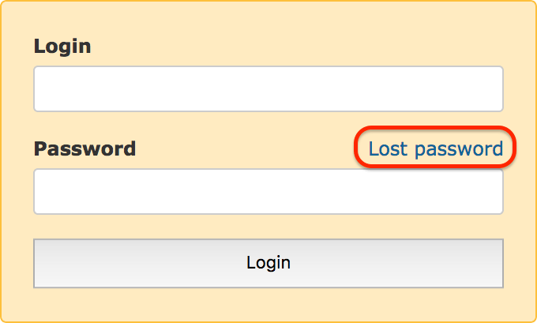
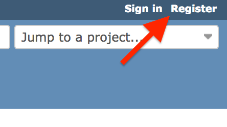

# RedmineAccounts

Backward translation from German [revision 10](http://www.redmine.org/projects/redmine/wiki/DeRedmineAccounts/10)

# Accounts

## My account

This area enables you to adapt your existing account to your needs.

### Information

Here you can edit your user data: first name, last name, email address, display language.\
From version 4.2.0 you can, if activated in the system configuration (options: blocked/optional/required), increase security by activating two-factor authentication for your access.

### Mail notifications

Users receive notifications for projects they’re a member of. It’s possible to receive notifications for an issue regardless the notification settings by watching it. Note that this will put your email address into the `CC` instead of the `To` field.\
It’s possible to pick one of these options:

<table>
<tbody>
<tr>
<td><strong>For any event on all my projects</strong></td>
<td>Receive all project events. No filtering is employed.</td>
</tr>
<tr>
<td><strong>For any event on the selected projects only…</strong></td>
<td>Same as “Only for things I watch or I’m involved in”, but limited to the selected projects. 
<em>Note: The User has to be member of the project for it to show up in this list</em></td>
</tr>
<tr>
<td><strong>Only for things I watch or I’m involved in</strong></td>
<td>Notify if the event is for an issue is: created by the user, assigned to the user or previously assigned to the user</td>
</tr>
<tr>
<td><strong>Only for things I am assigned to</strong></td>
<td>Notify if the event is for an issue: assigned to the user or previously assigned to the user</td>
</tr>
<tr>
<td><strong>Only for things I am the owner of</strong></td>
<td>Notify if the event is for an issue created by the user 
<em>Note: Even if a ticket was assigned to the user, they won’t get any notifications unless they’re watching the ticket.</em></td>
</tr>
<tr>
<td><strong>No events</strong></td>
<td>Don’t ever notify the user for events. This can be combined with watching individual tickets to selectively receive notifications.</td>
</tr>
</tbody>
</table>

From version 4.2.0 you can choose whether you only want to receive notifications with high importance and thus filter out changes with low priority.\
You can also tick that you do not want to be notified of your own changes.

### Email address

You can store additional addresses to which notifications will be sent. To do this, click on the link 

In a window you can enter the other addresses, delete them and deactivate / activate the notifications.

### Preferences

Personal settings for display in Redmine.

- **Do not show email address:** Hides the email address in the profile page so that other users cannot see it.
- **Time zone:** Here you can select a time zone that differs from the default setting in Redmine. The time zone controls the display of the date and time.
- **Show comments:** Controls the chronological sorting of comments.
- **Warn before leaving a page with unsecured text in the editor:** Security setting against data loss.
- **Font for text areas:** Here you can force a predefined proportional or non-proportional font instead of the standard font.
- **Number of recently used projects in the project jump box:** Here you can specify how many of your recently used projects are shown above the standard list. Default is 3.
- **Standard tab for ticket history:** The detailed contents of the tickets are divided into tabs, here you can specify which tab should be opened when a ticket is called up. The default is notes.
- **Languages ​​for code highlighting, editor S toolbar**: Specifies which programming languages ​​are to be recognized and parsed accordingly. Default: @ c, cpp, csharp, css, diff, go, groovy, html, java, javascript, objc, perl, php, python, r, ruby, sass, scala, shell, sql, swift, xml, yaml @

### Password

To change your password, click  on “My account” page and then type your old password and your new password twice. Password length must be 8 characters or more (the admin can change the minimum length. See [RedmineSettings#Minimum-password-length](../admin/settings.md#Minimum-password-length)).

If your account uses an external authentication mean (LDAP), you can’t change your password in Redmine.

## Password lost

If you forget your password, this procedure lets you choose a new one.

On the [login screen](login.md), click on **Lost password**. Enter your email address and submit the form. An email is then sent to you. It contains a link that allows you to change your password.

Note that this functionality can be disabled by the administrator (see [RedmineSettings#Lost-password](../admin/settings.md#Lost-password)). Also, if your account uses an external authentication mean (LDAP), this procedure isn’t available.

## Register

By registering, you can get an account without the intervention of the administrator.

In the upper right corner of the [login screen](login.md), click on **Register**. Fill the form and submit it. An email will be sent to you. To activate your account, use the link that is contained in this email. See [Register](register.md) for more details.

Note that this functionality can be disabled by the administrator.

