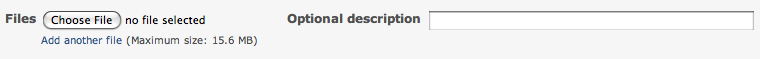

# Redmine Attached Files

## Introduction

Attached files can be added to different resources within the Redmine system:

- issues - using the ["New File" form](attached-files.md#Attach-files-form) while adding/editing an issue
- documents - using the ["New File" form](attached-files.md#Attach-files-form) while adding/editing a document
- forum messages - using the ["New File" form](attached-files.md#Attach-files-form) while adding/editing a forum message
- news items - using the ["New File" form](attached-files.md#Attach-files-form) while adding/editing a news item
- wiki pages - using the [“Files” section](attached-files.md#Files-added-via-New-File) at the bottom of the page, or the [attach files form](attached-files.md#Attach-files-form) while editing the page

## Usage

### Inline Images

Attached files can be shown within the parent page by targeting it’s name via image url (i.e. `!attached_image!`).

### Non plain text files

Keep in mind there is a dedicated [documents](documents.md) module for storing technical and user documentation that can be linked via the [wiki](wikis.md) and a dedicated [files](files.md) module for publishing versions of the tracked project, as a bundle (release).

However, if that doesn’t fit the bill, file upload support provides a way to distribute any file for user download.

## File storage

Uploaded attached files are stored in subdirectories of the `<Redmine install dir>/files` directory (or of the directory set by `attachments_storage_path` in `config/configuration.yml`) named after the year and month the file has been uploaded (`YYYY/MM`).

The stored file name is prefixed with a timestamp of the upload (`yymmddHHMMSS_`); a file name that contains characters other than ASCII letters, digits, `_`, `.` and `-`, or is longer than 50 characters, is replaced by a hash (keeping the extension when it is short). Multiple files can be uploaded with the same name, however a link within the wiki will only show the most recently uploaded one.

#### Unattached uploaded files

Uploaded files can be left unattached if the user don’t submit the form; a [Rake task](../admin/rake.md#rake-redmineattachementsprune) is made available and can be scheduled for regular deletion of these files.

## Attach files form

The input form is as shown below.

Starting from version version:2.3.0, it is possible to:

- select and attach multiple files at once
- drag and drop files over the form

The optional description field, which appears once the file upload is finished, is also used as the alternate text of the image file inserted using `!image_url!` syntax within the parent content (i.e. issue description or note, forum message, wiki page, document, …).

## Files added via “New File”

At the bottom of wiki pages is a collapsible “Files” section, and document pages have a “New file” link. Attaching a file makes that page the parent of the file and it is limited in scope to that page.

See the [Usage](files.md#Usage) section for more information.
