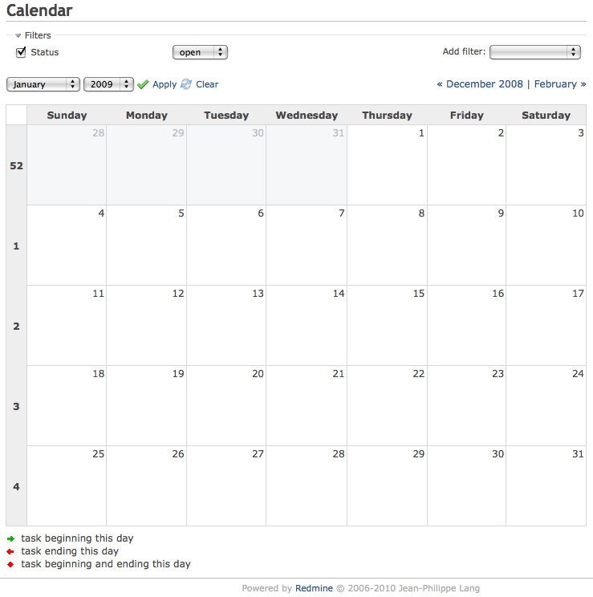

# Calendar

## Overview

The calendar provides an overview of the current project as a monthly view. This view displays all the issues that have at least a start date and indicates their start date and (if available) their due date. The calendar also displays all versions which have a due date set.

## Access control

### Module activation

The calendar module can be enabled or disabled per project via the project’s configuration tab. Within the configuration page go to the Modules tab and check or uncheck the Calendar checkbox to activate or disable the module.

### Roles and permissions

Access to the module can be granted or denied at a role level.\
To do this go to the administration page, follow the roles and permissions link, choose a role and check or uncheck the Calendar permissions checkbox.

## Filters

Like on the [issue-lists](issue-list.md) and the [Gantt chart](gantt.md), it is possible to define filters to define a subset of issues to be shown on the calendar. Such filters are similar to those specified on any [issue-list](issue-list.md).

