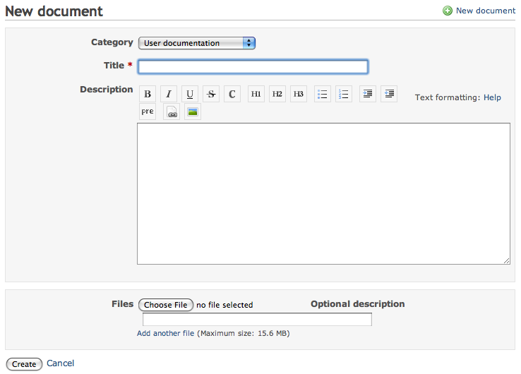
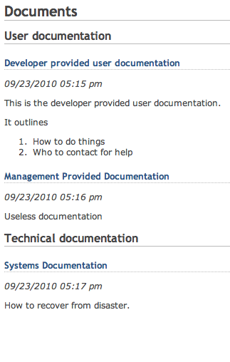

# Redmine Documents

## Introduction

Documents is an available module to projects in Redmine.

## Adding Documents

From the **Documents** tab press the **New document** link.

By default there are two categories for documentation:

1.  User documentation
2.  Technical documentation

These categories can be modified and other categories can be added by a Redmine administrator using [document category enumerations](../admin/enumerations.md).

## Viewing Documents

Once documents have been uploaded, the title is used as the link to download the attached documents, and add more if necessary.

