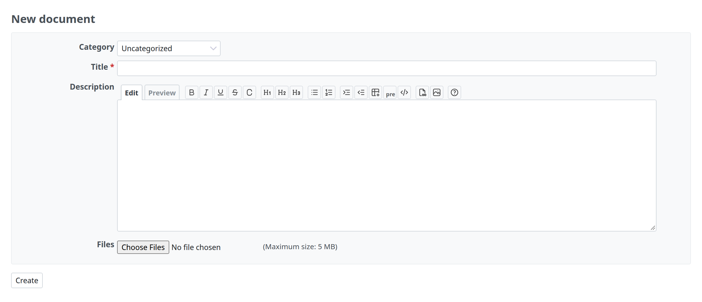
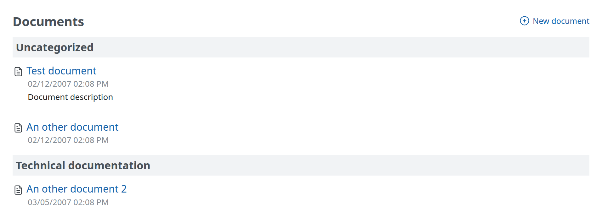

# Redmine Documents

## Introduction

Documents is an available module to projects in Redmine.

## Adding Documents

From the **Documents** tab press the **New document** link.

By default there are two categories for documentation:

1.  User documentation
2.  Technical documentation

These categories can be modified and other categories can be added by a Redmine administrator using [document category enumerations](../admin/enumerations.md).

## Viewing Documents

Once documents have been created, the title is used as the link to the document page, where the attached files can be downloaded and more files can be added using the **New file** link.

