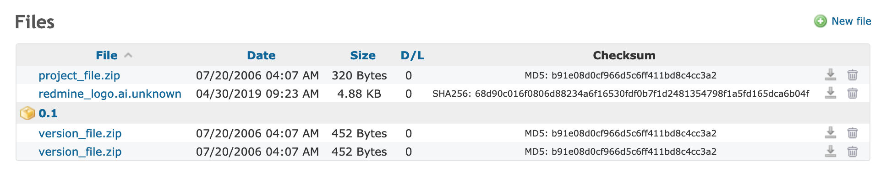
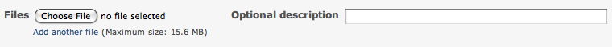

# Redmine Files

## Files Module

Each project can have a **Files** module enabled/disabled via the settings menu.

A sortable table shows the details of all the uploaded files. If a version if selected while uploading a file, that file will be shown below the version. Of note are the Checksum hash and D/L(Download Count).

New files are added via the **New File** button in the upper right hand corner.

## File storage

All uploaded files are stored at the `/{install dir}/files` directory.

The uploaded file name is prefixed with a unique id based on it’s parent for directory storage.

## New file form

If a new file is added, the input form is as shown below. Select a version from the list to link a file to a specific version. Adding multiple files at once is possible using the “Add another file” link.

The optional description is used for an `alt` text.

