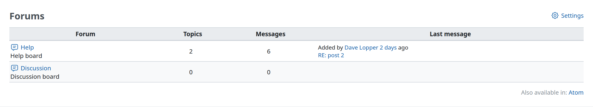

# Forums

The forums allow users from a project to communicate with each others. Users with the “Manage forums” permission define a list of forums in the [Project Settings](project-settings.md#Forums).

The forum list displays the project forums overview:

- total number of topics
- total number of messages
- a link to the latest message

## Adding a topic

To add a topic in a given forum, click on the forum name, then click on **New message**.

You can now enter a subject, a body and attach files to your message.\
Two options are available:

- **sticky**: if checked, the topic will stay displayed at the top of topic list, in bold.
- **locked**: if checked, users can not add replies to the message.
