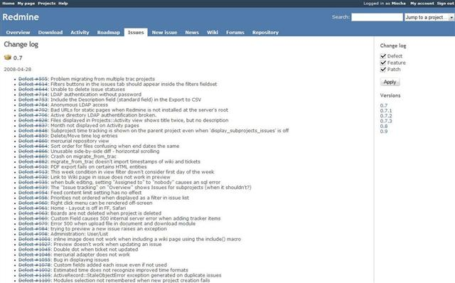
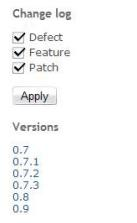

# The Change log

> [!CAUTION] Note
> The here explained feature has been merged within the Redmine [roadmap](roadmap.md) and has been removed as a seperate view starting from Redmine [0.9.0](https://www.redmine.org/versions/6) (specifically: done in [r3162](https://www.redmine.org/projects/redmine/repository/svn/revisions/3162)).

## Overview

Redmine provides a change log, which provides a project-level overview of all closed issues, sorted per target version.

Considering the fact that this is an overview of what has changed in the specified target-versions, only closed issues which have the target-version field filled are shown in this overview.

## Sidebar

The contextual sidebar on the right of the change log provides several things:

- checkboxes and an apply-button to include/exclude issues from specific trackers on the changelog (which trackers are shown here with checkboxes depends on the individual [tracker-configuration](../admin/issue-tracking-setup.md#Trackers))
- links to the configured target-versions of the project, where each link links to the change log itself starting with the selected target-version
