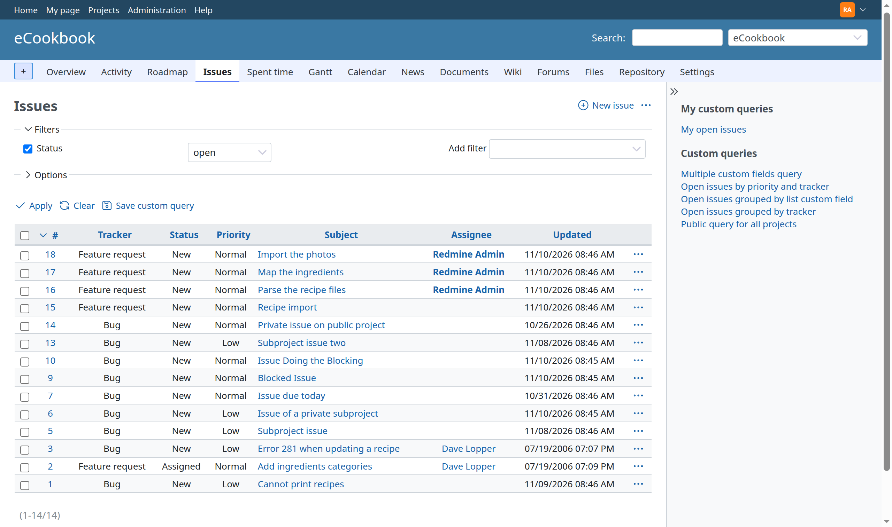
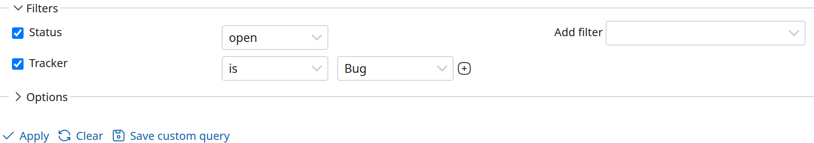
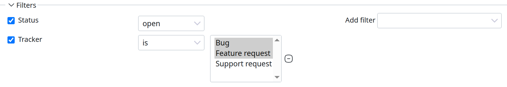
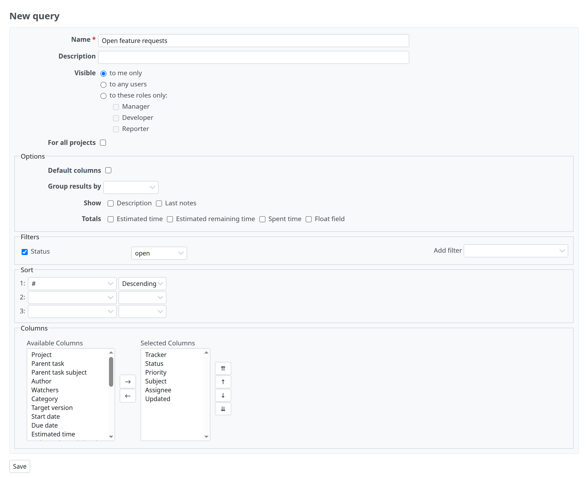
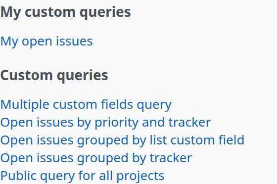
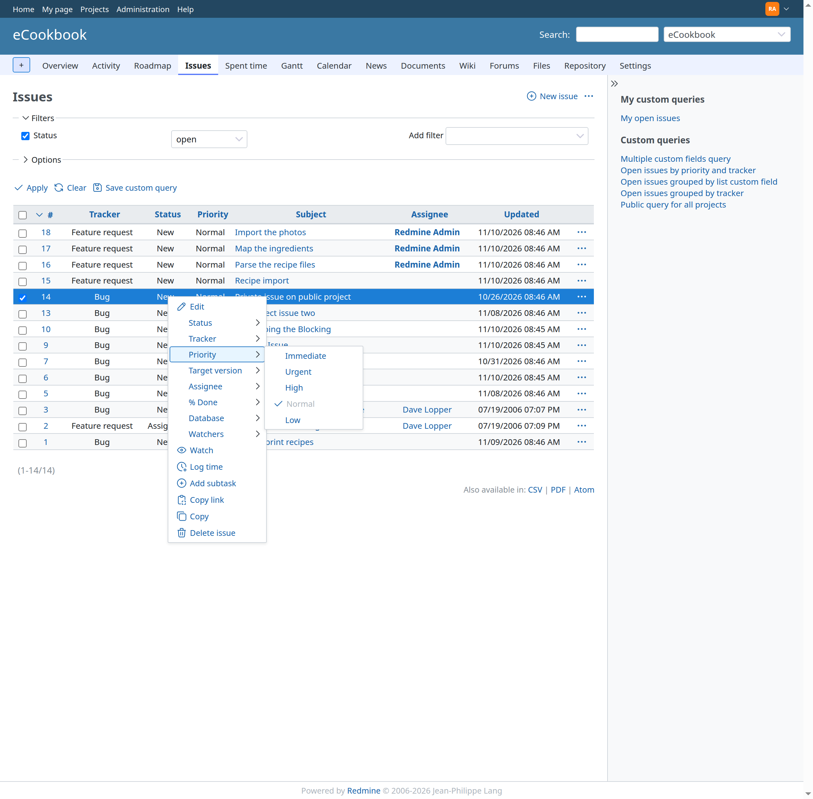
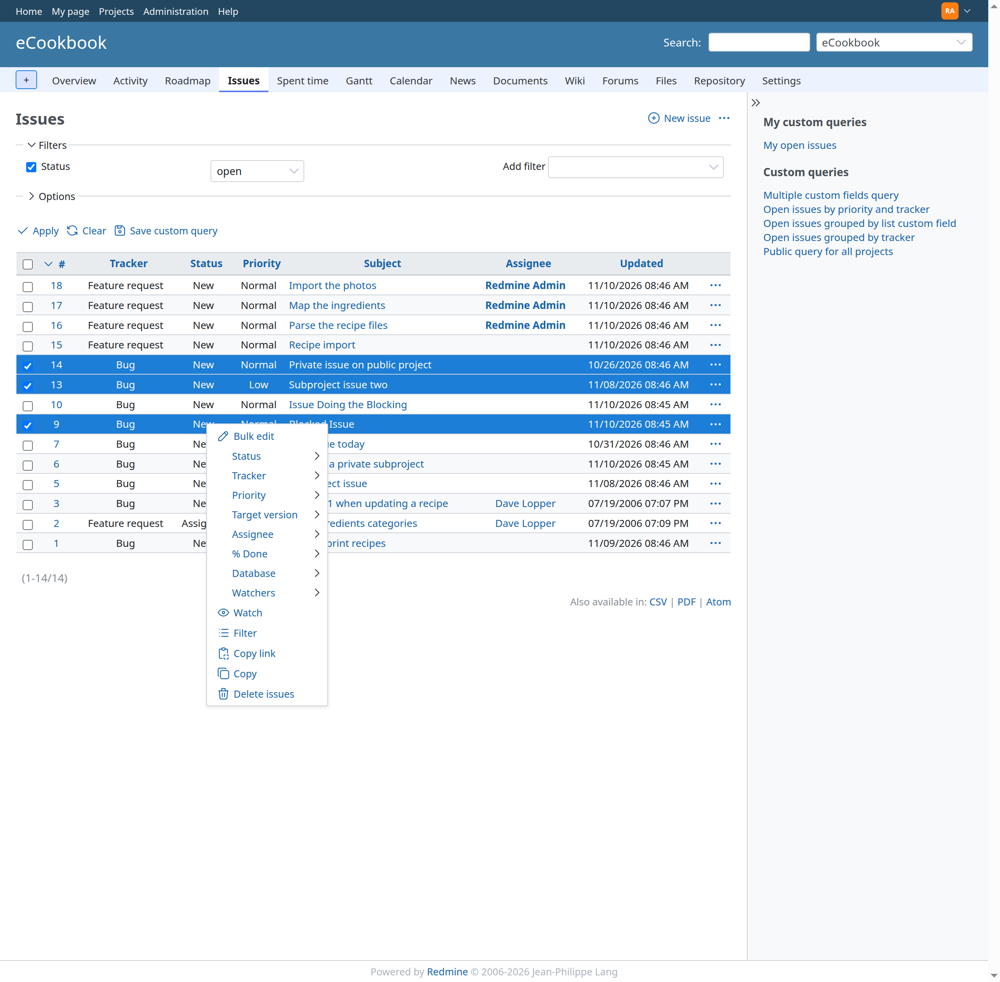

# The issue list

## Overview

The issue list provides a way to look at issues for a project.

## Applying and saving filters

The issue list displays open issues by default. By setting the filter you can change the condition of the issues to be listed. Standard and [custom fields](../admin/custom-fields.md) can be used as filters. Once the filters are set, click on **Apply** to refresh the issue list. Click on **Clear** to clear the filters.

It is possible to select multiple values at once for a specified field by pressing the **+** button. This will convert the drop-down menu in a selection list. In order to add to the selection list, use the Ctrl key (Windows) / ⌘ key (macOS) on your keyboard.

### Custom queries

Filters you built can be saved as custom queries. And you can apply the saved filters with a single click.

Custom queries can be saved by clicking on **Save custom query**.\
A form lets you give it a name and select the columns that you want to be displayed on the issue list for this query (both standard and [custom fields](../admin/custom-fields.md) can be displayed). The **Visible** option lets you make the query visible **to me only**, **to any users** or **to these roles only**. This option needs the **Manage public queries** permission; without it, only you will see the query.

Once saved, the query is listed in the [sidebar](issue-list.md#Sidebar).

## Shortcut menu

A context menu pops up when right clicking on an issue of the issue list, or when clicking the **Actions** (…) button at the end of its row.\
This menu offers several shortcuts to quickly edit, reprioritize, reassign, copy or delete the issue.

Note that you have to **right-click outside of the issue link**, otherwise the browser’s default context menu is displayed.

## Bulk editing issues

From the issue list, you can bulk edit/move/delete issues by selecting multiple issues and then right-click on the selection.\
Issues can be selected either by using the checkboxes or by clicking on the rows with Control or Shift key pressed.\
You can also use the little tick at the upper-left corner of the list to select/unselect all the issues.

## Sidebar

 The contextual sidebar on the right of the issue list provides links to the custom queries you can use:

- **My custom queries**: the queries that are visible to you only
- **Custom queries**: the queries that are visible to other users (to any users or to some roles), for the current project or for all projects

The [issue summary](issue-summary.md), which is a report of all the issues at a project-level (in contrast to the [version overview](version.md) which provides an overview at version-level), is available as **Summary** in the actions menu (…) at the upper right of the issue list. Depending on the [project settings](project-settings.md), the [calendar](calendar.md) and the [gantt](gantt.md) chart are available as tabs in the project menu.
