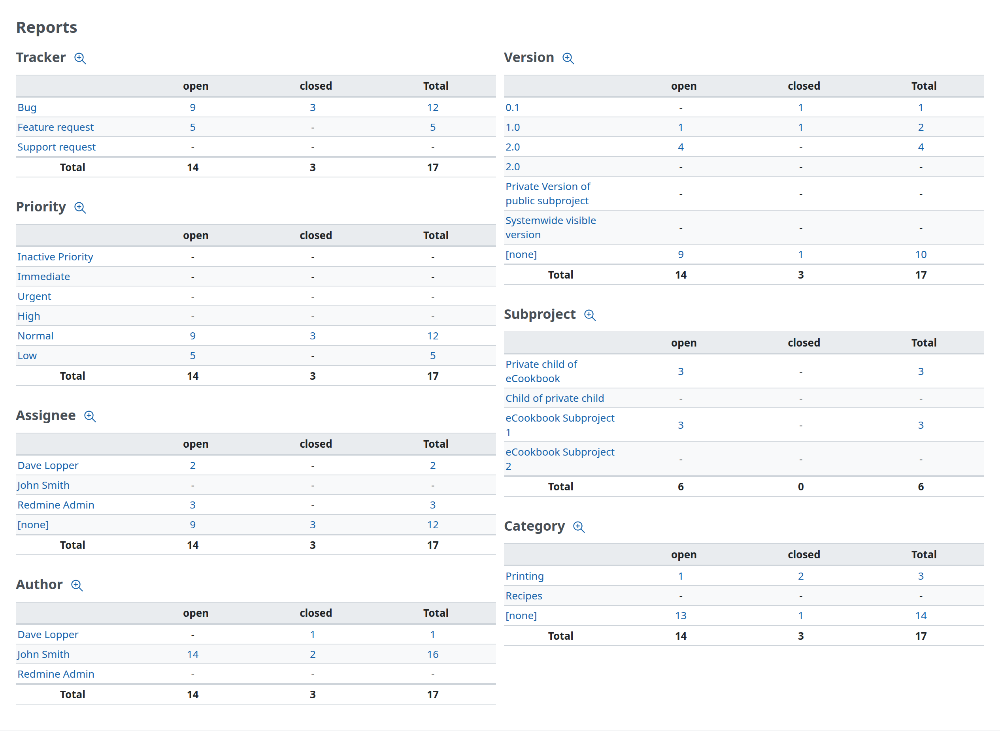
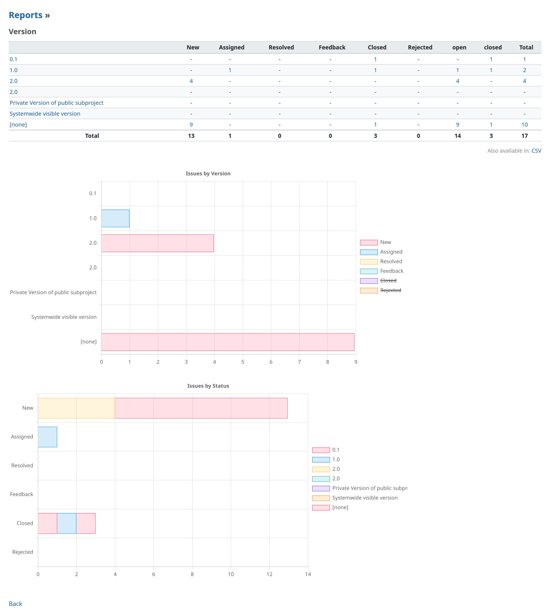

# Issue summary

## Overview

The issue summary provides a report of the amount of all the issues at a project-level (in contrast to the version overview which provides an overview at version-level). This report is split-up in different blocks where each block shows the amount of open/closed/total issues per:

- Tracker
- Priority
- User to which the issue is assigned to
- User who opened the issue (the author)
- Version
- Subproject (only when the project has subprojects)
- Category

## Drill-through links

Each tracker, priority, assigned user, author, version and category links to the [issue list](issue-list.md) which has the selected item as the current filter.\
Also the numbers of issues in the reports provides drill-through links to their respective views in the [issue list](issue-list.md).

## Detailed reports

Each report-block can be selected to get a detailed report from it. This not only shows the amount of open/closed/total issues but also provides details for all the other configured [issue statuses](../admin/issue-tracking-setup.md#Issue-statuses). The screenshot below shows the detailed report for the versions.

