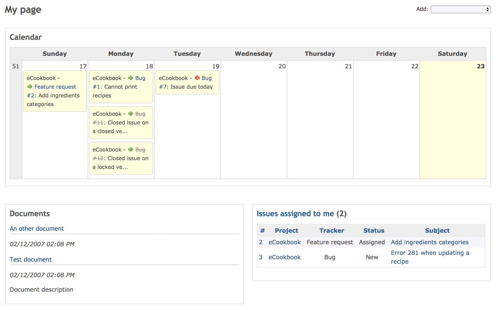

# My page

My page lets you display various blocks of information about your projects. Users can personalize their own “My page” by adding, removing and reordering blocks.

## blocks

The following blocks are available, as well as the “Updated issues” and “Activity” blocks. Only “Issues assigned to me” and “Reported issues” block are enabled by default.

The layout (as in positioning of the blocks) of the “My page” can also be re-ordered and modified using drag-and-drop.

### Issues assigned to me

“Issues assigned to me” block provides a cross-project list of issues, which are assigned to the current user, showing by default the project, tracker, status and subject of each issue (the columns can be changed with the block’s options).

### Reported issues

“Reported issues” block provides a cross-project list of issues, which are reported by the current user, showing by default the project, tracker, status and subject of each issue (the columns can be changed with the block’s options).

### Calendar

“Calendar” block provides a cross-project weekly calendar overview.

### Documents

“Documents” block provides a cross-project overview of the latest documents.

### Issues

“Issues” block provides a list of issues returned by a selected custom query.

### Latest news

“Latest news” block provides a cross-project overview of the latest news.

### Spent time

“Spent time” block provides a cross-project overview of the spent time entries of the current user of the last seven days (the number of days can be changed with the block’s options).

### Watched issues

“Watched issues” block provides a cross-project list of issues, which are watched by the current user, showing by default the project, tracker, status and subject of each issue (the columns can be changed with the block’s options).
