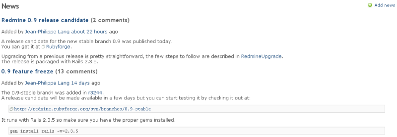

# News

In the news area you can publish news items about the project or any subject you like.

You can give the news item a title, a summary and the detailed description. The summary will be displayed in the **Latest news** area of the [project overview](project-overview.md) whereas the description will be displayed if you click on the title of the news item.

If you have the [permissions](../admin/roles.md#Permissions) to create news items, then you can add/edit/delete an existing news entry ([see Redmine Permissions](../admin/roles.md#Permissions)).

If you have the [permission](../admin/roles.md#Permissions) to create new news items, you have a green plus sign (\*+ Add news\*) in the upper right of you screen. If you click on that, you can add a new news item. On this page, you have to insert the **Title**, **Summary** and **Description** of the news item.

