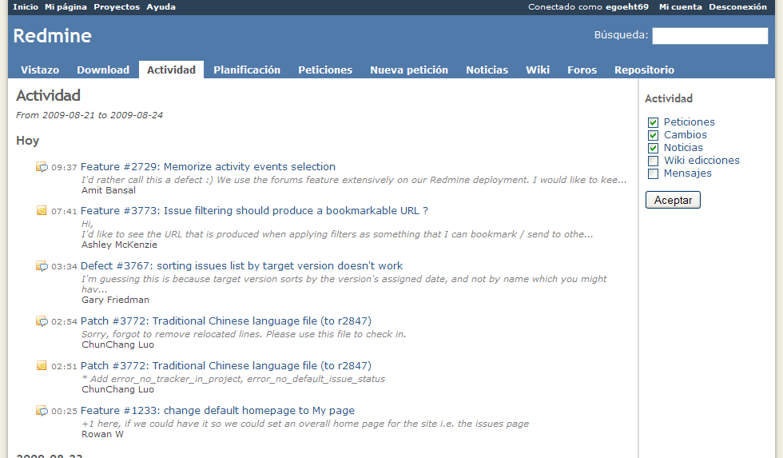

# Project Activity

The ***Activity*** page will give an historical log of at least all activities which had happen in the given project.

This will include:

- A new issue (feature, defect…) has been created.
- The status of the issue has been changed.
- The given issue has been closed.
- A note to the issue has been added.
- This means a changeset has been commited to the repository.
- A news has been added to the news area.
- A message in the forum area has been added.
- A reply to a message in the forum has been added.
- A wiki page has been edited or newly created.
- A new file has been added in the files area or to a document.
- A new document has been added.
- Some hours has been logged.

Using the checkboxes in the sidebar of the right, you can choose which items are displayed.

The activity is also available as an Atom feed.

A cross-project activity view is available from the Projects page, it will lists the activity of all visible projects.
