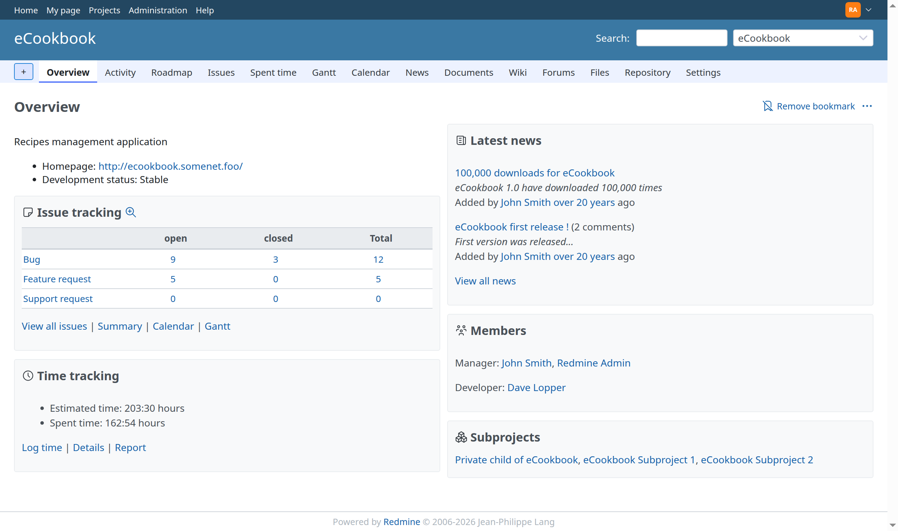

# Project Overview

The Project overview will give you an overview of the whole project. On left upper side in the ***Issue tracking*** area you will get an overview of how many task are open and closed for each [tracker](../admin/issue-tracking-setup.md) specified for the project. In the ***Members*** area you can see who are the members of the given project and in particular who is the administrator of the project. In the ***Latest news*** area you can see which are the latest news for the particular project.

TODO: Write about Issue trackers and configuration….

On the upper right side you see [Sign in](login.md) and [Register](register.md). The [Sign in](login.md) link allows those who have an account for this project to login. The [Register](register.md) link allow unregistered users to register themselves, allowing them to be part of any projects contained within this installation of Redmine.

Note that the [Register](register.md) link can be disabled by the administrator.

TODO: Make links to other areas…
