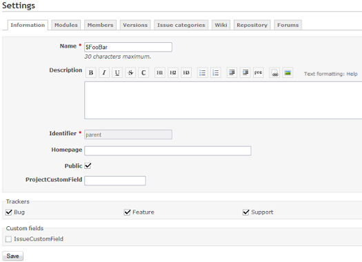

# Project Settings

Members who have necessary permissions in the project can configure the project on the projects’ settings tab.

## Information

In this screen (the **Project** tab) you can configure the basic (though important) settings for the selected project.



### General settings

The following general settings are available:

- **Name**: project display name.
- **Description**: description that appears on the project overview.
- **Identifier**: used by the application for various things (eg. in URLs). It must be unique and cannot be composed of only numbers. Once the project is created, this identifier cannot be modified.
- **Homepage**: homepage-link that appears on the [project overview](project-overview.md).
- **Public**: if checked, the project can be viewed by all the users, including those who are not members of the project. If unchecked, only the project members have access to it, according to their [role](../admin/roles.md).
- **Subproject of**: lets you define a parent project to the project being created. Projects can be unlimitedly nested.

If there are any [projects custom fields](../admin/custom-fields.md#Fields-for-Projects) configured by the administrator, they’ll show up below the “Subproject of” and “Inherit members” settings.

### Trackers

The trackers and the custom fields below are set on the **Issue tracking** tab, which is shown when the Issue tracking module is enabled. This tab also has the **Default version**, **Default assignee** and **Default issue query** of the project.

Redmine lets you define which of the [configured trackers](../admin/issue-tracking-setup.md#Trackers) (thus also their respective [workflows](../admin/issue-tracking-setup.md#Workflow)) you are able to use within this specific project.

- **Trackers**: select the trackers that you want to use for issues of the project. Only the administrator can define new trackers.

### Custom fields

- **Custom fields**: select the [issues custom fields](../admin/custom-fields.md#Fields-for-Issues) that you want to use for issues of the project. Only the administrator can define new [custom fields](../admin/custom-fields.md).

Note that some of these custom fields can be only configured (e.g. unchecked) if the issue custom field is *not* defined as a *global* issue custom field (which can be done by the administrator by checking the “For all projects” checkbox in the custom field create/edit view).

## Modules

The **Modules** section at the bottom of the **Project** tab lets you choose the modules you want to use for the project.

Disabling a module doesn’t delete the associated data. It only prevents users from accessing it. After a module was disabled, it can be re-enabled with all its data.\
You can for example disable ‘Issue tracking’ module for a single project. Existing issues are not deleted. You will be able to access them if you re-enable the module.

### Core modules

- Issue tracking: provides [Issue tracking](issues.md) feature, including [issue categories](project-settings.md#Issue-categories), [versions](project-settings.md#Versions), the [Roadmap](roadmap.md) and [version overviews](version.md)
- Time tracking: provides [Time tracking](time-tracking.md) feature
- News: provides [News](news.md) feature
- Documents: provides [Documents](documents.md) feature
- Files: provides [Files](files.md) feature
- Wiki: provides [Wiki](wikis.md) feature
- Repository: provides [Repository](repository.md) feature
- Forums: provides [Forum](forums.md) feature
- Calendar: provides [Calendar](calendar.md) feature
- Gantt: provides [Gantt](gantt.md) feature

Additional modules can be added to the system using [Redmine plugins](https://www.redmine.org/projects/redmine/wiki/Plugins). Plugins can only be installed by the administrator.

## Members

This screen lets you define project members and their roles. You can add a user or a group, with one or multiple role(s) in a given project.

## Versions

Projects versions allow you to track and plan changes. You can assign issues to versions and then view the list of assigned issues for each version on the [roadmap](roadmap.md).\
You can also assign a wikipage to a version which will be added to the [roadmap](roadmap.md) and the [version overview](version.md).

*Note: the [roadmap](roadmap.md) menu-item shows up in the project-menu only when the issue tracking [module](project-settings.md#Core-modules) is enabled for the project and at least one [version](project-settings.md#Versions) is configured in the [projects settings](project-settings.md).*

The following properties are configurable for (each of the) versions:

- **Name**: The text you want to be displayed to identify the version. *This field is required.*
- **Description**: A short description to describe the version. *This field is optional.*
- **Status**: the status lets you control how issues can be assigned to the version:
  - open: no restriction (default)
  - locked: can not assign new issues to the version
  - closed: can not assign new issues and can not reopen assigned issues
- **Wiki page**: The name of a wikipage assigned to the version. *This field is optional.*
- **Due date**: The due date for the version to be completed. *This field is optional.*
- **Sharing**: this option lets you share the version with other projects, so that issues from these other projects can be assigned to the shared versions. Each version can be shared with:
  - subprojects: all the descendant projects
  - projects in the project hierarchy: ancestors + descendants (needs versions management permission on the root project)
  - projects in the project tree: root project + all its descendants (same as above)
  - all projects (can be set by admin users only)

```
---------------------------------------------------------------------------------
| None          | Subprojects   | Hierarchy     | Tree          | All projects  |
|               |               |               |               |               |
|      X     X  |      X     X  |      o     X  |      o     X  |      o     o  |
|      |     |  |      |     |  |      |     |  |      |     |  |      |     |  |
|    --X--   X  |    --X--   X  |    --o--   X  |    --o--   X  |    --o--   o  |
|   /  |  \     |   /  |  \     |   /  |  \     |   /  |  \     |   /  |  \     |
|  X   V   X    |  X   V   X    |  X   V   X    |  o   V   o    |  o   V   o    |
|     / \       |     / \       |     / \       |     / \       |     / \       |
|    X   X      |    o   o      |    o   o      |    o   o      |    o   o      |
|   /           |   /           |   /           |   /           |   /           |
|  X            |  o            |  o            |  o            |  o            |
---------------------------------------------------------------------------------

V = project with the shared version
o = projects that can assign issues to the shared version
X = projects that can't assign issues to the shared version
```

Sharing a version of a private project with public projects will make its name visible to everyone.

From the versions list, you can click on **Close completed versions** to automatically set the status of all the completed versions (due date reached and no open issues) to *closed*.

## Issue categories

Issue categories let you to organize issues. Categories can for example correspond to the different components of your project.

You are able to configure your own set of issue categories for each individual project. It is also possible to auto-assign new issues to a specific user based on the chosen category of the newly created issues.

The following properties are configurable for (each of the) issue categories:

- **Name**: The text you want to be displayed to identify the issue category. *This field is required.*
- **Assignee**: The project member to who you want to auto-assign newly created issues in this category. *This field is optional.*

## Wiki

Each project can have its own wiki. Enable the [module](project-settings.md#Modules) on the desired project to activate it.

- **Start page**: This page is used as the start page for the wiki in both the project menu wiki link as well as in the start page link in the [wiki sidebar](wikis.md#Sidebar) (default: ‘Wiki’). To use another page as the start page, open that page, click **Rename** and check **Start page** (requires the “Manage wiki” permission).

## Repository

One or more SCM repositories can be associated with each project (**Repositories** tab). Once a repository is configured, you can browse it and view the changesets. The changesets also appear in the [Activity view](project-activity.md).\
See [the following page](../admin/repositories.md) for details about how to configure your repository in Redmine.

## Forums

Each project can have one or more discussion forums. Each forum has the following properties:

- **Name**: The text you want to be displayed to identify the discussion forum. *This field is required.*
- **Description**: A short description to describe the subject of the specific forum. *This field is required.*

## Activities (time tracking)

Among the value of time tracking activities which is registered to [Enumerations](../admin/enumerations.md) can be excluded when it is not used in the project.\
The value which is unchecked “Active” on this screen (**Time tracking** tab), it is not appear in activities options when entering time log.
