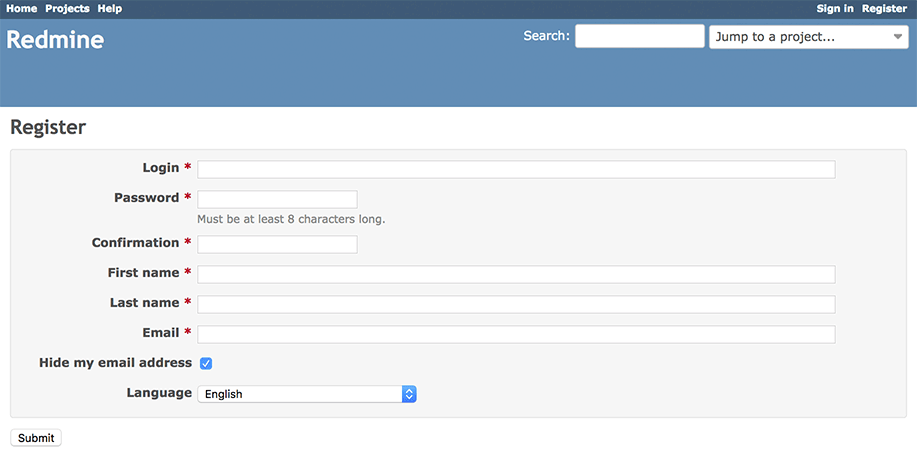
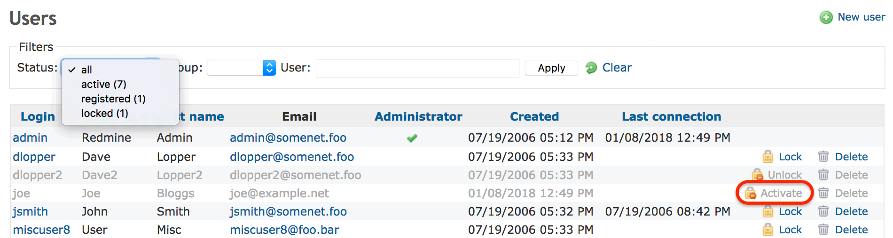

# Register

The Register page is used for self-registration of a new user. You can go to the page by clicking “Register” link at the upper-right corner on pages. Note that admin can disable self-registration. See the description of [Self-registration setting](../admin/settings.md#Self-registration).

A new user has to give the information about his ***Login***, ***Password***, ***First name***, ***Last name*** and ***Email*** address and which language the user would like to use to for the user interface.

## Registration Process

Based on the [Redmine settings](../admin/settings.md#Self-registration), the user will have to either **activate his account by email**, **wait for an administrator to validate his account** or **see his account automatically activated**.

### Account Activation by Email

After providing the information required on the Registration page, the user will receive an email to the email provided on the Registration page. By clicking on the activation link provided in the email, the user enables himself his account.

Such method is often used to prevent email spamming.

### Manual Account Activation

After providing the information required on the Registration page, the user must wait for the approval of an administrator. The administrator will enable the user account on “Administration” \> ["Users" page](../admin/users.md). When the user account is enabled, the user is allowed to login.

### Automatic Account Activation

After providing the information required on the Registration page, the user is allowed to login at any moment, no further steps are required.
