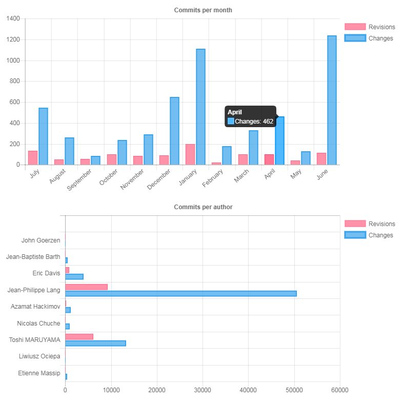

# Repository Statistics

Redmine generates two images representing the number of *Changes* and the number of *Revisions* in the configured repository. One image shows a month to month break down of *Changes* vs *Revisions*. The other image shows the number of *Changes* and *Revisions* made by each commiter.

## Definitions

- *Revisions* is a count of repository commits and is displayed in reddish/orange.
- *Changes* is a count of the number of files that have changed overall and is displayed in blue.

