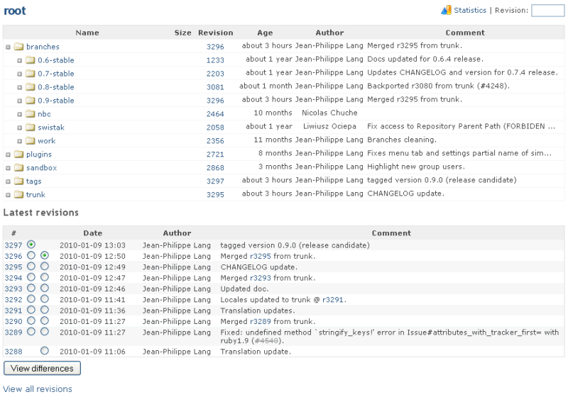

# Repository

The Repository tab lets you browse the project repository and view the latest commits.

You can expand a directory by clicking on the arrow icon in front of its name.\
You can also enter a directory by clicking on its name.

Clicking a revision number will display the details of the commit.

To browse the repository at a given revision, enter the revision number in the upper-right field and hit Enter.

