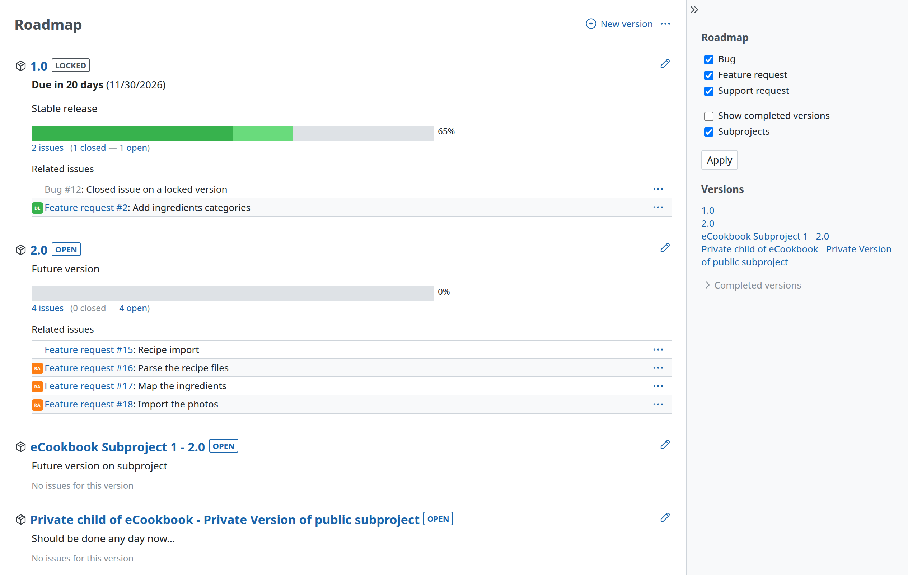

# Roadmap

The roadmap provides a highly-configurable, version-based view on the issue tracking system that helps planning and managing the development of a project. It also provides an in-depth (version-based) overview of the current state of your project.

*Note: the [roadmap](roadmap.md) menu-item shows up in the project-menu only when the issue tracking [module](project-settings.md#Core-modules) is enabled for the project and at least one [version](project-settings.md#Versions) is available to the project (configured in the [projects settings](project-settings.md) or shared with it from another project).*

## Overview

If you select the Roadmap you will get an overview of the current state of your project, like the following:

The above mentioned view contains the following “blocks” of information for all (incomplete) versions:

- the version name
- the date the version is scheduled to be complete
- a progress bar which indicates overall active/done/closed-ratio based on the %-done, estimated time and statuses of the issues targeted to the corresponding version, visualized by different color gradients
- if configured: the content of the wiki-page that has been configured to be attached to the version (see below)
- if configured: a list of all the issues assigned to the specific version (see below)

The mentioned progress bar includes drill-down links to the issue-list which preloads the specific filters thus providing quick links to open/closed issues targeted to a corresponding version. Simply click on the number left to ***open*** to see all open issues in the issue-list. If you like to know which issues are already solved/closed simply click on the number left to ***closed***.

If you click on the version itself (0.8 right from the version icon), you can get a detailed view of the current, overall state of a specific version. This is the [version-view](version.md).

### Version completion percentage

It uses estimated time to weight each issue.\
Issues with no estimated time are weighted with the average estimated time.\
If no issue are estimated, they receive the same weight.

Details [#2182](https://www.redmine.org/issues/2182)#note-6

## Managing the Roadmap

If you have the appropriate permissions you can change the Roadmap-view in two ways:

1.  You can attach a wikipage to the version (see [RedmineProjectSettings#Versions](project-settings.md#Versions)) which can be used for describing main objectives of the version etc.
2.  You can select the trackers of which individual issues, which are targetted to the corresponding version, are listed in a way that you will see an area with all related issues directly under the version. This behaviour can be changed as an administrator in the area of the [trackers](../admin/issue-tracking-setup.md#Trackers).

## Sidebar

The contextual sidebar on the right of the roadmap provides several things:

- a checkbox to include completed target-versions on the roadmap
- checkboxes and an apply-button to include/exclude issues from specific trackers on the roadmap (which trackers are shown here with checkboxes depends on the individual [tracker-configuration](../admin/issue-tracking-setup.md#Trackers))
- links to the configured target-versions of the project where each links to the roadmap itself starting with the selected target-version
