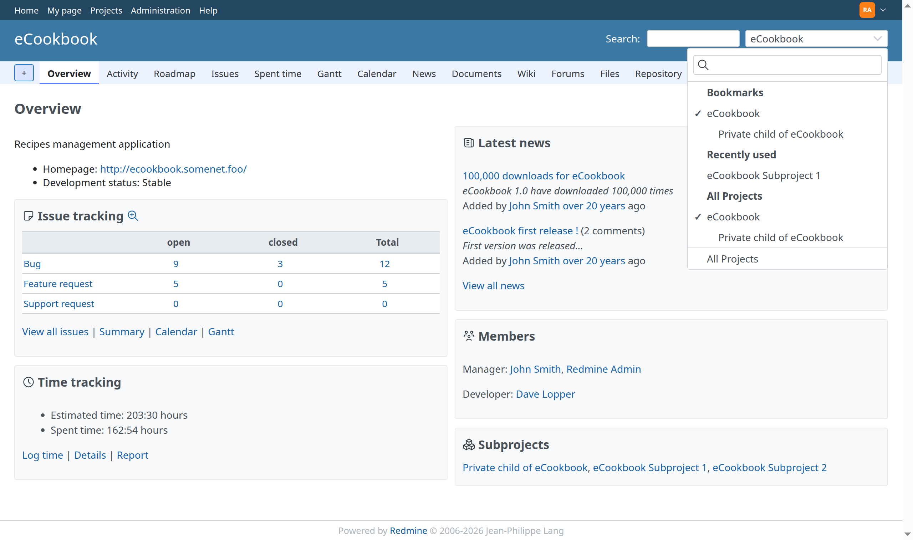
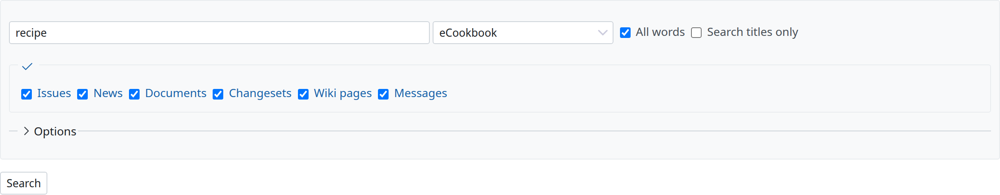
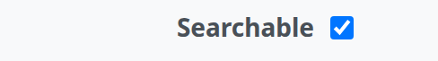
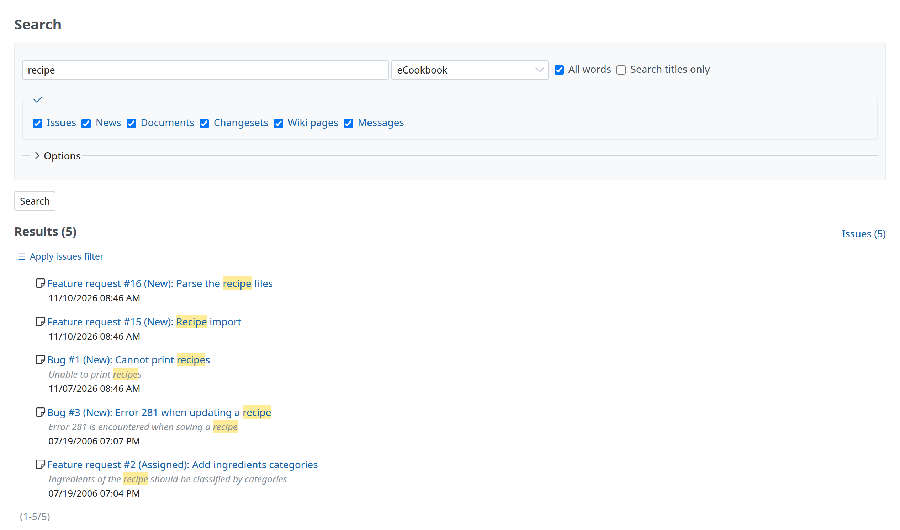

# RedmineSearch

A part of any project management process is spent looking for existing information. Enter the Redmine search capability..

## Search box

At the top right-hand side of Redmine is a simple search box. Type anything and press enter to search.

Searching for \#{IssueID} or {IssueID} will go straight to the issue. Search parameters can be enclosed in double quotation marks.

Depending on permission settings and project membership a drop down menu option may show the current project. Simple search searches full text on the project currently displayed in that chooser.

Clicking on the word **Search** will immediately take you to the advanced search and results page. Notice the project chooser has followed, and there are checkboxes to limit search to specific types of entries. The checkboxes displayed only if the module is enabled at that project level.

## Search configuration

### Search titles only

From the advanced search box, **Search titles only** can be enabled to limit results.

### Search custom fields

Custom fields are not searched by default. Don’t forget to set custom fields checkbox **Searchable** to true to also search these fields.

## Results

Here is a sample results page from this site on “test issue”.

- Many links to go to what was found.
- Unique text highlighting by search terms.
- Capability to jump to groupings of results (ie News items).
- Leading icons to categorize type of result (ie changeset, issue, comment)

## Search controller

Always check the source first:

[source:/trunk/app/controllers/search_controller.rb](https://www.redmine.org/projects/redmine/repository/svn/show/trunk/app/controllers/search_controller.rb)

A more advanced look at the controller explains some of the above behavior:

- Only searches the first 5 tokens of a search
- Tokens must be at least 2 characters long (a single Chinese/Japanese kanji character is accepted)
- Results are paginated according to the **Search results per page** setting (default 10)
