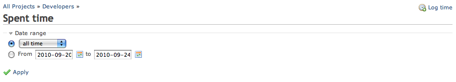
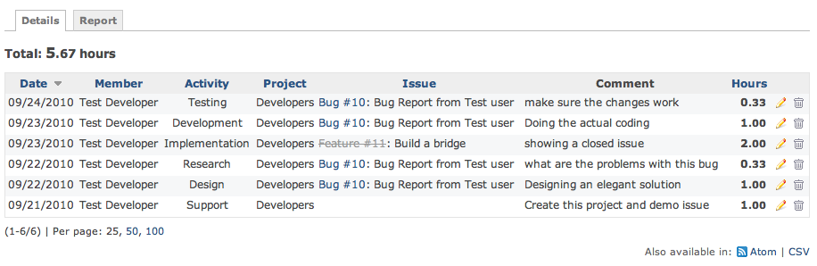

# Redmine Timelog Details

## Introduction

After building a set of time entries through Redmine the **Timelog Details** page can help show running totals of time against a project.

The **Timelog Details** page is the **Details** tab of the project’s **Spent time** menu (also linked from the **Time tracking** box of the Overview).\
Note that the timelog feature is available only when the project’s “Time tracking” module is activated.

## Searching

Shares the same search interface as [RedmineTimelogReport](timelog-report.md)

## Results

By default the detail time log shows **all time** entries in the system.

From top to bottom in the image

- Total time result of the search
- pagination table of time entries
  - sortable columns
- Atom and CSV format available

Notice the bottom line has no issue, it was logged against the project.

Links work the same as the rest of the wiki; closed issues have strike through applied to them.

### HTML output

### CSV output

A sample CSV output of the above time entries (and attached):

| Date | User | Activity | Project | Issue | Tracker | Subject | Hours | Comment |
|----|----|----|----|----|----|----|----|----|
| 09/24/2010 | Test Developer | Testing | Developers | 10 | Bug | Bug Report from Test user | 0.333333 | make sure the changes work |
| 09/23/2010 | Test Developer | Development | Developers | 10 | Bug | Bug Report from Test user | 1.0 | Doing the actual coding |
| 09/23/2010 | Test Developer | Implementation | Developers | 11 | Feature | Build a bridge | 2.0 | showing a closed issue |
| 09/22/2010 | Test Developer | Research | Developers | 10 | Bug | Bug Report from Test user | 0.333333 | what are the problems with this bug |
| 09/22/2010 | Test Developer | Design | Developers | 10 | Bug | Bug Report from Test user | 1.0 | Designing an elegant solution |
| 09/21/2010 | Test Developer | Support | Developers |  |  |  | 1.0 | Create this project and demo issue |
