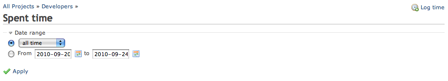
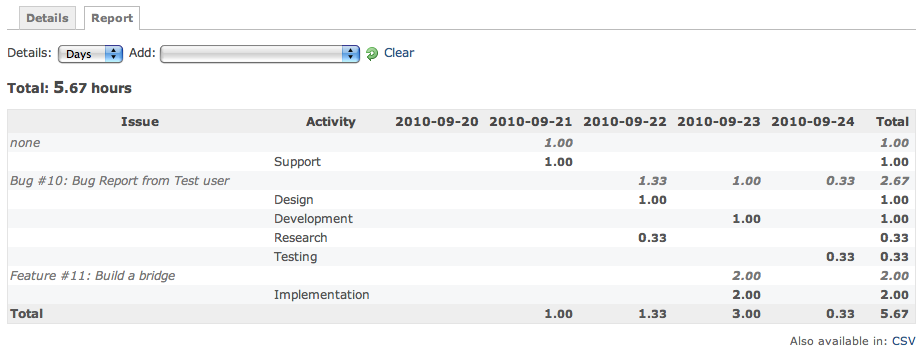

# Redmine Timelog Report

## Introduction

Time entries can be viewed at a [detailed level](timelog-details.md), but sometimes a report format is desired.

**Timelog Report** allows users to display their time grouped by categories.

The **Timelog Report** page is accessible from the Overview \> Spent Time \> Report menu.\
Note that the timelog feature is available only when the project’s “Time tracking” module is activated.

## Searching

Shares the same search interface with [RedmineTimelogDetails](timelog-details.md).

## Results

### HTML output

Using the drop down choosers this result set is based on the detailed time entries found at [RedmineTimelogDetails](timelog-details.md).

For this example **Days** is set for the **Details** parameter.

**Add** groupings to show the report; until anything is added this area will be blank. For this example first **Issue** was selected, then **Activity**. The list will always go back to blank after a selection. The drop down will disable once the maximum number of combinations are added, use the clear button to start over.

### CSV output

| Issue | Activity | 2010-09-20 | 2010-09-21 | 2010-09-22 | 2010-09-23 | 2010-09-24 | Total |
|----|----|----|----|----|----|----|----|
| none |  |  | 1.00 |  |  |  | 1.00 |
|  | Support |  | 1.00 |  |  |  | 1.00 |
| Bug \[#10](https://www.redmine.org/issues/10): Bug Report from Test user |  |  |  | 1.33 | 1.00 | 0.33 | 2.67 |
|  | Design |  |  | 1.00 |  |  | 1.00 |
|  | Development |  |  |  | 1.00 |  | 1.00 |
|  | Research |  |  | 0.33 |  |  | 0.33 |
|  | Testing |  |  |  |  | 0.33 | 0.33 |
| Feature \[#11](https://www.redmine.org/issues/11): Build a bridge |  |  |  |  | 2.00 |  | 2.00 |
|  | Implementation |  |  |  | 2.00 |  | 2.00 |
| Total |  |  | 1.00 | 1.33 | 3.00 | 0.33 | 5.67 |
