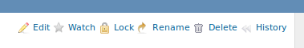
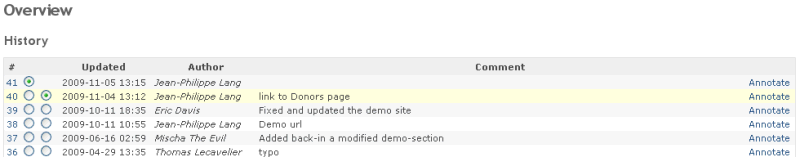
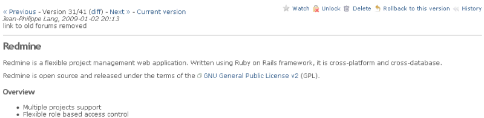

# Wikis

## Creating a new wiki page

As in every wiki, just add a link to the page you want to create.

    [MyNewWikiPage](https://www.redmine.org/projects/redmine/wiki/MyNewWikiPage)

Save the page and click on that link: you are now editing the new wiki page with the name “MyNewWikiPage”. Follow the **Edit** instructions below.

## Creating sub-pages (parent/child relationships)

It is possible to create parent/child relationships between wiki pages. This has two benefits:

- On the “Index by title”, the page tree is sorted according to the relationships:\
  \> \* Guide\
  \> RedmineAccounts\
  \> RedmineCustomFields\
  \> RedmineInstall\
  \> RedmineIssueList\
  \> RedmineIssues
- On each child page a breadcrumb is displayed showing the location of the page within the page tree:\
  TODO, add image

These relations can be set by assigning a parent page to a to-be child-page.

## Toolbar

Each wiki page has a toolbar located in the upper right corner with buttons for actions to perform on the page. Depending on the [Roles and permissions](../admin/roles.md) of the site your user might not have permission to perform some of the actions, in this case the respective button will not be displayed at all.

The actions are explained below.

### Edit

To edit the current contents of a wiki page click the **Edit** button. See [RedmineTextFormatting](text-formatting.md) for details about text annotation. The pages’s parent can be changed by using the drop down box “Parent page”.

### Watch

Clicking the **Watch** button adds you as a watcher of the page. This means you will be notified of changes to the page by email.

### Rename (or move)

To rename a wiki page or move a wiki page and its children to another project, click on the **Rename** button.

If ‘Redirect existing links’ is checked, existing links to the current page are redirected to the new wiki page when renamed or moved. Links to the children-pages move to other project are not redirected. To stop the redirection see a workaround in \[#6401](https://www.redmine.org/issues/6401)#note-8.

You can specify a parent page in ‘Parent page’.

You can move a page to another project by specifying the destination project in ‘Project’. When moving a page, each child page is also moved unless the destination project contains a page with the same name.

### Lock (protect)

Clicking the **Lock** button locks the page, and transforms the button into **Unlock**.

A locked wiki page can only be edited by users who have the permission to protect wiki pages, these users can also unlock it again by clicking **Unlock**.

### Delete

Click **Delete** to delete the wiki page. A confirmation is needed to perform the action.

### History

Redmine keeps a record of every change made to a wiki page. You can view the list of these changes by clicking on **History**.

To view a specific version of the page click on its number.

What is displayed can be misleading: `Version 31/41 (diff)` means that you are viewing version 31 out of 41, it does not mean that the diff link will show you the differences between 31 and 41. It does show you the differences between version 30 and 31. If you’re looking at version 30, you’ll see Version 30/41, and the diff will show you the changes in version 30.

If you want to see differences between 40 and 41, go to the revisions list and click ‘View changes’ (by default, it will show the diff of the last version).

You can revert a page to a previous version by clicking on **Rollback to this version**, then **Save**. In that case a new page version is created without losing the wiki page history.

If you instead do want to delete all history of a wiki page you have to copy the content of that page to a safe place (copy/paste in edit window), delete the page and re-create it with the same name. Then re-insert the copied content.

## Sidebar

The content of the wiki page named ‘`Sidebar`’ is rendered in the wiki sidebar if it exists. Permission to protect wiki pages is required to create this page.\
The contextual sidebar on the right of any wiki page provides links to:

- **Start page**: Link to the [configured start page](project-settings.md#Wiki) of the wiki
- **Index by title**: Index of all the wiki pages sorted by name (and, if [configured](wikis.md#Creating-sub-pages-parentchild-relationships), by parent/child relationships)

TODO, add image

- Index by date: Index of all the wiki pages sorted by date of last modification

TODO, add image
