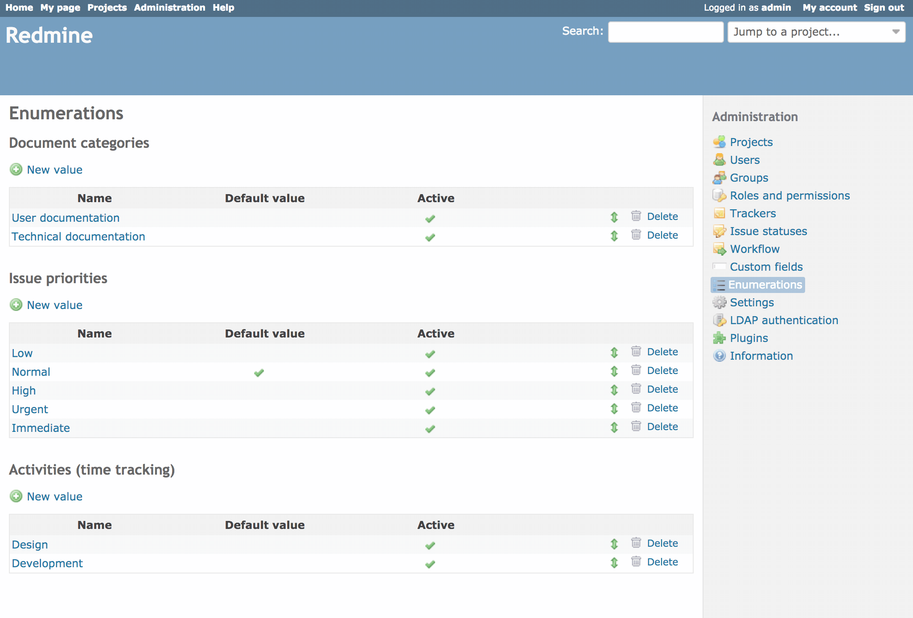

# 選択肢の値

「選択肢の値」は、Redmine のいくつかの機能で使う、全プロジェクト共通の値です。

- 「作業分類 (時間管理)」
- 「文書カテゴリ」
- 「チケットの優先度」(優先度の低いものから高いものの順に並べます)

これらの値は、自由に追加、変更、削除できます。どの値にも、選択できるかどうかを決める「有効」と、その値をデフォルトにするかどうかを決める「デフォルト値」の 2 つの設定があります。

「デフォルト値」にチェックを入れると、その値が該当する入力欄のデフォルト値になります。同じ種類(作業分類、文書カテゴリ、チケットの優先度)の値のどれもデフォルト値にしていないときは、入力欄で何も選択されていない状態になります。

