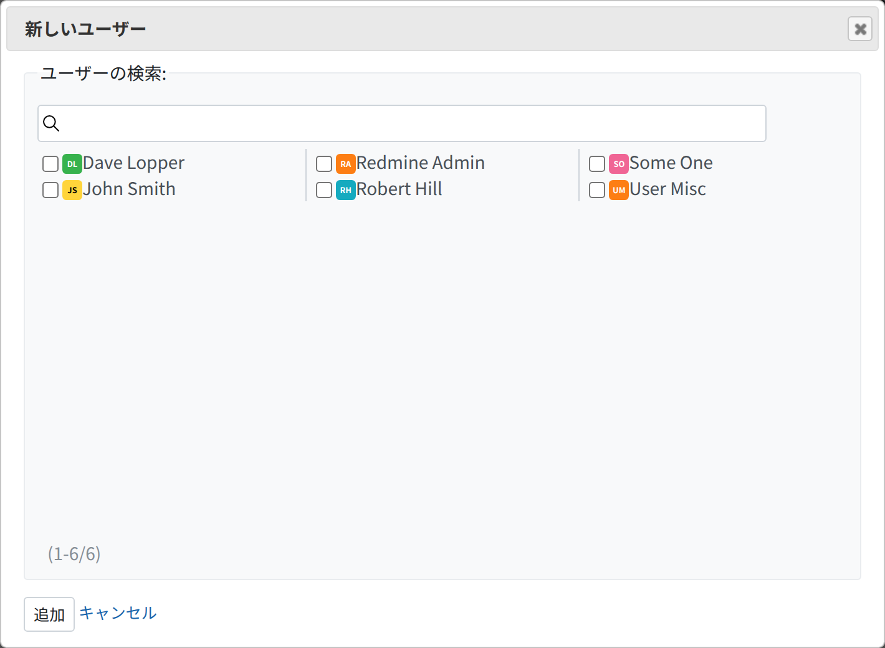
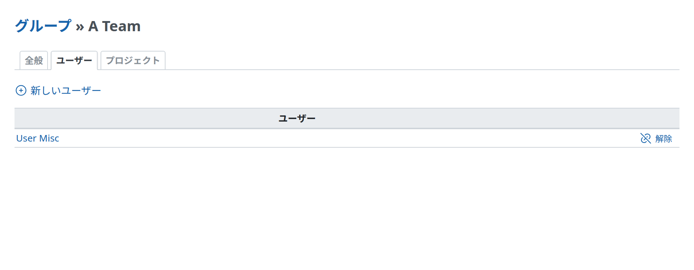
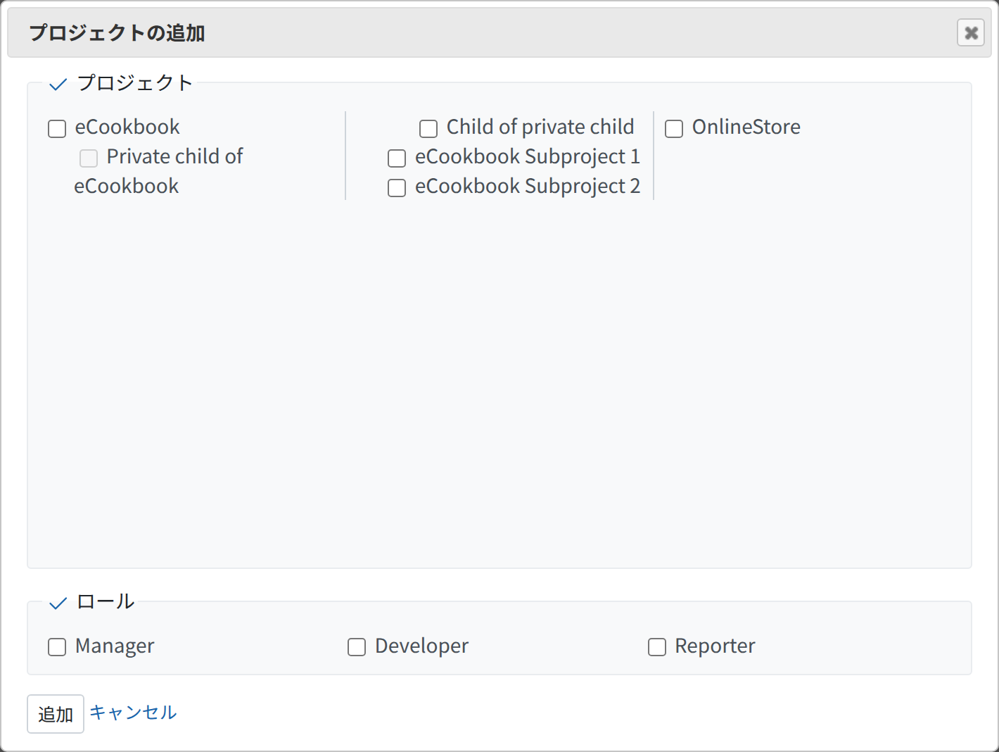
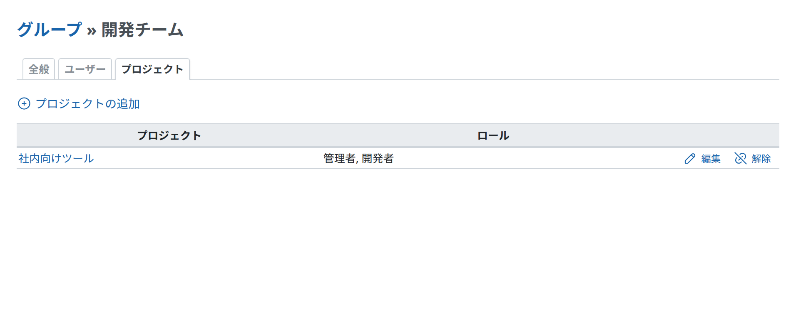

# グループ

バージョン 0.9 から、管理者は Redmine でユーザーのグループを作成できます。\
グループは、通常のユーザーと同じように、同じ[ロール](roles.md)を使ってプロジェクトのメンバーにできます。

既存のグループにユーザーを追加すると、そのユーザーはグループの権限をすべて引き継ぎます。

## グループの作成

グループを作成する手順は次のとおりです。

1.  「管理」をクリックします
2.  「グループ」をクリックします
3.  「新しいグループ」をクリックします
4.  「名称」にグループの名前を入力します
5.  「作成」をクリックします

## メンバーの追加とプロジェクトの関連付け

グループにメンバーを追加する手順は次のとおりです。

1.  「管理」 » 「グループ」を開きます
2.  変更するグループの名前をクリックします
3.  「全般」、「ユーザー」、「プロジェクト」の 3 つのタブがあります
    - 「全般」
      - 「名称」の欄を編集して、名前を変更します
    - 「ユーザー」
      - 「新しいユーザー」をクリックし、追加するユーザーのチェックボックスにチェックを入れます
      - 「追加」をクリックします
    - 「プロジェクト」
      - 「プロジェクトの追加」をクリックし、プロジェクトのチェックボックスにチェックを入れます
      - ロールのチェックボックスにチェックを入れます
      - 「追加」をクリックします

\
図 1: グループへのメンバーの追加

\
図 2: グループの「ユーザー」タブの例

\
図 3: グループの画面からのプロジェクトの関連付け

\
図 4: グループの「プロジェクト」タブの例
