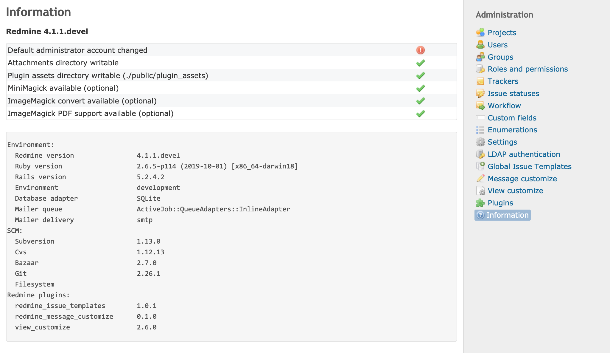

# 情報

「管理」 > 「情報」のページでは、次の 3 種類の情報を確認できます。

- Redmine のバージョン
- 重要な設定が正しく行われているかどうかを示す表
- Redmine のサーバーの環境の情報

## Redmine のバージョン

一番上に、Redmine のバージョンが表示されます。バージョン番号の後ろには「stable」か「devel」が付きます。通常は「stable」です。

「devel」は、開発中のソースコード(コントリビューターは「trunk」と呼びます)で Redmine を動かしているときに表示されます。trunk はリリースされたバージョンほど安定していないため、Redmine の開発に参加するときや、次のリリースの新しい機能を試すときだけ使ってください。本番環境で trunk を使うことはおすすめしません。

## 重要な設定の状態

Redmine のバージョンのすぐ下に、重要な設定の状態を示す表があります。問題が見つかった項目には、感嘆符( **!** )が表示されます。

### デフォルト管理アカウントが変更済

admin アカウントのパスワードが、デフォルトの「admin」から変更されているかどうかを示します。感嘆符が表示されているときは、すぐに admin アカウントのパスワードを変更してください。

### 添付ファイルディレクトリに書き込み可能

添付ファイルを保存するディレクトリに書き込めるかどうかを示します。このディレクトリのデフォルトのパスはインストール先のディレクトリの下の `files` で、`config/configuration.yml` の `attachments_storage_path` で変更できます。

感嘆符が表示されているときは、ユーザーがファイルをアップロードできません。Redmine がファイルを保存できるように、ディレクトリに書き込みの権限を設定してください。詳しくは、[「インストール」の手順 8 (ファイルシステムのパーミッション)](../install/install.md#Step-8-File-system-permissions)を参照してください。

### プラグインのアセットのディレクトリに書き込み可能

プラグインのアセットを保存するディレクトリ(インストール先のディレクトリの下の `public/plugin_assets`)に書き込めるかどうかを示します。

感嘆符が表示されているときは、プラグインをインストールまたは更新した後、Redmine の起動時に例外が発生することがあります。プラグインが使う画像や CSS を、Redmine がこのディレクトリにコピーできないためです。Redmine がファイルを保存できるように、ディレクトリに書き込みの権限を設定してください。

### MiniMagickが利用可能

画像の処理に使う MiniMagick の gem が使えるかどうかを示します。

感嘆符が表示されるのは、Redmine のインストールで bundler を実行するときに `--without minimagick` のオプションを指定した場合だけです。`--without ''` のオプションを指定して bundler をもう一度実行すると直ります。bundler について詳しくは、[「インストール」の手順 4 (依存関係のインストール)](../install/install.md#Step-4-Dependencies-installation)も参照してください。

### ImageMagickのconvertコマンドが利用可能

ImageMagick の一部である `convert` コマンドが使えるかどうかを示します。

`convert` コマンドが使えないときは、画像のサムネイルの表示やガントチャートの PNG 画像へのエクスポートなど、いくつかの機能が無効になります。ImageMagick をインストールすると直ります。ImageMagick をインストールしているのにチェックが通らないときは、`config/configuration.yml` の `imagemagick_convert_command` を設定する必要があるかもしれません。

### ImageMagickのPDFサポートが利用可能

サーバーの ImageMagick の `convert` コマンドが PDF ファイルに対応しているかどうかを示します。

使えないときは、PDF ファイルのサムネイルを表示する機能が無効になります。ImageMagick と GhostScript の両方をインストールすると直ります。

## 環境の情報

アプリケーションが動いている環境について、さまざまな情報を表示します。

プラグインの開発者や Redmine のチームなどに問題を報告するときは、この情報を含めることをおすすめします。問題を調べる手がかりになります。
