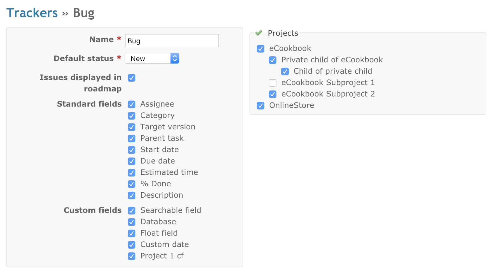
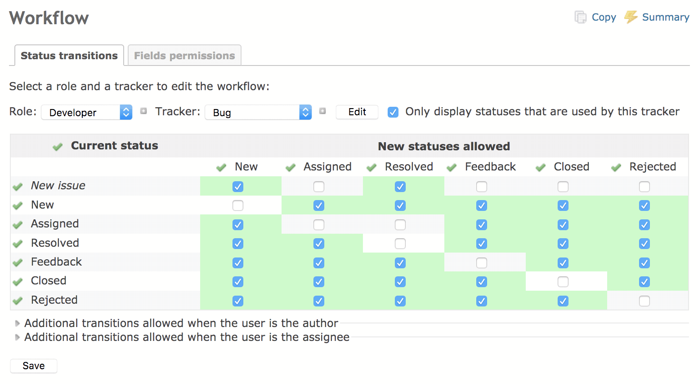
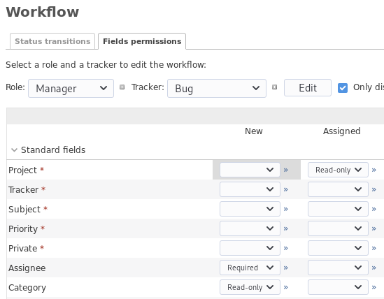

# チケットトラッキングの設定

## トラッカー

トラッカーは、チケットを種類に分けるためのものです。よく使われるのは、バグ、機能、不具合などです。

トラッカーごとに、次の項目を設定できます(下の画像を参照)。

- 名称(画像の例は「バグ」)
- デフォルトのステータス(新しいチケットにデフォルトで設定するステータス)
- このトラッカーのチケットを[ロードマップ](../user/roadmap.md)に表示するかどうか
- 別のワークフロー
- このトラッカーで使う標準フィールドとカスタムフィールド

新しいトラッカーを作成したら、正しく使えるように、そのワークフロー(下記を参照)を設定する必要があります。(手間を省くために、新しいトラッカーを作成するときに、既存のトラッカーのワークフローをコピーできます。「新しいトラッカー」の画面で、「ワークフローをここからコピー」のドロップダウンリストからトラッカーを選択します。)

## チケットのステータス

チケットのステータスは、自由に追加、削除できます。ステータスごとに、次のオプションを設定できます。

- 「終了したチケット」: このステータスのチケットを終了したものとして扱います(終了のステータスは複数設定できます)

### 進捗率

このオプション(と、チケットのステータスの一覧のその列)は、アプリケーションの設定の[「進捗率の算出方法」](settings.md#Calculate-the-issue-done-ratio)を「チケットのステータスに連動」にしているときだけ使えます。このオプションを設定すると、チケットごとに進捗率を手で入力する代わりに、割り当てたステータスに応じて進捗率が自動で更新されます。

空のままにすると、チケットをこのステータスに変更しても進捗率は変わりません。

### 進捗率の更新

このコマンドは、アプリケーションの設定の[「進捗率の算出方法」](settings.md#Calculate-the-issue-done-ratio)を「チケットのステータスに連動」にしているときだけ使えます。実行すると、すべてのチケットの進捗率を、それぞれのステータスの「進捗率」に設定した値にします。

## ワークフロー

### ステータスの遷移

ワークフローでは、プロジェクトのメンバーがチケットの種類ごとに行えるステータスの遷移を設定します。

ワークフローの設定の画面で、ワークフローを編集するロールとトラッカーを選択し、「編集」をクリックします。選択したロールとトラッカーについて、許可する遷移を選択できます。「現在のステータス」の列は、チケットの遷移前のステータスです。「遷移できるステータス」の列は、変更できるステータスです。

注: ユーザーがチケットのステータスを変更するには、「チケットの編集」か「自分が追加したチケットの編集」の権限が必要です (後者は自分が作成したチケットだけ) ([ロールと権限](roles.md)を参照)。

上の例では、「開発者」のロールは、ステータスが「新規」のバグを「Assigned」か「解決」に変更できます。「Assigned」のバグは「解決」に変更できます。そのほかのバグのステータスは、「開発者」は変更できません。

### フィールドに対する権限

このタブでは、ステータスごとに、フィールドに特別な権限を設定できます。「読み取り専用」か「必須」を選択するか、空のままにしてデフォルトの動作にします。「読み取り専用」にしたフィールドは、選択したロールの編集の画面に表示されず、変更できません。「必須」にしたフィールドは、選択したロールがチケットを編集するときに空にできません。

