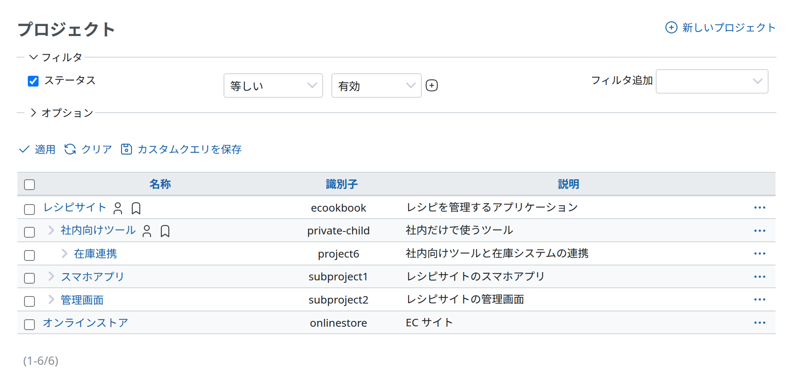
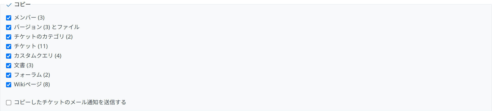

# プロジェクト

## プロジェクトの一覧

プロジェクトの一覧には、デフォルトで有効なプロジェクトがすべて表示されます。すべてのプロジェクト (有効、終了、アーカイブしたプロジェクト) を表示するには、ステータスのフィルタを外すか、フィルタですべてのステータスを選択します。なお、一般のユーザー向けのプロジェクトの一覧もあり、トップメニューの「プロジェクト」をクリックすると開きます。管理者でないユーザーも、その一覧で新しいプロジェクトを作成できます (プロジェクトの中でプロジェクトを終了することもできます)。ただし、ここで説明する管理画面のプロジェクトの一覧でできるような管理の操作はできません。[ユーザーの権限](roles.md)によっては、ここで説明するプロジェクトの一覧が、プロジェクトを管理できる唯一の場所になります。

一覧には、デフォルトで「名称」、「識別子」、「説明」の列が表示されます。「公開」や「作成日」などのほかの列は、一覧の「オプション」で追加できます。

- **名称:** プロジェクトの名前
- **識別子:** プロジェクトの識別子
- **説明:** プロジェクトの短い説明
- **公開:** ✓ のアイコンがあるプロジェクトは公開プロジェクトです。だれでもこのプロジェクトを閲覧でき、[非メンバーと匿名ユーザー](roles.md#System-roles)のロールで許可されている操作ができます。公開していないプロジェクトは、プロジェクトの管理者がアクセスを許可したユーザーだけが閲覧できます。
- **作成日:** このプロジェクトを作成した日付です。

## プロジェクトの追加と編集

[プロジェクト設定](../user/project-settings.md)を参照してください。

## プロジェクトの終了

プロジェクトを読み取り専用の状態にします。終了したプロジェクトも、通常のプロジェクトと同じように閲覧できますが、何も変更できなくなります。つまり読み取り専用です。

**プロジェクトを終了するリンクは、それぞれのプロジェクトの[「概要」](../user/project-overview.md)の画面にあります。上のプロジェクトの一覧にはありません。**

詳しくは、機能の [#3640](https://www.redmine.org/issues/3640) を参照してください。

## プロジェクトのアーカイブ

プロジェクトをアーカイブするには、プロジェクトの一覧でプロジェクトを右クリックし (または行の末尾の「操作」のボタンをクリックし)、「アーカイブ」を選択します。

アーカイブしたプロジェクトは、ユーザーからは見えなくなります。管理者は、アーカイブを解除して元の内容のまま戻せます。プロジェクトをアーカイブすると、そのサブプロジェクトもすべてアーカイブされます。

なお、プロジェクトをアーカイブしても、ストレージの使用量は減りません。プロジェクトを見えなくするだけで、圧縮はしません。

## 既存のプロジェクトのコピー

プロジェクトの一覧で、コピーするプロジェクトを右クリックし (または行の末尾の「操作」のボタンをクリックし)、「コピー」を選択します。

コピー元のプロジェクトの設定 (トラッカー、カスタムフィールドなど) が入力された状態で、新しいプロジェクトのフォームが開きます。フォームの下で、新しいプロジェクトにほかに何をコピーするかを選択できます。

## プロジェクトの削除

プロジェクトの一覧でプロジェクトを右クリックし (または行の末尾の「操作」のボタンをクリックし)、「削除」を選択します。別の画面で確認を求められ、プロジェクトの識別子を入力します。プロジェクトは削除処理待ちになり、バックグラウンドで削除されます。選択した複数のプロジェクトをまとめて削除することもできます。
