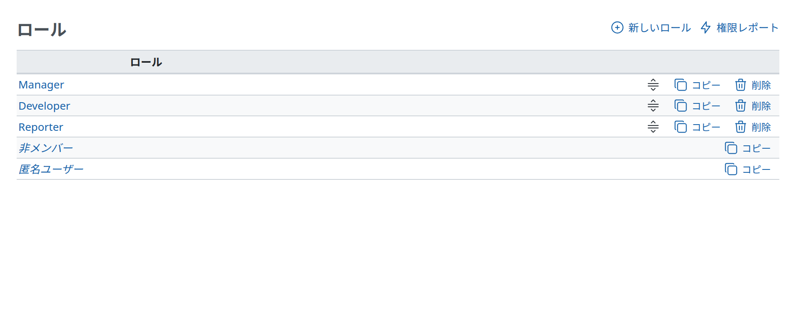

# ロールと権限

ロールは権限の集まりです。メンバーが[プロジェクト](projects.md)で持つ権限を設定します。

プロジェクトのメンバーは、そのプロジェクトで 1 つ以上のロールを持ちます。メンバーがプロジェクトで複数のロールを持つときは、すべてのロールの権限を合わせたものが、そのメンバーの権限になります。ユーザーは、プロジェクトごとに異なるロールを持てます。

新しいロールの作成や、既存のロールの編集ができます。ロールを削除できるのは、どのプロジェクトでもそのロールを持つユーザーがいないときだけです。

## ロールの設定項目

- 「名称」: ロールの表示名です。
- 「このロールのユーザーにチケットを割り当て可能」: チェックを外すと、プロジェクトでこのロールを持つメンバーを、チケットの担当者にできません。
- 「表示できるチケット」: チケットを表示できる範囲を設定します。このロールに「チケットの閲覧」の権限があるとき、このロールで参加しているプロジェクトのチケットには次のルールが適用されます。
  - 「すべてのチケット」: すべてのチケットを表示できます。
  - 「プライベートチケット以外」: プライベートに設定されていないすべてのチケットと、自分が作成者か担当者であるプライベートチケットを表示できます。これがデフォルトです。
  - 「作成者か担当者であるチケット」: 自分が作成者か担当者であるチケットだけを表示できます。
- 「表示できる作業時間」: 作業時間の記録を表示できる範囲を設定します。このロールに「作業時間の閲覧」の権限があるとき、このロールで参加しているプロジェクトの作業時間の記録には次のルールが適用されます。
  - 「すべての作業時間」: すべての作業時間の記録を表示できます。これがデフォルトです。
  - 「自分の作業時間」: 自分が作成した、または自分に割り当てられた作業時間の記録だけを表示できます。
- 「表示できるユーザー」: ユーザーを表示できる範囲を設定します (ユーザーのプロフィール、チケットのフィルタ、ウォッチャーを追加するときのユーザーの検索に適用されます)。このロールで参加しているプロジェクトのユーザーと、その外のユーザーに次のルールが適用されます。
  - 「すべてのアクティブなユーザー」: すべてのアクティブなユーザー (Redmine に登録されている有効なユーザーアカウントすべて) を表示できます。
  - 「見ることができるプロジェクトのメンバー」: 表示できるプロジェクトのメンバーのユーザーだけを表示できます。これがデフォルトです。

## 権限

ロールを編集するときに、それぞれの操作のチェックボックスのチェックを入れたり外したりして、権限を設定します。

<table>
<thead>
<tr>
<th>権限</th>
<th>説明</th>
</tr>
</thead>
<tbody>
<tr>
<td colspan="2"><strong><em>プロジェクト</em></strong></td>
</tr>
<tr>
<td>プロジェクトの追加</td>
<td>管理者でないユーザーが、最上位のプロジェクトを作成できるようにします 管理者でないユーザーがプロジェクトを作成したときに自動で割り当てるロールを指定できます (<a href="settings.md#Projects">「設定」の「プロジェクト」</a>を参照)</td>
</tr>
<tr>
<td>プロジェクトの編集</td>
<td>プロジェクトの設定を編集できるようにします</td>
</tr>
<tr>
<td>プロジェクトの終了/再開</td>
<td>プロジェクトを終了または再開できるようにします</td>
</tr>
<tr>
<td>モジュールの選択</td>
<td>プロジェクトのモジュール (チケットトラッキング、Wiki、リポジトリなど) を有効または無効にできるようにします</td>
</tr>
<tr>
<td>メンバーの管理</td>
<td>プロジェクトのメンバーを追加または削除したり、既存のメンバーのロールを変更したりできるようにします</td>
</tr>
<tr>
<td>バージョンの管理</td>
<td>プロジェクトのバージョンを追加、編集、削除できるようにします</td>
</tr>
<tr>
<td>サブプロジェクトの追加</td>
<td>プロジェクトにサブプロジェクトを追加できるようにします</td>
</tr>
<tr>
<td>公開クエリの管理</td>
<td>プロジェクトの公開クエリを保存、編集、削除できるようにします</td>
</tr>
<tr>
<td>クエリの保存</td>
<td>自分の非公開のクエリを保存、編集、削除できるようにします</td>
</tr>
<tr>
<td colspan="2"><strong><em>フォーラム</em></strong></td>
</tr>
<tr>
<td>メッセージの閲覧</td>
<td>フォーラムとフォーラムの活動を閲覧できるようにします</td>
</tr>
<tr>
<td>フォーラムの管理</td>
<td>プロジェクトのフォーラムを追加、編集、削除できるようにします</td>
</tr>
<tr>
<td>メッセージの追加</td>
<td>フォーラムに新しいトピックを投稿できるようにします</td>
</tr>
<tr>
<td>メッセージの編集</td>
<td>どのメッセージも編集でき、メッセージの添付ファイルを削除できるようにします</td>
</tr>
<tr>
<td>自分が追加したメッセージの編集</td>
<td>自分のメッセージだけを編集できるようにします</td>
</tr>
<tr>
<td>メッセージの削除</td>
<td>どのトピックや返信も削除できるようにします</td>
</tr>
<tr>
<td>自分が追加したメッセージの削除</td>
<td>自分のトピックや返信を削除できるようにします</td>
</tr>
<tr>
<td colspan="2"><strong><em>文書</em></strong></td>
</tr>
<tr>
<td>文書の追加</td>
<td>プロジェクトの文書を追加できるようにします</td>
</tr>
<tr>
<td>文書の編集</td>
<td>プロジェクトの文書を編集できるようにします</td>
</tr>
<tr>
<td>文書の削除</td>
<td>プロジェクトの文書を削除できるようにします</td>
</tr>
<tr>
<td>文書の閲覧</td>
<td>文書を閲覧できるようにします</td>
</tr>
<tr>
<td colspan="2"><strong><em>ファイル</em></strong></td>
</tr>
<tr>
<td>ファイルの管理</td>
<td>「ファイル」でプロジェクトのファイルを追加、編集、削除できるようにします</td>
</tr>
<tr>
<td>ファイルの閲覧</td>
<td>ファイルを閲覧できるようにします</td>
</tr>
<tr>
<td colspan="2"><strong><em>チケットトラッキング</em></strong></td>
</tr>
<tr>
<td>チケットのカテゴリの管理</td>
<td>チケットのカテゴリを追加、編集、削除できるようにします</td>
</tr>
<tr>
<td>チケットの閲覧</td>
<td>プロジェクトのチケットを閲覧できるようにします</td>
</tr>
<tr>
<td>チケットの追加</td>
<td>新しいチケットを作成できるようにします</td>
</tr>
<tr>
<td>チケットの編集</td>
<td>既存のチケットのすべての項目を編集できるようにします</td>
</tr>
<tr>
<td>自分が追加したチケットの編集</td>
<td>自分が作成したチケットのすべての項目を編集できるようにします</td>
</tr>
<tr>
<td>チケットのコピー</td>
<td>既存のチケットをコピーできるようにします</td>
</tr>
<tr>
<td>関連するチケットの管理</td>
<td>チケット同士の関連を追加または削除できるようにします</td>
</tr>
<tr>
<td>子チケットの管理</td>
<td>チケットに子チケットを追加または削除できるようにします</td>
</tr>
<tr>
<td>コメントの追加</td>
<td>既存のチケットにコメントを追加できるようにします</td>
</tr>
<tr>
<td>コメントの編集</td>
<td>チケットのどのコメントも編集できるようにします</td>
</tr>
<tr>
<td>自分が追加したコメントの編集</td>
<td>自分のコメントだけを編集できるようにします</td>
</tr>
<tr>
<td>チケットの削除</td>
<td>チケットを削除できるようにします</td>
</tr>
<tr>
<td>ウォッチャー一覧の閲覧</td>
<td>チケットをだれがウォッチしているかを閲覧できるようにします</td>
</tr>
<tr>
<td>ウォッチャーの追加</td>
<td>ほかのユーザーをチケットのウォッチャーに追加できるようにします</td>
</tr>
<tr>
<td>ウォッチャーの削除</td>
<td>チケットのウォッチャーを削除できるようにします</td>
</tr>
<tr>
<td colspan="2"><strong><em>ニュース</em></strong></td>
</tr>
<tr>
<td>ニュースの閲覧</td>
<td>ニュースとニュースの活動を閲覧できるようにします</td>
</tr>
<tr>
<td>ニュースの管理</td>
<td>プロジェクトのニュースを追加、編集、削除できるようにします</td>
</tr>
<tr>
<td>ニュースへのコメント</td>
<td>ニュースにコメントを追加できるようにします</td>
</tr>
<tr>
<td colspan="2"><strong><em>リポジトリ</em></strong></td>
</tr>
<tr>
<td>リポジトリの管理</td>
<td>プロジェクトのリポジトリを設定できるようにします</td>
</tr>
<tr>
<td>リポジトリの閲覧</td>
<td>プロジェクトのリポジトリの内容を閲覧できるようにします</td>
</tr>
<tr>
<td>更新履歴の閲覧</td>
<td>更新履歴を閲覧できるようにします</td>
</tr>
<tr>
<td>コミット権限</td>
<td>Redmine.pm が、プロジェクトのリポジトリへの書き込みのアクセスを許可するのに使います <a href="https://www.redmine.org/projects/redmine/wiki/Repositories_access_control_with_apache_mod_dav_svn_and_mod_perl">Repositories_access_control_with_apache_mod_dav_svn_and_mod_perl</a> を参照してください</td>
</tr>
<tr>
<td colspan="2"><strong><em>時間管理</em></strong></td>
</tr>
<tr>
<td>作業時間の記録</td>
<td>プロジェクトに作業時間を記録できるようにします</td>
</tr>
<tr>
<td>作業時間の閲覧</td>
<td>プロジェクトの作業時間の記録を閲覧できるようにします</td>
</tr>
<tr>
<td>作業時間の編集</td>
<td>どの作業時間の記録も編集できるようにします</td>
</tr>
<tr>
<td>自分の作業時間の編集</td>
<td>自分の作業時間の記録だけを編集できるようにします</td>
</tr>
<tr>
<td>作業分類 (時間管理) の管理</td>
<td>作業分類を追加、編集、削除できるようにします</td>
</tr>
<tr>
<td colspan="2"><strong><em>Wiki</em></strong></td>
</tr>
<tr>
<td>Wikiの管理</td>
<td>プロジェクトの Wiki を作成または削除できるようにします Wiki の削除は<strong>元に戻せない</strong>操作です。すべてのページ、その履歴、すべての添付ファイルが削除されます。</td>
</tr>
<tr>
<td>Wikiページ名の変更</td>
<td>既存の Wiki ページの名前を変更したり、Wiki ページの親ページを設定したりできるようにします</td>
</tr>
<tr>
<td>Wikiページの削除</td>
<td>Wiki ページを削除できるようにします Wiki ページの削除は<strong>元に戻せない</strong>操作です。ページとその履歴がすべて削除されます。</td>
</tr>
<tr>
<td>Wikiの閲覧</td>
<td>Wiki を閲覧できるようにします</td>
</tr>
<tr>
<td>Wikiページのエクスポート</td>
<td>Wiki ページをさまざまな形式 (PDF、HTML など) にエクスポートできるようにします</td>
</tr>
<tr>
<td>Wiki履歴の閲覧</td>
<td>Wiki ページの古いバージョンと、バージョン間の差分を閲覧できるようにします</td>
</tr>
<tr>
<td>Wikiページの編集</td>
<td>保護されていない Wiki ページを編集できるようにします</td>
</tr>
<tr>
<td>添付ファイルの削除</td>
<td>既存の Wiki ページの添付ファイルを削除できるようにします</td>
</tr>
<tr>
<td>Wikiページの保護</td>
<td>Wiki ページをロックまたはロック解除し、ロックしたページを編集できるようにします</td>
</tr>
<tr>
<td colspan="2"><strong><em>カレンダー</em></strong></td>
</tr>
<tr>
<td>カレンダーの閲覧</td>
<td>カレンダーを閲覧できるようにします</td>
</tr>
<tr>
<td colspan="2"><strong><em>ガントチャート</em></strong></td>
</tr>
<tr>
<td>ガントチャートの閲覧</td>
<td>ガントチャートを閲覧できるようにします</td>
</tr>
</tbody>
</table>

## 組み込みロール

Redmine には、「非メンバー」と「匿名ユーザー」の 2 つの組み込みロールがあります。Redmine が内部で使うため、削除できません。

- 「非メンバー」: 登録したユーザーが、自分がメンバーでないプロジェクトで持つ権限を設定します。
- 「匿名ユーザー」: 匿名ユーザーがプロジェクトで持つ権限を設定します。

この 2 つのロールは公開プロジェクトにだけ適用されます。匿名ユーザーや、非公開のプロジェクトのメンバーでないユーザーは、そのプロジェクトを見ることもできないためです。

「匿名ユーザー」と「非メンバー」のロールは、特定のユーザーやグループに割り当てるのではなく自動で割り当てられるため、これらのロールの権限は、その Redmine 全体で共通です。具体的には、プロジェクトごとの要件に合わせて、権限を少しずつ変えた開発者のロール (reporter1、reporter2 など) は作成できます。しかし、「匿名ユーザー」と「非メンバー」のロールを、あるプロジェクトでは非メンバーにフォーラムへのメッセージの投稿を許可し、別のプロジェクトでは許可しない、というように調整することはできません。

これらのロールには与えられない権限もあります。たとえば、「メンバーの管理」の権限は、非メンバーや匿名ユーザーには与えられません。
