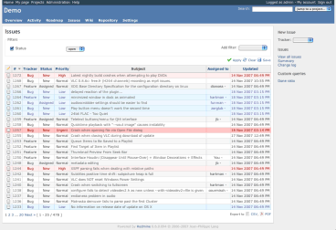

# 設定

「管理」 > 「設定」のページでは、管理者がアプリケーション全体のさまざまな設定を行えます。

## 全般

### アプリケーションのタイトル

アプリケーションのヘッダに表示するタイトルです。ログインしているときに「ホーム/マイページ/プロジェクト/ヘルプ」が並ぶ細いバーのすぐ下に表示されるリンクです。

### ウェルカムメッセージ

Redmine のホームページに表示するテキストです。

### ページごとの表示件数

1 ページに表示するオブジェクト(チケット、コミットなど)の件数として、ユーザーが選択できる値を設定します。

*デフォルト: 25, 50, 100*

### ページごとの検索結果表示件数

1 ページに表示する[検索](../user/search.md)の結果の件数です。

*デフォルト: 10*

### プロジェクトの活動ページに表示する日数

[活動](../user/project-activity.md)のタブで、プロジェクトの活動を表示する日数です(最初に表示するときと、さかのぼって表示するときの単位)。

### ホスト名とパス

Redmine のサーバーのホスト名とパスです。ユーザーに送るメールの中の URL に使います。たとえば、この Redmine のホスト名は redmine.org です。

Redmine はこの設定の値を推測し、入力欄の下に例として表示します。推測した値は、ほとんどの場合、その Redmine のサーバーに合っています。

### プロトコル

メール通知の中のリンクを作るのに使うプロトコルです。*デフォルト: http*

メールの中のリンクは「推測」で作りますが、使っている Web サーバーが暗号化なし(http)か暗号化あり(https、つまり SSL 上の http)かは判別できません。

### テキスト書式

チケット、ニュース、文書などの「説明」の欄に適用する書式です。

**なし**、**Textile**、**CommonMark Markdown (GitHub Flavored)** *<span class="default"></span>* のいずれかを選択できます。

### テキスト書式の変換結果をキャッシュ

テキスト書式は、元のテキストを HTML に変換する処理で、書式付きのテキスト(チケットの説明、Wiki ページなど)をユーザーのブラウザーに送るたびに実行されます。大きなページやテキストでは、この処理に時間がかかることがあります。

この設定で、書式を変換したテキストのキャッシュを有効にできます。

キャッシュのデータの保存先は、キャッシュストアの設定によって決まります。デフォルトのキャッシュストアは [FileStore](http://api.rubyonrails.org/classes/ActiveSupport/Cache/FileStore.html) で、キャッシュのデータをファイルとして `tmp/cache` ディレクトリに保存します。

`config/environments/production.rb` に `config.cache_store = :memory_store` のような設定を追加すると、キャッシュストアを [MemoryStore](http://api.rubyonrails.org/classes/ActiveSupport/Cache/MemoryStore.html) や [MemCacheStore](http://api.rubyonrails.org/classes/ActiveSupport/Cache/MemCacheStore.html) などに変更できます。例:

```ruby
Rails.application.configure do
  # Settings specified here will take precedence over those in config/application.rb

  config.cache_store = :memory_store

  ...
```

キャッシュストアについて詳しくは、Rails のガイドを参照してください。\
http://guides.rubyonrails.org/caching_with_rails.html#cache-stores

### Wiki履歴を圧縮する

Wiki の履歴を圧縮して保存します(データベースのサイズが小さくなります)。*デフォルト: 無効*

### Atomフィードの最大出力件数

Atom フィードに含めるレコードの最大件数です。*デフォルト: 15*

## 表示

### テーマ

カスタムのテーマを選択します。\
Redmine には、[デフォルト](https://www.redmine.org/projects/redmine/wiki/ThemeDefault)のテーマのほかに、2 つのテーマが付属しています。

- [alternate](https://www.redmine.org/projects/redmine/wiki/ThemeAlternate): 主に、チケットの優先度に応じてチケットの一覧に色を付けます。
- [classic](https://www.redmine.org/projects/redmine/wiki/ThemeClassic): Redmine 0.5.1 のデザインを元にした、*クラシック*な見た目です。

[alternate](https://www.redmine.org/projects/redmine/wiki/ThemeAlternate) のテーマのスクリーンショット:



付属のテーマは `app/assets/themes/` にあり、ほかのテーマは `themes/` にインストールします。詳しくは [Themes](https://www.redmine.org/projects/redmine/wiki/Themes) を参照してください。

### デフォルトの言語

アプリケーションがユーザーのブラウザーの言語を判別できないときに使う言語です。複数のユーザーにメールを送るときにも使います。*デフォルト: English*

### 匿名ユーザーにデフォルトの言語を強制

匿名ユーザーについて、ブラウザーの設定による言語の自動判別を無効にし、[デフォルトの言語](settings.md#Default-language)を使います。

### ログインユーザーにデフォルトの言語を強制

[個人設定](../user/accounts.md#My-account)のページの「言語」の設定を無効にし、ログインしているユーザーに[デフォルトの言語](settings.md#Default-language)を使います。

### 週の開始曜日

週の最初の曜日を選択します。

デフォルトは「ユーザーの言語の設定に従う」です。この設定では、週の最初の曜日はユーザーによって異なります。たとえば、ユーザーの言語が英語のときは、カレンダーは日曜日から始まります。

### 日付の形式

日付の表示方法を選択します。

- **ユーザーの言語の設定に従う**: ユーザーごとに、その言語で決まっている形式で日付を表示します
- **その他の形式**: 常に指定した形式で日付を表示します

*デフォルト: ユーザーの言語の設定に従う*

### 時刻の形式

時刻の表示方法を選択します。

- **ユーザーの言語の設定に従う**: ユーザーごとに、その言語で決まっている形式で時刻を表示します
- **その他の形式**: 常に指定した形式で時刻を表示します

*デフォルト: ユーザーの言語の設定に従う*

### 時間の形式

時間(予定工数、作業時間など)の表示形式を選択します。

- **0.75**: 10 進数で表示します。
- **0:45 h** *<span class="default"></span>*: 「HH:MM」の形式で表示します。

### ユーザー名の表示形式

ユーザー名の表示方法を選択します。次の組み合わせがあります。

- *名 姓*
- *名 姓の頭文字.*
- *名の頭文字. 姓*
- *名*
- *姓 名*
- *姓名*
- *姓, 名*
- *姓*
- *ユーザー名*

### Gravatarのアイコンを使用する

有効にすると、ユーザーの [Gravatar](http://en.gravatar.com/)(グローバルに使えるアバター)を、いくつかの場所に表示します。

### デフォルトのGravatarアイコン

Gravatar を持っていないユーザーに使う画像です。

### 添付ファイルのサムネイル画像を表示

有効にすると、添付ファイルの一覧の下に、添付した画像のサムネイルを表示します。

### サムネイル画像の大きさ(ピクセル単位)

「[添付ファイルのサムネイル画像を表示](settings.md#Display-attachment-thumbnails)」が有効なときの、サムネイル画像のサイズ(ピクセル)です。

*デフォルト: 100*

### 新規オブジェクト作成タブ

新しいオブジェクトを作成するタブの種類を選択します。

- **なし**: 「新しいチケット」のタブも「+」のドロップダウンも表示しません。
- **"新しいチケット" タブを表示**: Redmine 3.2 以前に表示されていた「新しいチケット」のタブを表示します。
- **"+" ドロップダウンを表示**(デフォルト): チケットや Wiki ページなど、さまざまなオブジェクトを作成できる「+」のドロップダウンを表示します。

## 認証

### 認証が必要

チェックを入れると、匿名ユーザーはアプリケーションのどのページにもアクセスできません。アプリケーションにアクセスするには、ログインする必要があります。*デフォルト: いいえ*

### 自動ログイン

ユーザーが自動ログインの機能を使えるようにします。*デフォルト: 無効*

### ユーザーによるアカウント登録

新しいユーザーが自分でアカウントを登録できるかどうかを設定します。

- **無効**: ユーザーはアカウントを登録できません。
- **メールでアカウントを有効化**: 新しいユーザーに、アカウントを有効にするリンクを含むメールが届きます(ユーザーは正しいメールアドレスを入力する必要があります)。
- **手動でアカウントを有効化** *<span class="default"></span>*: 新しいユーザーのアカウントは作成されますが、管理者の承認が必要です。管理者には、承認待ちのアカウントがあることを通知するメールが届きます。
- **自動でアカウントを有効化**: 新しいユーザーは、登録するとすぐにログインできます。

ユーザーによるアカウント登録について詳しくは、[アカウント登録](../user/register.md)を参照してください。

### アカウント登録画面でカスタムフィールドを表示

(WIP)

### パスワードの最低必要文字数

パスワードの最小の長さを、管理者が決めます。

*デフォルト: 8*

### パスワードの有効期限

有効にすると、ユーザーは定期的にパスワードを変更する必要があります。パスワードの最長の有効期間を、7 日から 365 日までの 6 つの選択肢から設定できます。

### パスワード再設定機能の使用を許可

「パスワード再設定機能の使用を許可」にチェックを入れると、[パスワードの再設定の機能](../user/accounts.md#Password-lost)を使えます。*デフォルト: はい*

### OpenID によるログインと登録を許可

Redmine 7.0.3 にはこの設定はありません。OpenID への対応は Redmine 5.0.0 で削除されました。

### セッション有効期間

有効期間の最大値: セッションの最大の有効期間を、管理者が設定します。\
無操作タイムアウト: 何時間操作がないとセッションがタイムアウトするかを、管理者が設定します。\
<span style="color:red">警告 1</span>: これらの設定を変更すると、現在のセッション(自分のセッションを含む)が期限切れになることがあります。\
<span style="color:red">警告 2</span>: Redmine は、セッションの管理に Rails の cookiestore を使います。セッションの有効期間の最大値を設定することを強くおすすめします。設定しないと、攻撃者がセッションの Cookie を盗んで再利用できる可能性が理論上あります。

## API

Redmine 7.0.3 では、このタブの名前は「連携」です。Redmine 7.0.0 で追加された「Webhookを有効にする」の設定もあります。

### RESTによるWebサービスを有効にする

(WIP)

### JSONPを有効にする

(WIP)

## プロジェクト

### デフォルトで新しいプロジェクトは公開にする

新しく作成したプロジェクトのデフォルトの状態です。プロジェクトの作成時や作成後に、非公開にすることもできます。

### 新規プロジェクトにおいてデフォルトで有効になるモジュール

(WIP)

### 新規プロジェクトにおいてデフォルトで有効になるトラッカー

(WIP)

### プロジェクト識別子を連番で生成する

Redmine が、連番のプロジェクト識別子を提案します。提案された識別子は、プロジェクトの作成時にだけ手で変更でき、作成後は変更できません。

### システム管理者以外のユーザーが作成したプロジェクトに設定するロール

管理者でないユーザーがプロジェクトを作成したときに、デフォルトで与えるロールを設定します(管理者でないユーザーがプロジェクトを作成できるように Redmine の権限を設定しているときだけ適用されます)。

## ユーザー

### 追加メールアドレス数の上限

(WIP)

### ユーザーによるアカウント削除を許可

有効にすると、ユーザーは「個人設定」のページのサイドバーにある「自分のアカウントを削除」のリンクをクリックして、自分のアカウントを削除できます。

*デフォルト: 有効*

### デフォルトのメール通知オプション

この設定は「新しいユーザーのデフォルト設定」の枠にあります。

(WIP)

## チケットトラッキング

### 異なるプロジェクトのチケット間で関連の設定を許可

「はい」にすると、異なるプロジェクトのチケットの間で関連を作成できます。*デフォルト: いいえ*

### チケットをコピーしたときに関連を設定

(WIP)

### 異なるプロジェクトのチケット間の親子関係を許可

子チケットの範囲を制限します。範囲の定義は、[プロジェクト設定の「バージョン」](../user/project-settings.md#Versions)で説明しているバージョンの共有と同じです。*デフォルト: プロジェクトツリー単位*

選択肢は次のとおりです。

- `無効`: 親チケットは、同じプロジェクトの子チケットだけを持てます。
- `すべてのプロジェクト`: 親チケットは、ほかのどのプロジェクトの子チケットも持てます。
- `プロジェクトツリー単位`: 親チケットは、同じプロジェクト、上位のプロジェクトとそのすべての下位のプロジェクト(「兄弟のプロジェクト」、「いとこのプロジェクト」なども含む)の子チケットを持てます。
- `プロジェクト階層単位`: 親チケットは、同じプロジェクト、サブプロジェクト、上位のプロジェクトの子チケットを持てます。
- `サブプロジェクト単位`: 親チケットは、同じプロジェクトかサブプロジェクトの子チケットだけを持てます(親プロジェクトや関係のないプロジェクトの子チケットは持てません)。

### 重複しているチケットを連動して終了

(WIP)

### グループへのチケット割り当てを許可

(WIP)

### 新規チケットの開始日を現在の日付とする

(WIP)

### サブプロジェクトのチケットをメインプロジェクトに表示する

「はい」にすると、メインのプロジェクトのチケットの一覧、カレンダー、ガントチャートに、デフォルトでサブプロジェクトのチケットを表示します([r1198](https://www.redmine.org/projects/redmine/repository/svn/revisions/1198) から)。*デフォルト: はい*

### 進捗率の算出方法

チケットの進捗率の設定方法を決めます。

- **チケットのフィールドを使用** *<span class="default"></span>*: ユーザーが進捗率を手で設定します。
- **チケットのステータスに連動**: チケットのステータスごとに進捗率を割り当てられます。[チケットの「進捗率」のオプション](issue-tracking-setup.md#-Done)と、[チケットのステータスの一覧の「進捗率の更新」のコマンド](issue-tracking-setup.md#Update-issue-done-ratios)が使えるようになります。

### 休業日

(WIP)

### エクスポートするチケット数の上限

CSV と PDF のエクスポートに含めるチケットの最大件数です。*デフォルト: 500*

### ガントチャート最大表示件数

(WIP)

### 親チケットの値の算出方法

(WIP)

### チケットの一覧で表示する項目

チケットの一覧にデフォルトで表示する列を設定します。

## 時間管理

### 作業時間の必須入力フィールド

(WIP)

## ファイル

### 添付ファイルサイズの上限

「添付ファイルサイズの上限」: アップロードするファイルの最大サイズ([キビバイト](http://en.wikipedia.org/wiki/Binary_prefix)単位)です。*デフォルト: 5120(つまり 5 [メビバイト](http://en.wikipedia.org/wiki/Binary_prefix))*

### 許可する拡張子

(WIP)

### 禁止する拡張子

(WIP)

### 画面表示するテキストファイルサイズの上限

画面に直接表示するテキストファイルの最大サイズを制限します。

### 差分の表示行数の上限

Redmine が表示する差分の最大行数を制限します。

### 添付ファイルとリポジトリのエンコーディング

リポジトリのファイルに使うエンコーディングを、優先する順に指定します(カンマ区切りで複数指定できます)。ブラウザーで正しく表示するために、ファイルの内容と差分を UTF-8 に変換するときに使います。\
複数のエンコーディングを入力すると、ファイルの内容に対して有効な最初のエンコーディングを使います。

フランス語のユーザーの場合の設定例:

UTF-8, ISO 8859-15, CP1252

日本語のユーザーの場合:

UTF-8, CP932, EUC-JP

## メール通知

### 送信元メールアドレス

ユーザーに送るメッセージの「From」の欄に使うメールアドレスです。

### BCC で送信

Redmine 7.0.3 にはこの設定はありません。Redmine 5.0.0 で削除されました。

### プレインテキスト形式(HTMLなし)

「はい」にすると、メールをプレーンテキストだけで送ります(HTML なし)。

### メールのヘッダ

(WIP)

### メールのフッタ

アプリケーションが送るメールの末尾に追加するテキストを入力します。

## 受信メール

これらの設定について詳しい手順は、[受信メール](receiving-emails.md)を参照してください。

### メール本文から一致する行以降を切り捨てる

受信したメールから署名を取り除くのに使います。

### 除外する添付ファイル名

(WIP)

### 受信メール用のWebサービスを有効にする

Redmine は、メールでチケットの作成やコメントの追加ができるように設定できます。この機能を使うには、メールを受け取る API を有効にする必要があります。この設定はそのためのものです。*デフォルト: オフ*

### APIキー

メールでチケットを作成したりコメントを追加したりする機能に使う、秘密のキーを入力します。

## リポジトリ

### 使用するバージョン管理システム

それぞれのプロジェクトに Redmine が「提供」するバージョン管理システムを選択(または選択解除)します。いくつかのバージョン管理システムにだけ対応するとき(たとえば Git だけ、SVN だけ)に便利です。

### コミットを自動取得する

有効にすると、ユーザーがリポジトリを閲覧したときに、アプリケーションが新しいリビジョンを自動で取得します。

*デフォルト: はい*

このオプションを無効にし、cron で Repository#fetch_changesets を呼び出すように自動化して、すべてのリポジトリのリビジョンをバックグラウンドで定期的に取得することもできます。\
例:

```text
ruby script/runner "Repository.fetch_changesets" -e production
```

Redmine 2.x の場合:

```text
ruby script/rails runner "Repository.fetch_changesets" -e production
```

Redmine 3.x の場合:

```text
bin/rails runner "Repository.fetch_changesets" -e production
```

リポジトリの post-commit や post-receive のフックからこのタスクを呼び出して、コミットのたびに、そのコミットを取得することもできます。\
Git でこれを行うチュートリアル: http://web.archive.org/web/20160523024839/http://www.barricane.com/remine-git-post-receive.html

### リポジトリ管理用のWebサービスを有効にする

SVN のリポジトリを自動で作成するスクリプトをインストールしたときだけ、有効にします。*デフォルト: いいえ*

### APIキー

リポジトリ管理用の Web サービスの秘密のキーです。

### ファイルのリビジョン表示数の上限

閲覧するパスについて、バージョン管理システムから取得するリビジョンの数を制限します。

### コミットメッセージにテキスト書式を適用

(WIP)

### コミットメッセージでのチケットの参照

リポジトリから取得したコミットメッセージから、参照または修正したチケットの ID を探します。\
これらのオプションでは、コミットメッセージでチケットを自動で参照または修正するのに使うキーワードと、修正したチケットに設定するステータスを設定します。

デフォルトのキーワードは次のとおりです。

- チケットの参照: refs, references, IssueID
- チケットの修正: なし

修正用キーワードは、参照用キーワードの下の表で、すべてのトラッカーまたはトラッカーごとに、修正したチケットに設定する「適用されるステータス」と「進捗率」とともに設定します。修正したチケットに設定するステータスには、デフォルトがありません。チケットを自動で終了するには、ステータスを指定する必要があります。\
キーワードなしでチケットを参照するには、「管理」 > 「設定」 > 「リポジトリ」の「**参照用キーワード**」の設定に、アスタリスク \* を 1 つだけ入力します。この場合、メッセージの中にあるチケットの ID はすべてそのリビジョンに関連付けられます。

デフォルトの参照用キーワードと、修正用キーワードとして設定した「fixes」を使ったコミットメッセージの例:

This commit refs \#1, \#2 and fixes \#3

このメッセージは、チケット 1 と 2 を参照し、チケット 3 を自動で修正したことにします。\
キーワードの後のチケットの ID は、空白、カンマ、& で区切れます。

キーワードは大文字と小文字を区別しません。一致させるには、キーワードと最初の # の間に、少なくとも 1 つの空白かコロンが必要です。\
上の例と同じ結果になる例を、ほかにも示します。

```text
This commit refs:#1, #2 and fixes #3
This commit Refs  #1, #2 and fixes #3
This commit REFS: #1, #2 and fixes #3
```

### コミット時に作業時間を記録する

コミットメッセージから直接、作業時間を記録できるようにします。そのプロジェクトで「時間管理」のモジュールを有効にしているときだけ意味があります。この場合、コミットメッセージに特別な語を書いて、チケットの作業時間を記録できます。

基本の構文は `@<time>` で、time は時間数か分数です。

チケット 1234 に N 時間の作業をしたことを記録する、有効なコミットメッセージの例です。

```text
Implement feature #1234 @2

Implement feature #1234 @2h

Implement feature #1234 @2hours

Implement feature #1234 @15m

Implement feature #1234 @15min

Implement feature #1234 @3h15

Implement feature #1234 @3h15m

Implement feature #1234 @3:15

Implement feature #1234 @3.25

Implement feature #1234 @3.25h

Implement feature #1234 @3,25

Implement feature #1234 @3,25h
```

### 作業時間の作業分類

コミットメッセージに作業時間の記録があったときに使う作業分類です(上記を参照)。
