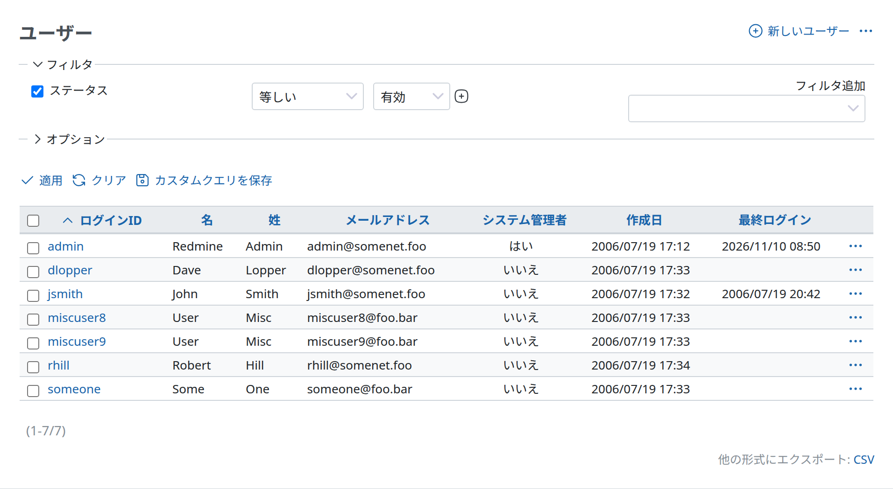

# ユーザー

## ユーザーの一覧

ユーザーの一覧には、デフォルトで有効なユーザーだけが表示されます。すべてのユーザー(有効、登録、ロック中のユーザー)を表示するには、ステータスのフィルタの演算子を「すべて」に変更するか、フィルタを外します。

- **ログインID:** ユーザーのログイン ID です。
- **名:** ユーザーの名です。
- **姓:** ユーザーの姓です。
- **メールアドレス:** ユーザーのメールアドレスです。
- **システム管理者:** ✓ のアイコンがあるユーザーは管理者です。アプリケーションとすべてのプロジェクトに、制限なくアクセスできます。
- **作成日:** このユーザーアカウントを作成した日付です。
- **最終ログイン:** このユーザーが最後にアプリケーションにログインした日付です。



### ユーザーのステータス

全体の設定によって、ユーザーには次のステータスがあります。

- **有効**
  - 🔒 のアイコンは、アカウントが有効であることを示します。有効なアカウントのユーザーは、ログインしてアプリケーションにアクセスできます。
- **ロック中**
  - 🔓 のアイコンは、アカウントがロックされていることを示します。ロックされたアカウントのユーザーは、次のようになります。
    - ログインしてアプリケーションにアクセスできない
    - チケットの担当者にできない
    - チケットのウォッチャーにできない
    - メール通知を受け取らない
    - プロジェクトの概要の画面で、プロジェクトのメンバーに表示されない
- **登録**
  - 🔓 のアイコンは、アカウントが登録済みで*有効になっていない*ことを示す場合もあります。登録しただけのアカウントのユーザーは、ログインしてアプリケーションにアクセスできません。\
    このステータスは、[アカウントを自分で登録した](settings.md#Self-registration)ユーザーに使います。このユーザーは、メールで届いたリンクを本人が開くか、Redmine の管理者が手動で、アカウントを有効にする必要があります。

「ロック」と「アンロック」のボタンで、有効なユーザーを**ロック**または**アンロック**できます。「有効にする」のボタンで、登録したユーザーを**有効にする**ことができます。

## ユーザーの認証

ユーザーは、*ログイン ID* と*パスワード*で認証します。これらは、Redmine が直接管理するほか、外部の LDAP のサーバー、または Redmine のプラグイン(たとえば、すでにある Apache の認証を使えるようにするもの)で管理できます。

参照:

- [LDAP認証](ldap.md)

## ユーザーの追加と編集

*管理者に指定したユーザーは、アプリケーションとすべてのプロジェクトに、制限なくアクセスできます。*

TODO

```text
## この説明は重要 ##
編集のときは、「パスワード」の欄を空のままにすると、ユーザーのパスワードは変わりません。

## 全体の説明に合わせ、重複しないように、この一覧を改善する ##
 * ログインID - ユーザーのログイン ID。
 * 名 - ユーザーの名。
 * 姓 - ユーザーの姓。
 * メールアドレス - プロジェクトから送られるメールを受け取る、ユーザーのメールアドレス。
 * 言語 - ユーザーの母語を設定します。
 * システム管理者 - チェックを入れると、このアカウントはアプリケーションとすべてのプロジェクトに制限なくアクセスできます。
 * 認証
 ** パスワード - 新しいパスワード
 ** パスワードの確認 - 新しいパスワードの確認
 * アカウント情報をユーザーに送信 - チェックを入れると、管理者がユーザーの情報を変更したときに、アカウント情報をユーザーのメールアドレスに送信します (有効なユーザーだけ)。
```

## ユーザーの削除

Redmine の [1.2.0](https://www.redmine.org/versions/27) より前は、Redmine からユーザーアカウントを削除できませんでした。[1.2.0](https://www.redmine.org/versions/27) から、管理者がユーザーを削除できます(#7296)。また [1.4.1](https://www.redmine.org/versions/46) 以降は、「[ユーザーによるアカウント削除を許可](settings.md#Allow-users-to-delete-their-own-account)」の設定によって、すべてのユーザーが自分のアカウントを削除できます(#10664)。\
ユーザーを削除すると、個人のデータ(ユーザーのレコード自体、保存した個人設定、ユーザーのトークンや鍵、プロジェクトのメンバーシップ、非公開のクエリなど)は削除され、公開のデータ(チケット、履歴、Wiki の編集やページ、添付ファイルなどの作成者の情報、そのほかユーザーが行った変更)は「匿名ユーザー」に割り当て直されます。ユーザーが担当していたチケットは、担当者なしになります。
