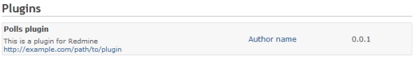
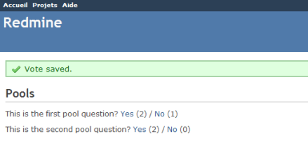
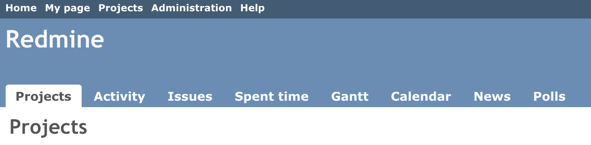
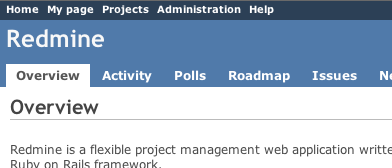
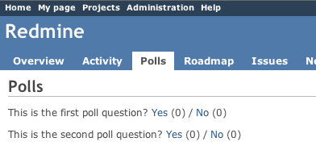
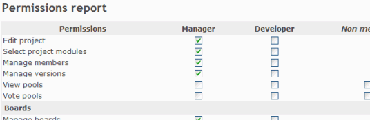
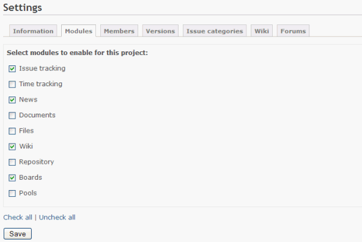
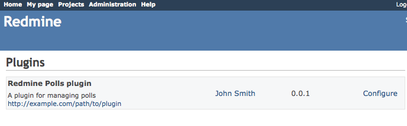
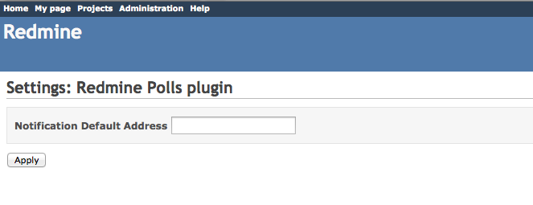

# プラグインのチュートリアル

このチュートリアルは Redmine 4.x と 3.x を前提にしています。\
以前のバージョンのチュートリアルも読めます。\
[Redmine 1.x](https://www.redmine.org/projects/redmine/wiki/Plugin_Tutorial?version=66)\
[Redmine 2.x](https://www.redmine.org/projects/redmine/wiki/Plugin_Tutorial?version=104)

Ruby on Rails のフレームワークに慣れていることを前提にしています。

## 新しいプラグインの作成

以下のコマンドを使うには、変数 RAILS_ENV を設定する必要がある場合があります。

```text
$ export RAILS_ENV="production"
```

Windows の場合:

```text
$ set RAILS_ENV=production
```

新しいプラグインは、Redmine のプラグインジェネレーターで作成できます。\
このジェネレーターの構文は次のとおりです。

```text
bundle exec rails generate redmine_plugin <plugin_name>
```

コマンドプロンプトを開いて Redmine のディレクトリに「cd」し、次のコマンドを実行します。

```text
$ bundle exec rails generate redmine_plugin Polls
      create  plugins/polls/app
      create  plugins/polls/app/controllers
      create  plugins/polls/app/helpers
      create  plugins/polls/app/models
      create  plugins/polls/app/views
      create  plugins/polls/db/migrate
      create  plugins/polls/lib/tasks
      create  plugins/polls/assets/images
      create  plugins/polls/assets/javascripts
      create  plugins/polls/assets/stylesheets
      create  plugins/polls/config/locales
      create  plugins/polls/test
      create  plugins/polls/test/fixtures
      create  plugins/polls/test/unit
      create  plugins/polls/test/functional
      create  plugins/polls/test/integration
      create  plugins/polls/test/system
      create  plugins/polls/README.rdoc
      create  plugins/polls/init.rb
      create  plugins/polls/config/routes.rb
      create  plugins/polls/config/locales/en.yml
      create  plugins/polls/test/test_helper.rb
```

プラグインの構成が `plugins/polls` に作成されます。`plugins/polls/init.rb` を編集して、プラグインの情報(名前、作者、説明、バージョン)を調整します。

```ruby
Redmine::Plugin.register :polls do
  name 'Polls plugin'
  author 'Author name'
  description 'This is a plugin for Redmine'
  version '0.0.1'
  url 'http://example.com/path/to/plugin'
  author_url 'http://example.com/about'
end
```

アプリケーションを再起動し、ブラウザで http://localhost:3000/admin/plugins を開きます。\
ログインすると、プラグインの一覧に新しいプラグインが表示されます。



注: プラグインの `init.rb` はリクエストのたびには読み込み直されないため、変更したらアプリケーションを再起動する必要があります。

## モデルの生成

今のところ、プラグインは何も保存しません。プラグインに簡単な Poll モデルを作成してみます。構文は次のとおりです。

   ```text
      bundle exec rails generate redmine_plugin_model <plugin_name> <model_name> [field[:type][:index] field[:type][:index] ...]
   ```

コマンドプロンプトで次のコマンドを実行します。

```text
$ bundle exec rails generate redmine_plugin_model polls poll question:string yes:integer no:integer
      create  plugins/polls/app/models/poll.rb
      create  plugins/polls/test/unit/poll_test.rb
      create  plugins/polls/db/migrate/xxxxxxxxxxxx_create_polls.rb
```

Poll モデルと、対応するマイグレーションのファイル `xxxxxxxxxxxx_create_polls.rb` が `plugins/polls/db/migrate` に作成されます。

```ruby
class CreatePolls < ActiveRecord::Migration[5.2]
  def change
    create_table :polls do |t|
      t.string :question
      t.integer :yes, default: 0
      t.integer :no, default: 0
    end
  end
end
```

注: Redmine 3.x では、`class CreatePolls < ActiveRecord::Migration[5.2]` は `class CreatePolls < ActiveRecord::Migration` です。

マイグレーションのファイルを調整(デフォルト値など)したら、次のコマンドでデータベースをマイグレーションします。

```text
$ bundle exec rake redmine:plugins:migrate

Migrating polls (Polls plugin)...
==  CreatePolls: migrating ====================================================
-- create_table(:polls)
   -> 0.0410s
==  CreatePolls: migrated (0.0420s) ===========================================
```

マイグレーションはプラグインごとに別に管理されることに注意してください。

作業の材料として、コンソールで Poll をいくつか追加します。コンソールでは、Redmine の環境を対話的に操作して調べられ、いろいろ試すととても参考になります。ここでは Poll のオブジェクトを 2 つ作成するだけです。

```text
bundle exec rails console
>> Poll.create(question: "Can you see this poll")
>> Poll.create(question: "And can you see this other poll")
>> exit
```

プラグインのディレクトリの `plugins/polls/app/models/poll.rb` を編集し、コントローラーから呼び出す \#vote メソッドを追加します。

```ruby
class Poll < ActiveRecord::Base
  def vote(answer)
    increment(answer == 'yes' ? :yes : :no)
  end
end
```

## コントローラーの生成

今のところ、プラグインは何もしません。プラグインのコントローラーを作成してみます。\
これにはプラグインのコントローラーのジェネレーターを使えます。構文は次のとおりです。

```text
bundle exec rails generate redmine_plugin_controller <plugin_name> <controller_name> [<actions>]
```

コマンドプロンプトに戻り、次のコマンドを実行します。

```text
$ bundle exec rails generate redmine_plugin_controller Polls polls index vote
      create  plugins/polls/app/controllers/polls_controller.rb
      create  plugins/polls/app/helpers/polls_helper.rb
      create  plugins/polls/test/functional/polls_controller_test.rb
      create  plugins/polls/app/views/polls/index.html.erb
      create  plugins/polls/app/views/polls/vote.html.erb
```

2 つのアクション(`#index` と `#vote`)を持つコントローラー `PollsController` が作成されます。

`plugins/polls/app/controllers/polls_controller.rb` を編集して、この 2 つのアクションを実装します。

```ruby
class PollsController < ApplicationController
  def index
    @polls = Poll.all
  end

  def vote
    poll = Poll.find(params[:id])
    poll.vote(params[:answer])
    if poll.save
      flash[:notice] = 'Vote saved.'
    end
    redirect_to polls_path(project_id: params[:project_id])
  end
end
```

続けて、既存の投票を表示する `plugins/polls/app/views/polls/index.html.erb` を編集します。

```erb
<h2>Polls</h2>

<% @polls.each do |poll| %>
  <p>
    <%= poll.question %>?
    <%= link_to 'Yes', { action: 'vote', id: poll[:id], answer: 'yes', project_id: @project }, method: :post %> <%= poll.yes %> /
    <%= link_to 'No', { action: 'vote', id: poll[:id], answer: 'no', project_id: @project }, method: :post %> <%= poll.no %>
  </p>
<% end %>
```

`#vote` アクションは何もレンダリングしないので、`plugins/polls/app/views/polls/vote.html.erb` は削除してかまいません。

### ルートの追加

Redmine には、デフォルトのワイルドカードのルート(`':controller/:action/:id'`)はありません。プラグインは、必要なルートを自分の `config/routes.rb` に宣言する必要があります。`plugins/polls/config/routes.rb` を編集し、2 つのアクションのための 2 つのルートを追加します。

```ruby
get 'polls', to: 'polls#index'
post 'post/:id/vote', to: 'polls#vote'
```

Rails のルートについて詳しくは http://guides.rubyonrails.org/routing.html を参照してください。

アプリケーションを再起動し、ブラウザで http://localhost:3000/polls を開きます。\
2 つの投票が表示され、投票できるはずです。



## 国際化

翻訳のファイルは config/locales に保存する必要があります。たとえば `plugins/polls/config/locales/` です。

## メニューの拡張

コントローラーは正しく動きますが、投票を見るには URL を知っている必要があります。Redmine のプラグインの API を使うと、標準のメニューを拡張できます。\
アプリケーションのメニューに新しい項目を追加してみます。

### アプリケーションのメニューの拡張

プラグインのディレクトリの直下にある `plugins/polls/init.rb` を編集し、プラグインの登録のブロックの最後に次の行を追加します。

```ruby
Redmine::Plugin.register :polls do
  [...]

  menu :application_menu, :polls, { controller: 'polls', action: 'index' }, caption: 'Polls'
end
```

構文は次のとおりです。

menu(menu_name, item_name, url, options={})

拡張できるメニューは 5 つあります。

- `:top_menu` - 左上のメニュー
- `:account_menu` - ログイン/ログアウトのリンクがある右上のメニュー
- `:application_menu` - プロジェクトの外にいるときに表示されるメインメニュー
- `:project_menu` - プロジェクトの中にいるときに表示されるメインメニュー
- `:admin_menu` - 「管理」のページに表示されるメニュー (デフォルトでは「プラグイン」の前に挿入されます)

使えるオプションは次のとおりです。

- `:param` - プロジェクトの ID に使うパラメーターのキー(デフォルトは `:id`)
- `:if` - 項目をレンダリングする前に呼び出される Proc。true を返したときだけ項目が表示されます
- `:caption` - メニューの表示名。次のどれかです。
  - 翻訳された文字列のシンボル
  - 文字列
  - プロジェクトを引数に取れる Proc
- `:before`、`:after` - メニュー項目を挿入する位置(例: `after: :activity`)
- `:first`、`:last` - true にすると、項目がメニューの先頭/末尾に固定されます(例: `last: true`)
- `:html` - メニュー項目をレンダリングするときに `link_to` に渡す HTML のオプションのハッシュ

この例では、アプリケーションのメニュー (「プロジェクト」「活動」「チケット」などがすでにあるメニュー) に項目を追加しました。\
アプリケーションを再起動し、http://localhost:3000/projects を開きます。



プロジェクトの外にいるときに表示される Polls のタブをクリックすると、投票を開けるようになりました。

### プロジェクトのメニューの拡張

次に、投票がプロジェクト単位で定義されているものとします(この例の Poll モデルはそうなっていませんが)。そこで、Polls のタブをプロジェクトのメニューに追加することにします。\
`init.rb` を開き、先ほど追加した行を次の 2 行に置き換えます。

```ruby
Redmine::Plugin.register :polls do
  [...]

  permission :polls, { polls: [:index, :vote] }, public: true
  menu :project_menu, :polls, { controller: 'polls', action: 'index' }, caption: 'Polls', after: :activity, param: :project_id
end
```

2 行目は、Polls のタブをプロジェクトのメニューの「活動」のタブの直後に追加します。1 行目は必須で、`PollsController` の 2 つのアクションが公開であることを宣言します。これについては後で詳しく説明します。アプリケーションをもう一度再起動し、プロジェクトのどれかを開きます。



Polls のタブ(3 番目)をクリックすると、プロジェクトのメニューが表示されなくなることに気づくはずです。\
プロジェクトのメニューを表示するには、コントローラーのインスタンス変数 `@project` を初期化する必要があります。

PollsController を次のように編集します。

```ruby
def index
  @project = Project.find(params[:project_id])
  @polls = Poll.all # @project.polls
end


def vote
  poll = Poll.find(params[:id])
  poll.vote(params[:answer])
  if poll.save
    flash[:notice] = 'Vote saved.'
  end
  redirect_to :action => 'index', project_id: params[:project_id]
end
```

routes.rb に次のように追加します。

```ruby
post 'projects/:project_id/post/:id/vote', to: 'polls#vote', as: 'vote_poll'
```

views/polls/index.heml.erb を次のように編集します。

```ruby
<h2>Polls</h2>

<% @polls.each do |poll| %>
  <p>
  <%= poll.question %>?
  <%= link_to 'Yes', { action: 'vote', id: poll.id, answer: 'yes', project_id: @project.id }, method: :post %> (<%= poll.yes %>) /
  <%= link_to 'No', { action: 'vote', id: poll.id, answer: 'no', project_id: @project.id }, method: :post %> (<%= poll.no %>)
  </p>
<% end %>
```

上のメニュー項目の宣言に `param: :project_id` オプションがあるため、プロジェクトの ID はパラメーター `:project_id` で取得できます。

これで、投票を表示しているときにプロジェクトのメニューが表示されます。



### メニューの項目の削除

メニューの項目を削除するには、次の例のように `delete_menu_item` を使います。

```ruby
Redmine::Plugin.register :polls do
  [...]

  delete_menu_item :top_menu, :my_page
  delete_menu_item :top_menu, :help
  delete_menu_item :project_menu, :overview
  delete_menu_item :project_menu, :activity
  delete_menu_item :project_menu, :news
end
```

## 新しい権限の追加

今のところ、誰でも投票できます。権限の宣言を変えて、設定できるようにしてみます。\
プロジェクト単位の権限を 2 つ宣言します。1 つは投票の閲覧、もう 1 つは投票のための権限です。これらの権限は公開ではなくなります(`public: true` オプションを削除します)。

`plugins/polls/init.rb` を編集し、前の権限の宣言を次の 2 行に置き換えます。

```ruby
  permission :view_polls, polls: :index
  permission :vote_polls, polls: :vote
```

アプリケーションを再起動し、http://localhost:3000/roles/permissions を開きます。



これで、既存のロールにこれらの権限を付けられるようになりました。

もちろん、現在のユーザーの権限に応じて実際にアクションを保護するには、PollsController にコードを追加する必要があります。そのためには、`:authorize` フィルターを追加し、このフィルターを呼び出す前に @project インスタンス変数が正しく設定されるようにするだけです。

`#index` アクションの場合は次のようになります。

```ruby
class PollsController < ApplicationController
  before_action :find_project, :authorize, only: [:index, :vote]

  [...]

  def index
    @polls = Poll.all # @project.polls
  end

  [...]

  private

  def find_project
    # @project variable must be set before calling the authorize filter
    @project = Project.find(params[:project_id])
  end
end
```

`#vote` アクションの前に現在のプロジェクトを取得するのも、同じようにできます。\
これで、投票の閲覧と投票は、管理者か、プロジェクトで適切なロールを持つユーザーだけができるようになります。

権限のシンボルを多言語で表示するには、言語ファイルに必要なラベルを追加する必要があります。\
`plugins/polls/config/locales` に \*.yml ファイル(例: `en.yml`)を作成し、次のようにラベルを書きます。

```yaml
"en":
  permission_view_polls: View Polls
  permission_vote_polls: Vote Polls
```

この例では `en.yml` というファイルを作成しましたが、ほかの対応言語のファイルも同じように作成できます。\
上の例のとおり、ラベルは権限のシンボル `:view_polls` と `:vote_polls` の前に `permission_` を付けたものです。

アプリケーションを再起動し、権限の欄を開きます。

## プロジェクトのモジュールの作成

今のところ、投票の機能はすべてのプロジェクトに追加されています。しかし、一部のプロジェクトだけで投票を有効にしたい場合もあるでしょう。\
そこで、「Polls」というプロジェクトのモジュールを作成します。これには、権限の宣言を `#project_module` の呼び出しで囲みます。

`init.rb` を編集し、権限の宣言を変えます。

```ruby
  project_module :polls do
    permission :view_polls, polls: :index
    permission :vote_polls, polls: :vote
  end
```

アプリケーションを再起動し、プロジェクトのどれかの設定を開きます。\
「モジュール」のタブをクリックすると、モジュールの一覧の最後に Polls のモジュールが表示されます(デフォルトでは無効です)。



これで、プロジェクト単位で投票を有効/無効にできます。

## プラグインのビューの改善

### スタイルシートの追加

まず、プラグインのビューにスタイルシートを追加します。\
`plugins/polls/assets/stylesheets` ディレクトリに `voting.css` というファイルを作成します。

```css
a.vote { font-size: 120%; }
a.vote.yes { color: green; }
a.vote.no  { color: red; }
```

プラグインのアセットは、アセットパイプライン (Propshaft) によって `plugin_assets/polls/` のパスで配信されます。本番環境では、Redmine は起動時にアセットの変更を検出すると、アセットを `public/assets` にコンパイルします (`bin/rails assets:precompile` でもコンパイルできます)。そのため、プラグインのスタイルシートや JavaScript を変更したら、アプリケーションの再起動が必要です。

追加したクラスはリンクで使う必要があります。`plugins/polls/app/views/polls/index.html.erb` のリンクの宣言を次のように変えます。

```erb
<%= link_to 'Yes', {action: 'vote', id: poll[:id], answer: 'yes', project_id: @project }, method: :post, class: 'vote yes' %> (<%= poll.yes %>)
<%= link_to 'No', {action: 'vote', id: poll[:id], answer: 'no', project_id: @project }, method: :post, class: 'vote no' %> (<%= poll.no %>)
```

続けて、Redmine がスタイルシートをページのヘッダーに含めるように、`index.html.erb` の末尾に次の行を追加します。

```erb
<% content_for :header_tags do %>
    <%= stylesheet_link_tag 'voting', plugin: 'polls' %>
<% end %>
```

`stylesheet_link_tag` ヘルパーを呼び出すときは、`plugin: 'polls'` オプションが必要なことに注意してください。

JavaScript も、同じように `javascript_include_tag` ヘルパーでプラグインのビューに含められます。

### ページのタイトルの設定

ビューの中で `html_title` ヘルパーを使うと、HTML のタイトルを設定できます。\
例:

```erb
  <% html_title "Polls" %>
```

## フックの利用

### ビューのフック

Redmine のビューのフックを使うと、Redmine の通常のビューに独自の内容を挿入できます。たとえば [source:tags/2.0.0/app/views/projects/show.html.erb#L52](https://www.redmine.org/projects/redmine/repository/svn/show/tags/2.0.0/app/views/projects/show.html.erb#L52) を見ると、2 つのフックがあることがわかります。ビューの左側に内容を追加する `:view_projects_show_left` と、右側に内容を追加する `:view_projects_show_right` です。

ビューで 1 つ以上のフックを使うには、`Redmine::Hook::ViewListener` を継承したクラスを作成し、使うフックの名前のメソッドを実装します。プロジェクトの概要に内容を追加するには、プラグインにクラスを追加して `init.rb` で require し、フックの名前と同じ名前のメソッドを実装します。

このプラグインでは、次の内容で `plugins/polls/lib/polls_hook_listener.rb` を作成します。

```ruby
class PollsHookListener < Redmine::Hook::ViewListener
  def view_projects_show_left(context = {})
    return content_tag("p", "Custom content added to the left")
  end

  def view_projects_show_right(context = {})
    return content_tag("p", "Custom content added to the right")
  end
end
```

`plugins/polls/init.rb` の先頭に次の行を追加します。

```ruby
require_dependency File.expand_path('../lib/polls_hook_listener', __FILE__)
```

Redmine を再起動し、プロジェクトの「概要」のタブを開きます。概要の左側と右側に文字列が表示されるはずです。

`render_on` ヘルパーでパーシャルをレンダリングすることもできます。このプラグインでは、先ほど作成した `plugins/polls/lib/polls_hook_listener.rb` の内容を次のように置き換えます。

```ruby
class PollsHookListener < Redmine::Hook::ViewListener
  render_on :view_projects_show_left, partial: "polls/project_overview"
end
```

`app/views/polls/_project_overview.html.erb` を作成して、プラグインにパーシャルを追加します。その内容(「Message from Hook!」などの文字列)が、プロジェクトの概要の左側に追加されます。Redmine の再起動を忘れないでください。

### コントローラーのフック

TODO

## プラグインを設定できるようにする

Redmine に登録したプラグインは、それぞれ admin/plugins のページに表示されます。基本的な設定の仕組みは、Settings コントローラーが提供しています。この機能は、プラグインの init.rb にあるプラグインの登録のブロックに「settings」メソッドを追加すると有効になります。

```ruby
Redmine::Plugin.register :polls do
  [ ... ]

  settings default: {'empty' => true}, partial: 'settings/poll_settings'
end
```

これを追加すると、2 つのことが起きます。まず、admin/plugins の一覧のプラグインの説明に「設定」のリンクが追加されます。このリンクを開くと、プラグインの共通の設定のテンプレートのビューが読み込まれ、その中で :partial で指定したパーシャルのビューがレンダリングされます。また、settings メソッドを呼び出すと、Setting モジュールがプラグインに対応します。Setting モデルは、プラグインの名前に基づいて、シリアライズしたハッシュを保存・取得します。このハッシュには、plugin\_\<plugin name\> という形の Setting のメソッド名でアクセスします。この例では、Setting.plugin_polls を呼び出してハッシュにアクセスできます。



settings メソッドに渡した :partial のキーで指定したビューは、プラグインの設定のビューの中にパーシャルとして読み込まれます。ページの基本のレイアウトは、プラグインの設定のビューで決まっています。フォームが宣言され、送信のボタンが生成されます。パーシャルは、フォームの中の table の div の中に読み込まれます。プラグインの設定は、標準の HTML のフォームの要素で表示・変更できます。



**注**: 2 つのプラグインが設定に同じ名前のパーシャルを使うと、1 つ目のプラグインが 2 つ目のプラグインの設定のページを上書きします。設定のパーシャルには、必ず重複しない名前を付けてください。

ページが送信されると、settings_controller は「settings」で参照されるパラメーターのハッシュを受け取り、シリアライズした形式で Setting.plugin_polls にそのまま保存します。ページを生成するたびに、Setting.plugin_polls の現在の値がローカル変数 settings に代入されます。

`plugins/polls/app/views/settings/_poll_settings.erb` というファイルを作成し、次の内容を書きます。

```erb
<table>
  <tbody>
    <tr>
      <th>Notification Default Address</th>
      <td>
        <input type="text" id="settings_notification_default"
                           value="<%= settings['notification_default'] %>"
	                       name="settings[notification_default]" >
      </td>
    </tr>
  </tbody>
</table>
```

上の例では、設定のフォームを Rails のフォームヘルパーで作成していません。`@settings` というモデルはなく、設定のハッシュしかないためです。フォームヘルパーは、存在しないモデルのアクセサーメソッドで属性にアクセスしようとします。たとえば `@settings.notification_default` の呼び出しは失敗します。このフォームで設定した値には、Setting.plugin_polls\['notification_default'\] でアクセスします。

最後に、settings メソッドの呼び出しにある :default は、このプラグインの設定がまだ settings テーブルに保存されていないときに、Setting.plugin_polls の呼び出しが返す値を登録するものです。

## プラグインのテスト

### plugins/polls/test/test_helper.rb

筆者のテストヘルパーのファイルの内容です。

```text
require File.expand_path(File.dirname(__FILE__) + '/../../../test/test_helper')
```

### テストの例

Redmine 4.x の `plugins/polls/test/functional/polls_controller_test.rb` の内容:

```ruby
require File.expand_path('../../test_helper', __FILE__)

class PollsControllerTest < ActionController::TestCase
  fixtures :projects

  def test_index
    get :index, params: { project_id: 1 }

    assert_response :success
    assert_select 'h2', :text => 'Polls'
  end
end
```

Redmine 3.x の `plugins/polls/test/functional/polls_controller_test.rb` の内容:

```ruby
require File.expand_path('../../test_helper', __FILE__)

class PollsControllerTest < ActionController::TestCase
  fixtures :projects

  def test_index
    get :index, project_id: 1

    assert_response :success
    assert_template 'index'
  end
end
```

### テストの実行

必要であれば、テスト用のデータベースを初期化します。

```text
$ RAILS_ENV=test bundle exec rake db:drop db:create db:migrate redmine:plugins:migrate redmine:load_default_data
```

polls_controller_test.rb を実行するには、次のコマンドを実行します。

```text
$ RAILS_ENV=test bundle exec rake test TEST=plugins/polls/test/functional/polls_controller_test.rb
```

### 権限を使うテスト

プラグインでプロジェクトのメンバーであることが必要な場合は、機能テストの最初に次の行を追加します。

```ruby
def test_index
  @request.session[:user_id] = 2
  ...
end
```

プラグインで特定の権限が必要な場合は、次のようにユーザーのロールに権限を追加できます(ユーザーにどのロールが適切かは、フィクスチャーで確認してください)。

```ruby
def test_index
  Role.find(1).add_permission! :my_permission
  ...
end
```

特定のモジュールは、次のように有効/無効にできます。

```ruby
def test_index
  Project.find(1).enabled_module_names = [:mymodule]
  ...
end
```

### ファイル構成の参考

このチュートリアルと[フック](hooks.md)で触れたファイルとディレクトリの一覧です。標準のパスを使っているか確認するのに役立ち、初めての人がファイルをどこに置けばよいかを知るのにも役立ちます。

```text
plugins/PLUGIN/README.rdoc
plugins/PLUGIN/init.rb
plugins/PLUGIN/app/
plugins/PLUGIN/app/controllers/
plugins/PLUGIN/app/controllers/CONTROLLER_controller.rb
plugins/PLUGIN/app/helpers/
plugins/PLUGIN/app/helpers/CONTROLLER_helper.rb
plugins/PLUGIN/app/models/
plugins/PLUGIN/app/models/MODEL.rb
plugins/PLUGIN/app/views/
plugins/PLUGIN/app/views/CONTROLLER/
plugins/PLUGIN/app/views/CONTROLLER/_PARTIAL.html.erb
plugins/PLUGIN/app/views/CONTROLLER/CONTROLLER-ACTION.html.erb
plugins/PLUGIN/app/views/hooks/
plugins/PLUGIN/app/views/hooks/_HOOK.html.erb
plugins/PLUGIN/app/views/settings/
plugins/PLUGIN/app/views/settings/_MODEL_settings.html.erb
plugins/PLUGIN/assets/
plugins/PLUGIN/assets/images/
plugins/PLUGIN/assets/javascripts/
plugins/PLUGIN/assets/stylesheets/
plugins/PLUGIN/assets/stylesheets/voting.css
plugins/PLUGIN/config/
plugins/PLUGIN/config/locales/
plugins/PLUGIN/config/locales/en.yml
plugins/PLUGIN/config/routes.rb
plugins/PLUGIN/db/
plugins/PLUGIN/db/migrate/
plugins/PLUGIN/db/migrate/001_create_MODELs.rb
plugins/PLUGIN/lib/
plugins/PLUGIN/lib/PLUGIN_hook_listener.rb
plugins/PLUGIN/lib/PLUGIN/
plugins/PLUGIN/lib/PLUGIN/hooks.rb
plugins/PLUGIN/lib/PLUGIN/MODEL_patch.rb
plugins/PLUGIN/lib/tasks/
plugins/PLUGIN/test/
plugins/PLUGIN/test/test_helper.rb
plugins/PLUGIN/test/functional/
plugins/PLUGIN/test/functional/CONTROLLER_controller_test.rb
plugins/PLUGIN/test/unit/
plugins/PLUGIN/test/unit/MODEL_test.rb
```
