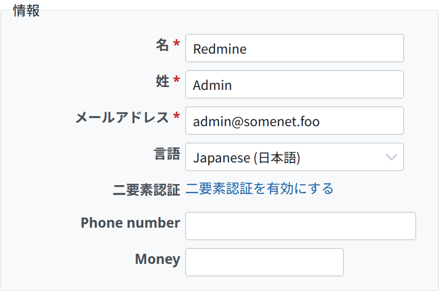
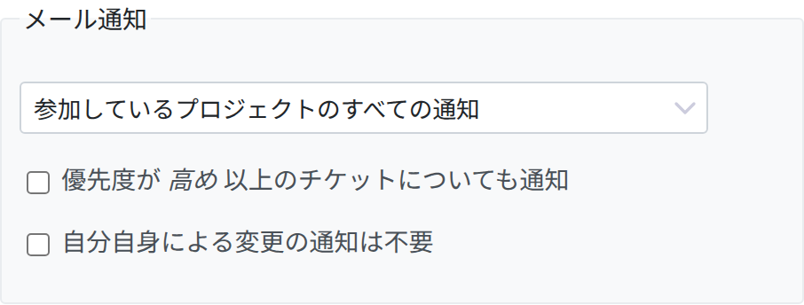
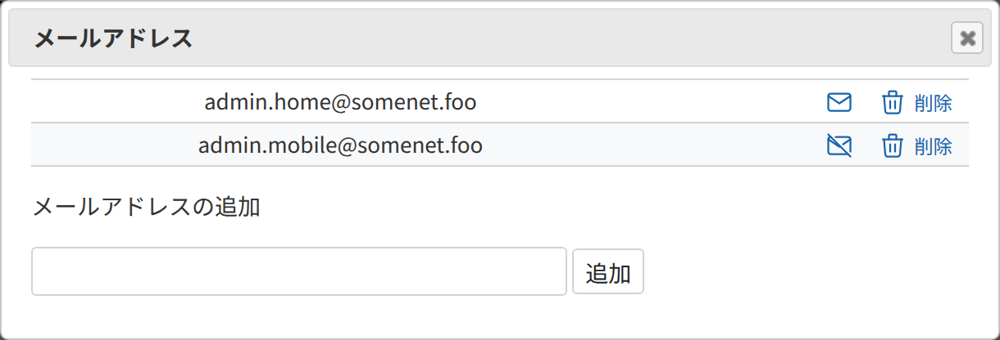
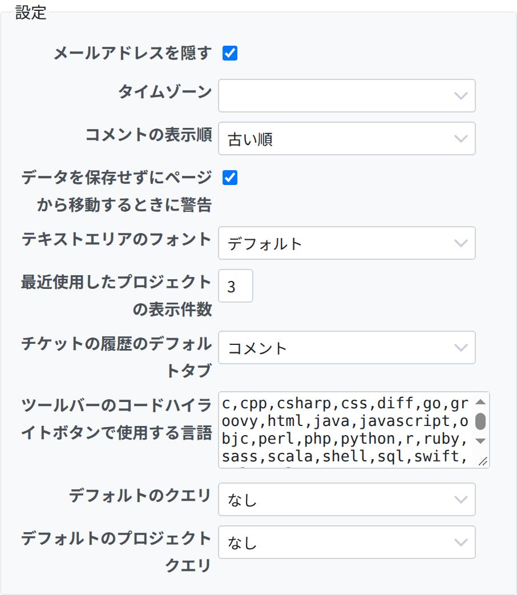
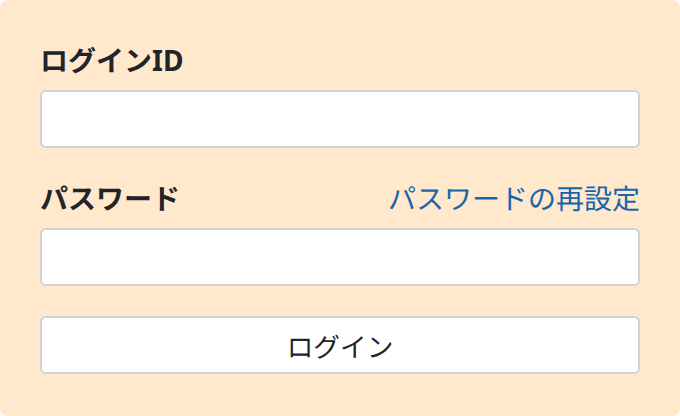

# アカウント

ドイツ語の[リビジョン 10](http://www.redmine.org/projects/redmine/wiki/DeRedmineAccounts/10)からの逆翻訳です。

# アカウント

## 個人設定

ここでは、自分のアカウントを必要に合わせて変更できます。

### 情報

名、姓、メールアドレス、表示する言語など、自分のユーザーの情報を編集できます。\
バージョン 4.2.0 から、システムの設定で有効になっていれば (選択肢: 「無効」/「任意」/「システム管理者のみ必須」/「必須」)、二要素認証を有効にして、アクセスのセキュリティを高められます。

### メール通知

ユーザーは、メンバーになっているプロジェクトの通知を受け取ります。チケットをウォッチすると、通知の設定にかかわらず、そのチケットの通知を受け取れます。通知のメールは受信者ごとに別々に送られ、受信者のメールアドレスは `To` のフィールドに入ります。\
次のどれかを選べます。

<table>
<tbody>
<tr>
<td><strong>参加しているプロジェクトのすべての通知</strong></td>
<td>プロジェクトのすべてのイベントの通知を受け取ります。絞り込みはしません。</td>
</tr>
<tr>
<td><strong>選択したプロジェクトのすべての通知...</strong></td>
<td>選択したプロジェクトのすべてのイベントの通知を受け取ります。選択していないプロジェクトでは、「ウォッチ中または自分が関係しているもの」と同じです。 
<em>注: この一覧には、ユーザーがメンバーになっているプロジェクトだけが表示されます</em></td>
</tr>
<tr>
<td><strong>ウォッチ中または自分が関係しているもの</strong></td>
<td>ユーザーが作成したチケット、ユーザーが担当しているチケット、以前にユーザーが担当していたチケットについてのイベントを通知します</td>
</tr>
<tr>
<td><strong>ウォッチ中または自分が担当しているもの</strong></td>
<td>ユーザーが担当しているチケット、以前にユーザーが担当していたチケットについてのイベントを通知します</td>
</tr>
<tr>
<td><strong>ウォッチ中または自分が作成したもの</strong></td>
<td>ユーザーが作成したチケットについてのイベントを通知します 
<em>注: チケットがユーザーの担当になっていても、そのチケットをウォッチしていなければ通知は届きません。</em></td>
</tr>
<tr>
<td><strong>ウォッチ中のもの</strong></td>
<td>ユーザーがウォッチしているチケットについてのイベントだけを通知します</td>
</tr>
<tr>
<td><strong>通知しない</strong></td>
<td>イベントをまったく通知しません。個々のチケットのウォッチと組み合わせると、選んだものの通知だけを受け取れます。</td>
</tr>
</tbody>
</table>

バージョン 4.2.0 から、上で選んだ選択肢にかかわらず、自分のプロジェクトで優先度が高い (またはそれより高い) すべてのチケットについても通知を受け取るかどうかを選べます。\
自分自身による変更の通知を受け取らないように、チェックを入れることもできます。

### メールアドレス

通知の送信先として、ほかのメールアドレスを登録できます。登録するには、リンク  をクリックします。

表示されるウィンドウで、ほかのメールアドレスを入力したり削除したり、通知を無効または有効にしたりできます。

### 設定

Redmine の表示についての個人の設定です。

- **メールアドレスを隠す:** プロフィールのページでメールアドレスを隠し、ほかのユーザーから見えないようにします。
- **タイムゾーン:** Redmine のデフォルトの設定と違うタイムゾーンを選べます。日付と時刻は、このタイムゾーンで表示されます。
- **コメントの表示順:** コメントを時系列でどちらの順に並べるかを決めます。
- **データを保存せずにページから移動するときに警告:** データの消失を防ぐための設定です。
- **テキストエリアのフォント:** 標準のフォントの代わりに、あらかじめ用意したプロポーショナルフォントまたは等幅フォントを使うように指定できます。
- **最近使用したプロジェクトの表示件数:** 「プロジェクトへ移動...」で、標準の一覧の上に、最近使用したプロジェクトをいくつ表示するかを指定できます。デフォルトは 3 です。
- **チケットの履歴のデフォルトタブ:** チケットの詳しい内容はタブに分かれています。チケットを開いたときにどのタブを表示するかを指定できます。デフォルトは「コメント」です。
- **ツールバーのコードハイライトボタンで使用する言語**: どのプログラミング言語を認識して、その言語として解析するかを指定します。デフォルト: ` c, cpp, csharp, css, diff, go, groovy, html, java, javascript, objc, perl, php, python, r, ruby, sass, scala, shell, sql, swift, xml, yaml `
- **デフォルトのクエリ:** クエリを選ばずにチケットの一覧を開いたときに適用するクエリです。
- **デフォルトのプロジェクトクエリ:** クエリを選ばずにプロジェクトの一覧を開いたときに適用するクエリです。

### パスワード

パスワードを変更するには、「個人設定」のページで  をクリックし、現在のパスワードと、新しいパスワードを 2 回入力します。パスワードは 8 文字以上にする必要があります (最低の文字数は管理者が変更できます。[「設定」の「パスワードの最低必要文字数」](../admin/settings.md#Minimum-password-length)を参照してください)。

アカウントが外部の認証方式 (LDAP) を使っている場合は、Redmine でパスワードを変更できません。

## パスワードの再設定

パスワードを忘れたときは、次の手順で新しいパスワードを設定できます。

[ログイン](login.md)の画面で「パスワードの再設定」をクリックします。メールアドレスを入力して、フォームを送信します。メールが届きます。メールには、パスワードを変更するためのリンクがあります。

この機能は、管理者が無効にできます ([「設定」の「パスワード再設定機能の使用を許可」](../admin/settings.md#Lost-password)を参照)。また、アカウントが外部の認証方式 (LDAP) を使っている場合は、この手順は使えません。

## アカウント登録

アカウントを登録すると、管理者の手を借りずにアカウントを作れます。

[ログイン](login.md)の画面の右上で「登録する」をクリックします。フォームに入力して送信します。メールが届きます。アカウントを有効にするには、このメールにあるリンクを使います。詳しくは[アカウント登録](register.md)を参照してください。

この機能は、管理者が無効にできます。

