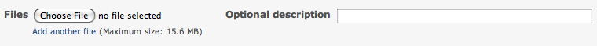

# 添付ファイル

## はじめに

添付ファイルは、Redmine のさまざまなリソースに追加できます。

- チケット: チケットの追加や編集のときに、[「新しいファイル」のフォーム](attached-files.md#Attach-files-form)を使います
- 文書: 文書の追加や編集のときに、[「新しいファイル」のフォーム](attached-files.md#Attach-files-form)を使います
- フォーラムのメッセージ: フォーラムのメッセージの追加や編集のときに、[「新しいファイル」のフォーム](attached-files.md#Attach-files-form)を使います
- ニュース: ニュースの追加や編集のときに、[「新しいファイル」のフォーム](attached-files.md#Attach-files-form)を使います
- Wiki ページ: ページの下にある[「新しいファイル」のリンク](attached-files.md#Files-added-via-New-File)を使います

## 使い方

### インライン画像

添付ファイルは、画像の URL にファイルの名前を指定すると(例: `!attached_image!`)、親のページの中に表示できます。

### プレーンテキスト以外のファイル

技術文書やユーザー向けの文書を保存するには、専用の[文書](documents.md)のモジュールがあり、[Wiki](wikis.md) からリンクできます。また、管理しているプロジェクトのバージョンをまとめて(リリースとして)公開するには、専用の[ファイル](files.md)のモジュールがあります。

ただし、それらが目的に合わない場合は、ファイルのアップロードの機能で、どのようなファイルでもユーザーがダウンロードできるように配布できます。

## ファイルの保存先

アップロードした添付ファイルは、`<Redmine をインストールしたディレクトリ>/files` のディレクトリの、アップロードした年の名前のサブディレクトリに保存されます。

アップロードしたファイルの名前には、ディレクトリに保存するために、親にもとづく一意の ID が先頭に付きます。同じ名前のファイルを複数アップロードできますが、Wiki の中のリンクには、最後にアップロードしたファイルだけが表示されます。

#### 添付されていないアップロードしたファイル

ユーザーがフォームを送信しなかった場合、アップロードしたファイルが添付されないまま残ることがあります。このようなファイルを定期的に削除するために、スケジュールを設定して実行できる [Rake タスク](../admin/rake.md#rake-redmineattachementsprune)が用意されています。

## ファイルを添付するフォーム

入力のフォームは下のとおりです。

バージョン 2.3.0 から、ブラウザーが対応していれば(IE10 以降)、次のことができます。

- 複数のファイルを一度に選んで添付する
- フォームにファイルをドラッグ アンド ドロップする

ファイルのアップロードが終わると表示される説明のフィールドは省略できます。説明は、親の内容(チケットの説明やコメント、フォーラムのメッセージ、Wiki ページ、文書など)に `!image_url!` の構文で挿入した画像ファイルの代替テキストにも使われます。

## 「新しいファイル」で追加したファイル

Redmine の多くのページの下に、「新しいファイル」のリンクがあります。ファイルを添付すると、そのページがファイルの親になり、ファイルの範囲はそのページに限られます。

詳しくは、[使い方](files.md#Usage)の節を参照してください。
