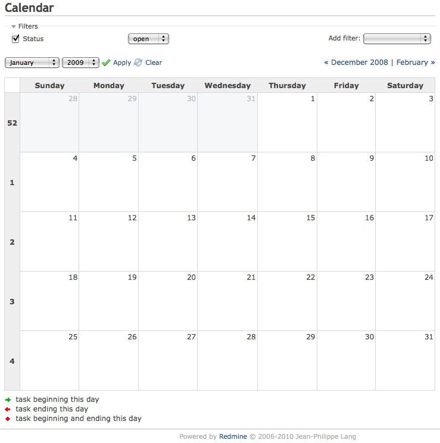

# カレンダー

## 概要

カレンダーでは、現在のプロジェクトを月単位で見渡せます。この画面には、少なくとも開始日のあるチケットがすべて表示され、その開始日と(あれば)期日が示されます。期日を設定したバージョンもすべて表示されます。

## アクセス制御

### モジュールの有効化

「カレンダー」のモジュールは、プロジェクトの「設定」のタブで、プロジェクトごとに有効または無効にできます。設定のページで「モジュール」のタブを開き、「カレンダー」のチェックボックスをオンまたはオフにして、モジュールを有効または無効にします。

### ロールと権限

モジュールへのアクセスは、ロールごとに許可または拒否できます。\
それには、「管理」のページで「ロールと権限」のリンクを開き、ロールを選んで、「カレンダー」の権限のチェックボックスをオンまたはオフにします。

## フィルタ

[チケット一覧](issue-list.md)や[ガントチャート](gantt.md)と同じように、フィルタを設定して、カレンダーに表示するチケットを絞り込めます。このフィルタは、[チケット一覧](issue-list.md)で設定するフィルタと同じようなものです。

