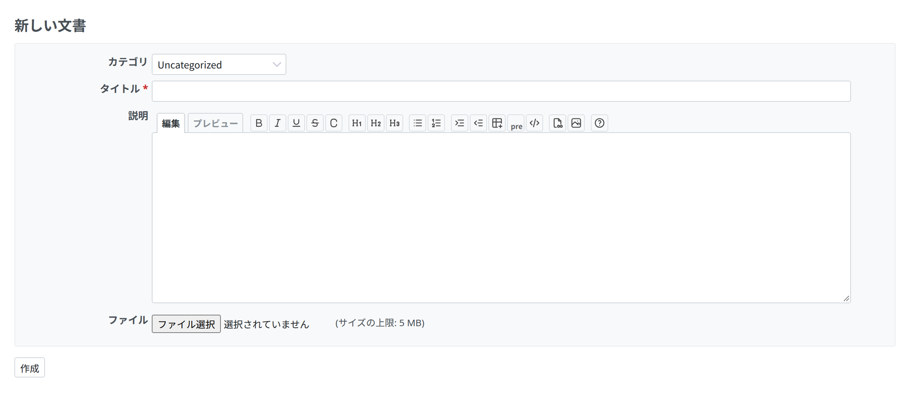
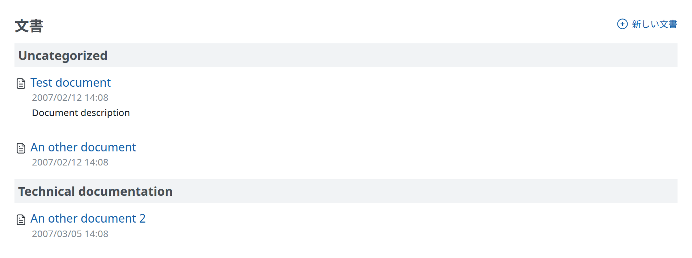

# 文書

## はじめに

文書は、Redmine のプロジェクトで使えるモジュールの 1 つです。

## 文書を追加する

「文書」のタブで「新しい文書」のリンクを押します。

最初は、文書のカテゴリが 2 つあります。

1.  ユーザー文書
2.  技術文書

これらのカテゴリは、Redmine の管理者が「[選択肢の値](../admin/enumerations.md)」の「文書カテゴリ」で変更したり追加したりできます。

## 文書を見る

文書を作成すると、タイトルが文書のページへのリンクになります。そのページで、添付したファイルをダウンロードでき、「新しいファイル」のリンクでファイルをさらに追加できます。

