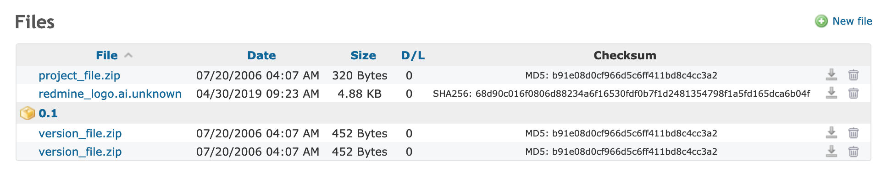

# ファイル

## 「ファイル」のモジュール

プロジェクトごとに、設定のメニューから「ファイル」のモジュールを有効または無効にできます。

アップロードしたすべてのファイルの詳細が、並べ替えのできる表に表示されます。アップロードのときにバージョンを選んだファイルは、そのバージョンの下に表示されます。チェックサムと DL(ダウンロードの回数)にも注目してください。

新しいファイルは、右上の「新しいファイル」のボタンから追加します。

## ファイルの保存先

アップロードしたファイルは、すべて `/{インストールしたディレクトリ}/files` のディレクトリに保存されます。

アップロードしたファイルの名前には、ディレクトリに保存するために、親にもとづく一意の ID が先頭に付きます。

## 新しいファイルのフォーム

新しいファイルを追加すると、下のような入力のフォームが表示されます。ファイルを特定のバージョンに結び付けるには、一覧からバージョンを選びます。「別のファイルを追加」のリンクで、複数のファイルを一度に追加できます。

説明は省略できます。説明は `alt` のテキストに使われます。

