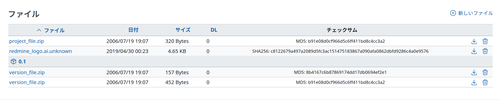
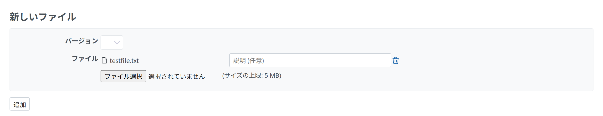

# ファイル

## 「ファイル」モジュール

プロジェクトごとに、設定のメニューから「ファイル」のモジュールを有効または無効にできます。

アップロードしたすべてのファイルの詳細が、並べ替えのできる表に表示されます。アップロードのときにバージョンを選んだファイルは、そのバージョンの下に表示されます。チェックサムと DL(ダウンロードの回数)にも注目してください。

新しいファイルは、右上の「新しいファイル」のリンクから追加します。

## ファイルの保存先

アップロードしたファイルは、すべて `/{インストールしたディレクトリ}/files` ディレクトリ (`config/configuration.yml` の `attachments_storage_path` を設定した場合はそのディレクトリ) の中の、アップロードした年月の `YYYY/MM` のサブディレクトリに保存されます。

保存するファイルの名前には、アップロードした日時のタイムスタンプ (`yymmddHHMMSS_`) が先頭に付きます。ファイル名に ASCII の英数字、`_`、`.`、`-` 以外の文字が含まれる場合や、50 文字を超える場合は、ファイル名がハッシュに置き換わります (短い拡張子は残ります)。

## 新しいファイル

新しいファイルを追加すると、下のような入力のフォームが表示されます。ファイルを特定のバージョンに結び付けるには、一覧からバージョンを選びます。ファイルを選ぶダイアログで複数のファイルをまとめて選ぶか、フォームにファイルをドラッグ アンド ドロップすると、複数のファイルを一度に追加できます。

説明は省略できます。説明は、ファイルの一覧でファイル名のツールチップとして表示されます。

