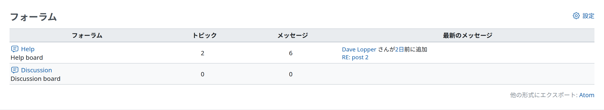

# フォーラム

フォーラムで、プロジェクトのユーザーどうしがやり取りできます。フォーラムの一覧は、「フォーラムの管理」の権限のあるユーザーが[プロジェクト設定](project-settings.md#Forums)で設定します。

フォーラムの一覧には、プロジェクトのフォーラムの概要が表示されます。

- トピックの合計の数
- メッセージの合計の数
- 最新のメッセージへのリンク

## トピックの追加

フォーラムにトピックを追加するには、フォーラムの名前をクリックし、「新しいメッセージ」をクリックします。

メッセージには、題名と本文を入力し、ファイルを添付できます。\
次の 2 つのオプションがあります。

- 「スティッキー」: チェックを入れると、トピックはトピックの一覧の一番上に太字で表示され続けます。
- 「ロック」: チェックを入れると、ユーザーはメッセージに返答できなくなります。
