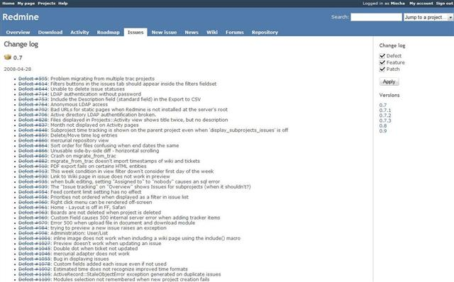
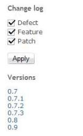

# 変更履歴

|  |
|----|
| ***注記**: ここで説明している機能は Redmine の[ロードマップ](roadmap.md)に統合され、Redmine version#6 から(具体的には r3162 で)独立した画面としては削除されました。* |

## 概要

Redmine には変更履歴があります。変更履歴は、完了したすべてのチケットを対象バージョンごとに並べた、プロジェクト単位の概要です。

指定した対象バージョンで何が変わったかの概要なので、この概要には、「対象バージョン」のフィールドが設定されている完了したチケットだけが表示されます。

## サイドバー

変更履歴の右にあるサイドバーには、次のものがあります。

- 変更履歴に、特定のトラッカーのチケットを含めるか除くかを選ぶチェックボックスと「適用」のボタン(ここにチェックボックスで表示されるトラッカーは、それぞれの[トラッカーの設定](../admin/issue-tracking-setup.md#Trackers)によって決まります)
- プロジェクトに設定した対象バージョンへのリンク。それぞれのリンクは、選んだ対象バージョンから始まる変更履歴そのものへのリンクです
