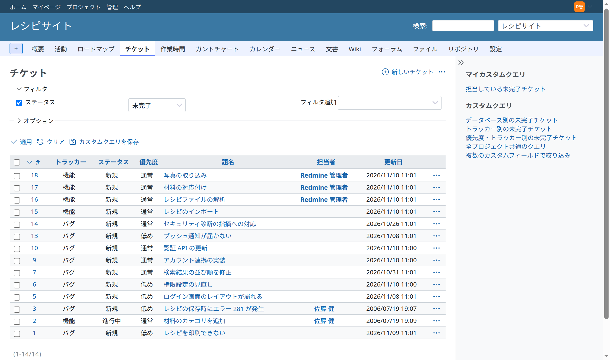
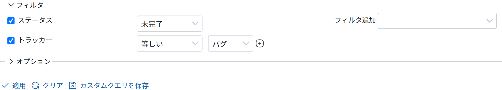
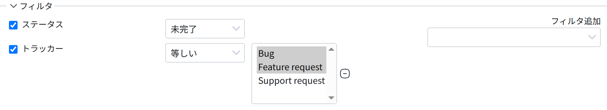
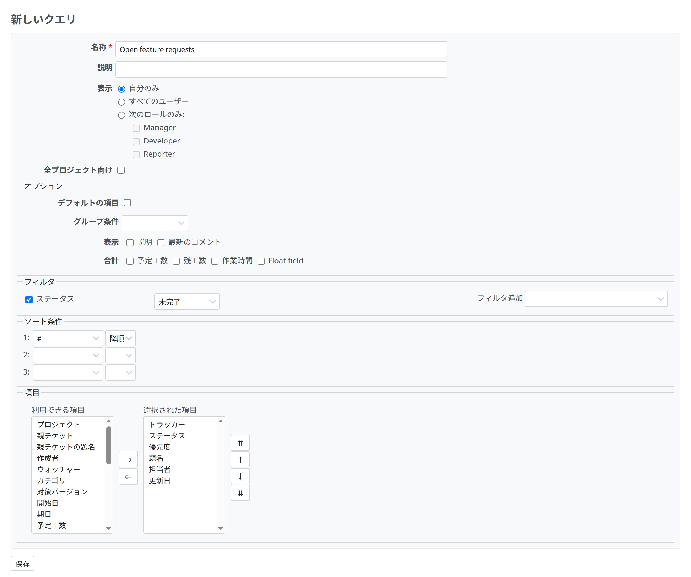
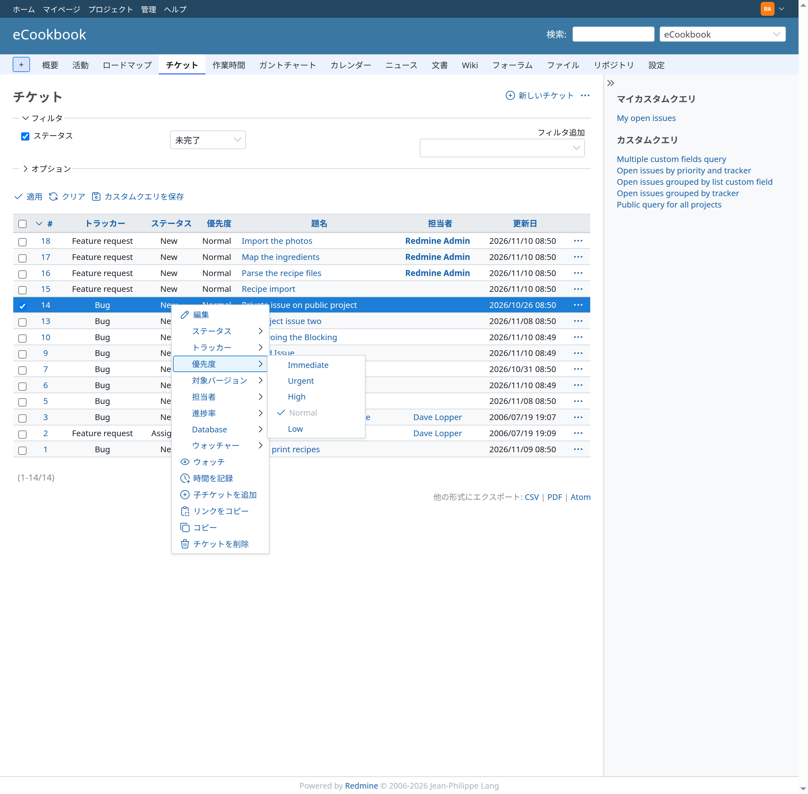
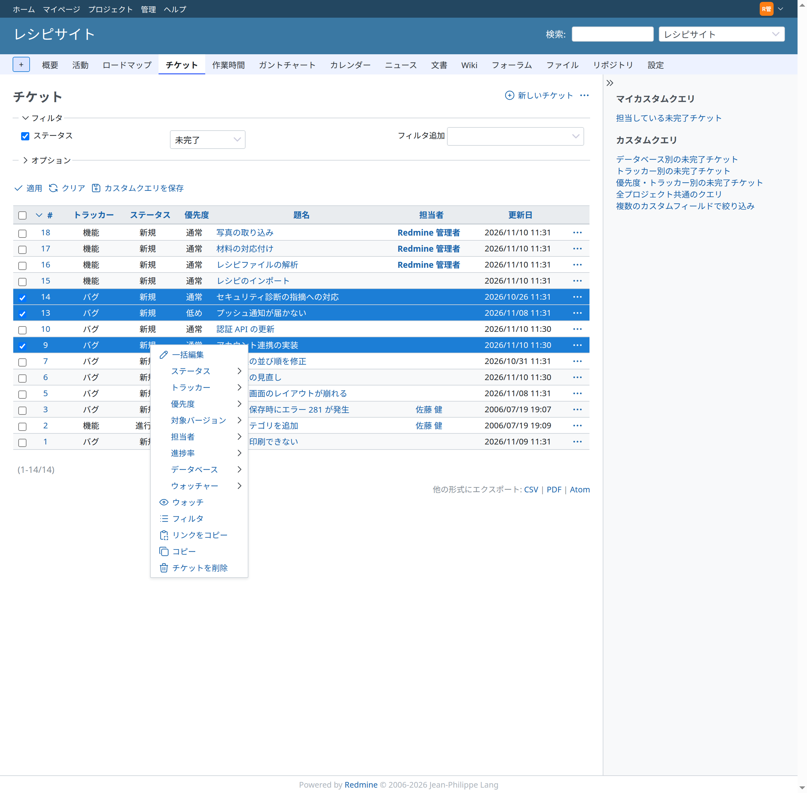
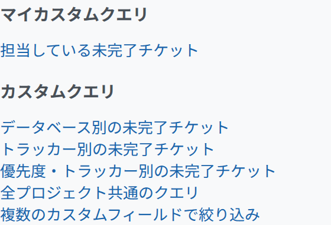

# チケット一覧

## 概要

チケット一覧で、プロジェクトのチケットを見られます。

## フィルタを適用して保存する

チケット一覧には、最初は未完了のチケットが表示されます。フィルタを設定すると、一覧にするチケットの条件を変えられます。標準のフィールドと[カスタムフィールド](../admin/custom-fields.md)をフィルタに使えます。フィルタを設定したら「適用」をクリックして、チケット一覧を更新します。フィルタを解除するには「クリア」をクリックします。

フィールドの「**+**」のボタンを押すと、1 つのフィールドに複数の値を一度に選べます。ドロップダウンのメニューが選択の一覧に変わります。選択の一覧に値を追加するには、キーボードの Ctrl キー (Windows) または ⌘ キー (macOS) を使います。

### カスタムクエリ

作ったフィルタは、カスタムクエリとして保存できます。保存したフィルタは、1 回のクリックで適用できます。

カスタムクエリは「カスタムクエリを保存」をクリックして保存します。\
フォームで、クエリの名前を付け、このクエリでチケット一覧に表示する列を選べます (標準のフィールドと[カスタムフィールド](../admin/custom-fields.md)のどちらも表示できます)。「表示」の選択肢で、クエリを「自分のみ」、「すべてのユーザー」、「次のロールのみ」のどれに表示するかを選べます。この選択肢には「公開クエリの管理」の権限が必要です。権限がなければ、クエリは自分にだけ表示されます。

保存したクエリは、[サイドバー](issue-list.md#Sidebar)に表示されます。

## コンテキストメニュー

チケット一覧でチケットを右クリックするか、行の右端にある「操作」(…) のボタンをクリックすると、コンテキストメニューが表示されます。\
このメニューから、チケットの編集、優先度や担当者の変更、コピー、削除をすばやく行えます。

**チケットのリンクの外側を右クリック**してください。リンクの上で右クリックすると、ブラウザーの標準のコンテキストメニューが表示されます。

## チケットの一括編集

チケット一覧で複数のチケットを選び、選んだところで右クリックすると、チケットをまとめて編集、移動、削除できます。\
チケットは、チェックボックスで選ぶか、Control キーまたは Shift キーを押しながら行をクリックして選びます。\
一覧の左上の小さなチェックで、すべてのチケットを選んだり、選択を外したりできます。

## サイドバー

 チケット一覧の右にあるサイドバーには、使えるカスタムクエリへのリンクがあります。

- **マイカスタムクエリ**: 自分にだけ表示されるクエリ
- **カスタムクエリ**: ほかのユーザーにも (すべてのユーザーに、または一部のロールに) 表示されるクエリ。このプロジェクトのクエリと全プロジェクト向けのクエリがあります

[チケットのレポート](issue-summary.md)は、プロジェクトのすべてのチケットのレポートです ([バージョン](version.md)のページはバージョンごとの概要です)。チケット一覧の右上にある操作メニュー (…) の「サマリー」から開けます。[プロジェクト設定](project-settings.md)によっては、[カレンダー](calendar.md)と[ガントチャート](gantt.md)をプロジェクトメニューのタブから開けます。
