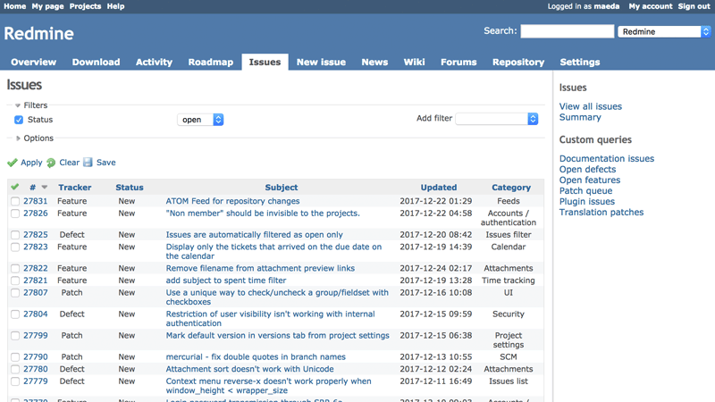
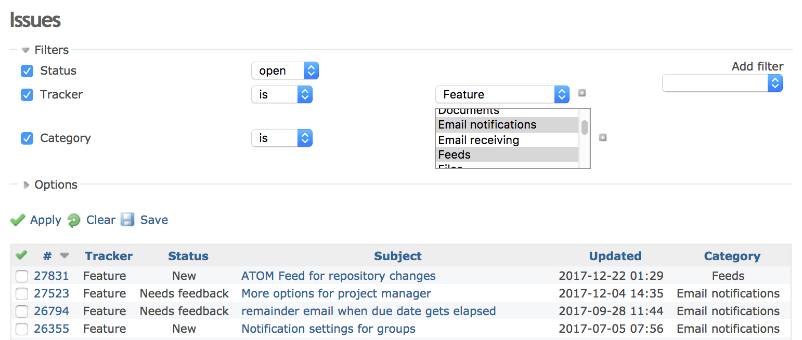
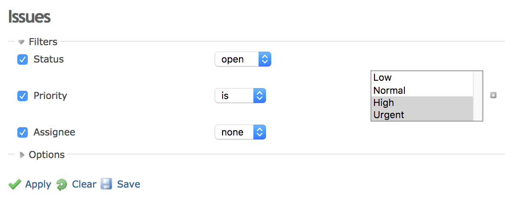
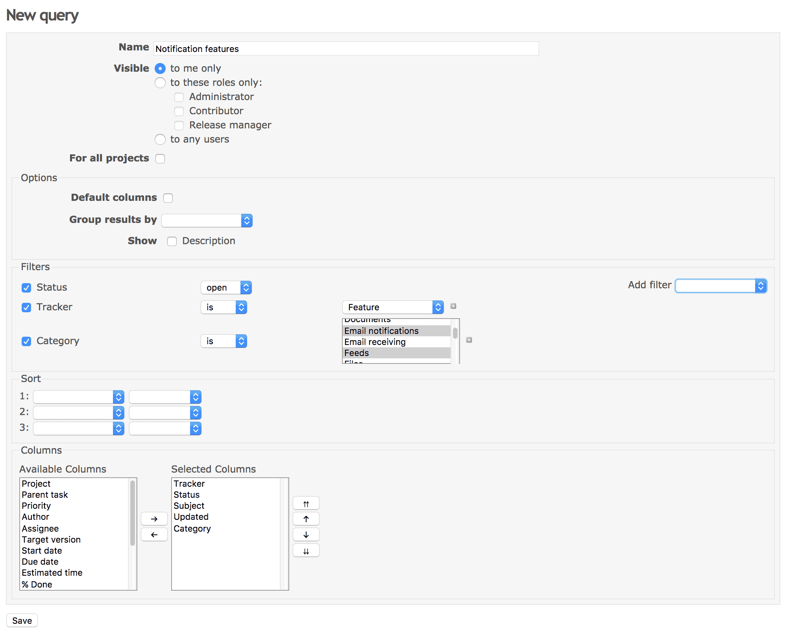
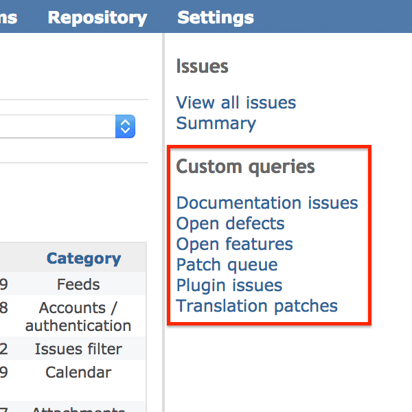
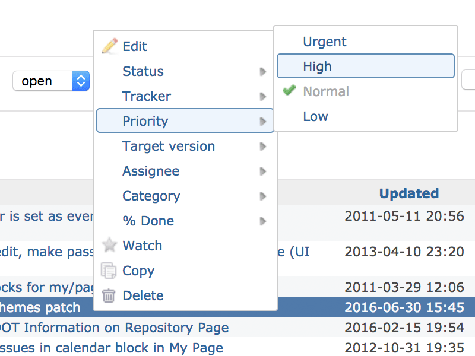
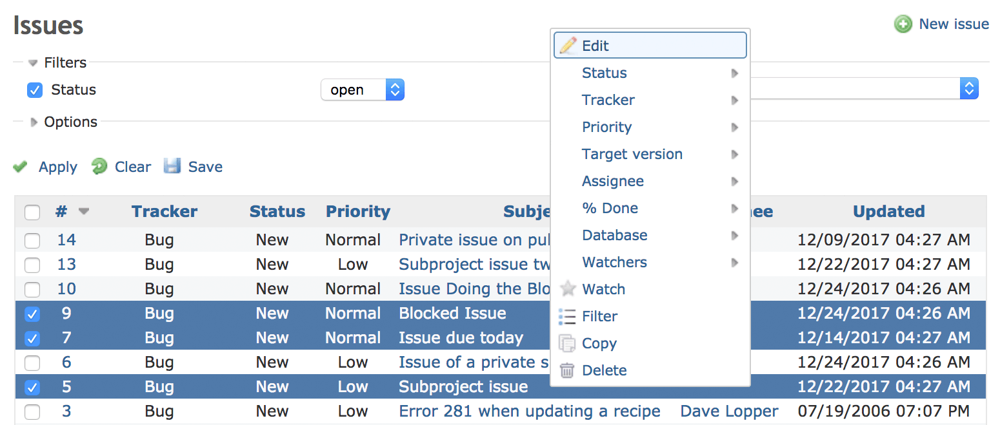
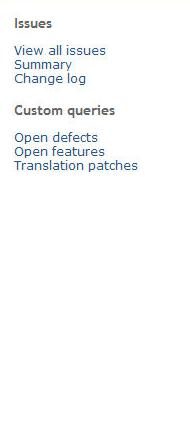

# チケットの一覧

## 概要

チケットの一覧で、プロジェクトのチケットを見られます。

## フィルタを適用して保存する

チケットの一覧には、最初は未完了のチケットが表示されます。フィルタを設定すると、一覧にするチケットの条件を変えられます。標準のフィールドと[カスタムフィールド](../admin/custom-fields.md)をフィルタに使えます。フィルタを設定したら「適用」をクリックして、チケットの一覧を更新します。フィルタを解除するには「クリア」をクリックします。

フィールドの「**+**」のボタンを押すと、1 つのフィールドに複数の値を一度に選べます。ドロップダウンのメニューが選択の一覧に変わります。選択の一覧に値を追加するには、キーボードの Ctrl キー(Windows)または ⌘ キー(macOS)を使います。

### カスタムクエリ

作ったフィルタは、カスタムクエリとして保存できます。保存したフィルタは、1 回のクリックで適用できます。

カスタムクエリは「保存」をクリックして保存します。\
フォームで、クエリの名前を付け、このクエリでチケットの一覧に表示する列を選べます(標準のフィールドと[カスタムフィールド](../admin/custom-fields.md)のどちらも表示できます)。「公開」にチェックを入れると、クエリは全員に表示されます。チェックを入れなければ、自分にだけ表示されます。

保存したクエリは、[サイドバー](issue-list.md#Sidebar)に表示されます。

## ショートカットのメニュー

チケットの一覧でチケットを右クリック(Opera では ALT + 左クリック)すると、コンテキストメニューが表示されます。\
このメニューから、チケットの編集、優先度や担当者の変更、コピー、移動、削除をすばやく行えます。

**チケットのリンクの外側を右クリック**してください。リンクの上で右クリックすると、ブラウザーの標準のコンテキストメニューが表示されます。

## チケットの一括編集

チケットの一覧で複数のチケットを選び、選んだところで右クリックすると、チケットをまとめて編集、移動、削除できます。\
チケットは、チェックボックスで選ぶか、Control キーまたは Shift キーを押しながら行をクリックして選びます。\
一覧の左上の小さなチェックで、すべてのチケットを選んだり、選択を外したりできます。

## サイドバー

 チケットの一覧の右にあるサイドバーには、次のリンクがあります。

- ほかのフィルタを適用していない標準のチケットの一覧(つまり未完了のチケットだけ)へのリンク。カスタムクエリを見ていて、標準のチケットの一覧に戻りたいときに便利です
- [チケットのサマリー](issue-summary.md)へのリンク。プロジェクトのすべてのチケットのレポートです([バージョンの概要](version.md)はバージョンごとの概要です)
- [変更履歴](issue-changelog.md)へのリンク。完了した**かつ**対象バージョンのあるチケットを、プロジェクト全体で、対象バージョンごとに並べた概要です
- カスタムクエリへのリンク(次の種類ごと)
  - 全プロジェクト向けのクエリ
    - 公開のクエリ
    - 非公開のクエリ
  - このプロジェクトのクエリ
    - 公開のクエリ
    - 非公開のクエリ
- [プロジェクトの設定](project-settings.md)によっては、次のリンクのある計画の欄
  - [カレンダー](calendar.md)
  - [ガントチャート](gantt.md)
